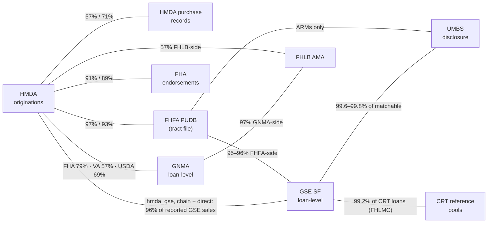

# Matching Workflows

No shared loan identifier exists across U.S. mortgage data sources, so every link between
them is recovered from loan characteristics. Each workflow lives in
`matching/match_{workflow}/` and writes its crosswalks to `crosswalk/{workflow}/`. Its page
in this directory covers the method, rounds, results and validation. Workflow names put
HMDA first and the MBS/UMBS side last.

HMDA is the spine. It covers nearly every origination and is the only source at that
coverage with borrower demographics, income, pricing, lender identity (LEI) and application
outcomes. It stops at origination: no credit score, amounts rounded to $10,000 bins, no
performance and no security identity. The agency files are the reverse: exact terms,
credit scores and monthly performance, but no demographics, no application context and
mostly censored lender identity.

## The matching network

Nodes are datasets and edges are crosswalks. Where an edge carries two rates, the first is
the left-hand node's side; the tables below name every denominator.

- **Conventional.** HMDA → FHFA → GSE loan-level → UMBS. FHFA pins the enterprise, the
  loan-level file adds credit score and performance, and UMBS adds uncensored seller names
  and security membership. `hmda_gse` is the one edge from HMDA to the GSE loan-level
  data, with two routes: the chain composes `hmda_fhfa`, `fhfa_mbs` and `mbs_umbs`,
  and the direct route matches HMDA to `combined/loan_issuance` with no FHFA leg. The
  master takes every chain link, adds the direct links it admits for loans the chain
  leaves unlinked, and withholds a loan's link where the two routes name different
  targets ([how the master uses the two routes](hmda_gse_matching.md#how-the-master-uses-the-two-routes)).
- **Government.** HMDA FHA loans reach GNMA by a direct match, each carrying its FHA
  record (through `hmda_fha`): the exact amount and endorsement month HMDA rounds away.
  VA and USDA have no administrative bridge and match on HMDA's fields alone.
- **Side edges.** FHLB AMA is the only loan-level view of the FHLBank portfolio channel;
  CRT reference pools attach market-priced credit risk. HMDA purchase records trace loan
  sales between HMDA filers.

[`master`](master_crosswalk.md) assembles every post-2018 HMDA edge into one row per HMDA
loan.

## The crosswalks

Each rate names its denominator; the linked page is authoritative. "HMDA GSE-sold" means
originations HMDA reports as sold to Fannie Mae or Freddie Mac (`purchaser_type` 1 or 3;
`hmda_gse` and the master count conventional first liens only).

### From HMDA

| Crosswalk | Links | Years | Pairs | Match rate |
|---|---|---|---:|---|
| [hmda_fha](hmda_fha_matching.md), post-2018 | HMDA FHA originations ↔ FHA endorsements | 2018–2025 | 7.26M | 90.8% of eligible HMDA FHA originations (non-reverse, ≤4 units); 88.8% of FHA endorsements |
| [hmda_fha](hmda_fha_matching.md), pre-2018 | as above | 2010–2017 | 7.12M | 75.6% of HMDA FHA originations; 77.9% of FHA endorsements |
| [hmda_fhfa](hmda_fhfa_matching.md), post-2018 | HMDA ↔ FHFA PUDB tract file | 2018–2025 | 32.39M | 96.7% of HMDA GSE-sold; 93.0% of FHFA loans |
| [hmda_fhfa](hmda_fhfa_matching.md), pre-2018 | as above | 2008–2017 | 33.59M | 84.0% of HMDA GSE-sold; 72.9% of FHFA loans |
| [hmda_gse](hmda_gse_matching.md), chain | HMDA → FHFA → GSE loan-level → UMBS | 2018–2025 | 16.87M FNMA, 14.23M FHLMC | 92.0% of HMDA sales to Fannie; 92.7% of HMDA sales to Freddie |
| [hmda_gse](hmda_gse_matching.md), direct | HMDA ↔ `combined/loan_issuance` | 2018–2025 | 26.96M (26.55M admitted) | 91.85% of HMDA GSE-sold (admitted rows) |
| [hmda_gnma](hmda_gnma_matching.md), FHA | HMDA FHA ↔ GNMA loan-level | 2018–2025 | 6.51M | 78.7% of HMDA FHA originations; 75.5% of GNMA FHA loans |
| [hmda_gnma](hmda_gnma_matching.md), VA/USDA | HMDA VA/USDA ↔ GNMA loan-level | 2018–2025 | 3.88M | 57.3% of HMDA VA, 69.3% of HMDA USDA originations |
| [hmda_fhlb](hmda_fhlb_matching.md), post-2018 | HMDA ↔ FHLB AMA | 2018–2025 | 270,021 | 57.2% of AMA loans |
| [hmda_fhlb](hmda_fhlb_matching.md), pre-2018 | HMDA ↔ FHLB AMA | 2009–2017 | 265,871 | 60.2% of AMA loans |
| [hmda_sellers_purchasers](hmda_sellers_purchasers_matching.md), post-2018 | HMDA originations ↔ HMDA purchase records | 2018–2025 | 10.90M | 70.6% of purchase records; 57.2% of originations sold to non-agency buyers (`purchaser_type` ≥ 5) |
| [hmda_sellers_purchasers](hmda_sellers_purchasers_matching.md), pre-2018 | as above | 2007–2017 | 11.70M | 36.2% of purchase records; 22.6% of originations in the matching universe |

### Between agency datasets

| Crosswalk | Links | Years | Pairs | Match rate |
|---|---|---|---:|---|
| [fhfa_mbs](fhfa_mbs_matching.md), FNMA | FHFA PUDB ↔ Fannie Mae issuances | 2018–2025 | 18.18M | 96.3% of FHFA Fannie loans; 97.8% of Fannie issuances (2019–2025) |
| [fhfa_mbs](fhfa_mbs_matching.md), FHLMC | FHFA PUDB ↔ Freddie Mac originations | 2018–2025 | 15.22M | 95.3% of FHFA Freddie loans |
| [fhfa_mbs](fhfa_mbs_matching.md#fhfaumbs-arm-crosswalk), ARM | FHFA ARM records ↔ UMBS ARM disclosures | 2018–2025 | 147,157 | with the SF crosswalks, 96.7% (Fannie) and 89.0% (Freddie) of FHFA ARM records |
| [mbs_umbs](mbs_umbs_matching.md), FNMA | GSE loan-level ↔ UMBS | pools from June 2019 | 26.21M | 99.79% of loans with first payment June 2019 on |
| [mbs_umbs](mbs_umbs_matching.md), FHLMC | GSE loan-level ↔ UMBS | pools from June 2019 | 23.79M | 99.58% of fixed-rate loans with first payment June 2019 on; 99.16% of UMBS loans |
| [crt_mbs](crt_mbs_matching.md), FHLMC | STACR/ACIS reference pools ↔ loan-level | deals 2013–2026 | 14.90M | 99.17% of CRT loans pinned 1:1 |
| [crt_mbs](crt_mbs_matching.md), FNMA | CAS/CIRT deal membership | extracted 2026-10 | 14.64M loan-deal pairs | none: extraction only, not yet linked to loan-level; 291,545 pairs (2.0%) carry no deal name because their rows name two deals |
| [fhlb_mbs](fhlb_mbs_matching.md) | FHLB AMA ↔ GNMA loan-level, one issuer | 2009–2025 | 15,777 | 97.3% of the issuer's GNMA loans; 46.9% of FHLB AMA government loans (both 2018–2025) |

### Assembled

| Crosswalk | Grain | Years | Rows | Coverage |
|---|---|---|---:|---|
| [master](master_crosswalk.md) | one row per HMDA loan any edge reaches | 2018–2025 | 46.43M loans | conventional edge: 96.07% of HMDA GSE-sold. A share of the spine is not an HMDA-wide rate. |

## Reading the rates

- **There is no single match rate.** Denominators differ by edge and by direction, and
  each rate above names its own.
- **Matchable denominators where they exist.** A raw rate over every source row can
  mislead: FHLMC `mbs_umbs` is 42.8% over all loans and 99.58% over loans that could match.
  Populations with no possible counterpart (Freddie ARMs, loans that ended before the June
  2019 snapshot, months past the loan-level release lag) belong outside the denominator.
- **HMDA GSE-side rates count reported sales only.** `purchaser_type` is accurate but
  incomplete: correspondent deliveries are reported by the aggregator, and sales after the
  origination year are not reported. The `hmda_gse` crosswalks are larger than their
  denominators because they also reach those acquisitions.
- **Cardinality.** Crosswalks key on `HMDAIndex` where there is an HMDA side and on each
  source's native id otherwise. All are 1:1 except post-2018 `hmda_sellers_purchasers` (one
  row per resale hop) and `crt_mbs` (deal × loan grain).
- **A null link in the master can mean withheld.** Where two methods contradict each other
  the master stores neither link and records why in `conflict_flags` (151,912 loans).
- **Crosswalks can fall behind their inputs.** Matcher outputs sit outside the medallion
  skip-if-exists guard, so a rebuilt input does not rebuild the crosswalk. Re-run the
  matcher after upstream rebuilds; `mbs_umbs` has a `check` command that compares input
  sizes with the ones the crosswalk was built on.

## Commands

Every matcher has `mortgage-data match {workflow} info` and `run`; all but `crt_mbs` have
`validate`, and `crt_mbs` and `mbs_umbs` have `check`. The master has `build`, `qc` and
`info`. Command names use hyphens (`match hmda-gse run`).
