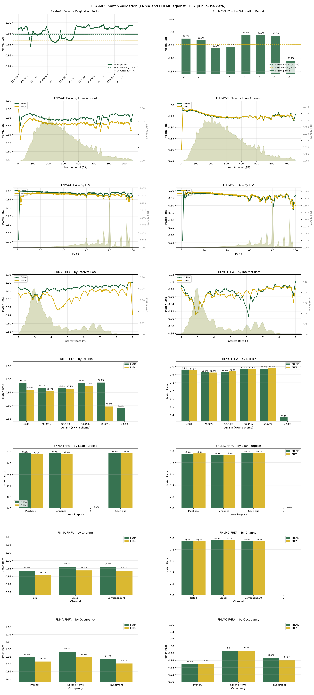
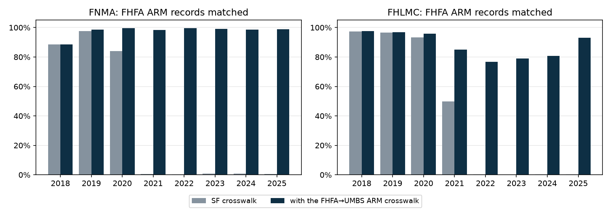

# FHFA-MBS Matching

This workflow links each GSE's single-family loan-level release (Fannie Mae issuances,
Freddie Mac originations) to FHFA's single-family census tract file (`sf_c`). A matched
pair joins a loan's credit and servicing detail to FHFA's borrower demographics, income
and census tract. It writes three crosswalks:

| Crosswalk | Loan-level source | FHFA-side match rate, 2018-2025 |
|---|---|---|
| FNMA-FHFA | Fannie Mae issuances | 96.3% (94.5% from the base pass alone) |
| FHLMC-FHFA | Freddie Mac originations | 95.3% (95.1% from the base pass; recovery net of the cross-year drop adds 1.2 points, the amount-bin rule removes 1.0) |
| FHFA→UMBS ARM | Fannie ILLD, Freddie FU ARM disclosures | ARM records only, SF crosswalks alone → with this one: 39.3% → 96.7% (Fannie), 43.7% → 89.0% (Freddie) |

## Data sources

- FHFA `sf_c`: about 2M acquisitions a year for both enterprises (`enterprise_flag` 1 =
  Fannie, 2 = Freddie), with amounts, LTV and DTI binned much as in HMDA. It includes
  high-LTV loans (100% and above, from programs such as HomeReady with MI) that the
  loan-level releases leave out; Fannie's issuance data stops at 97% LTV.
- FNMA issuances: loans securitized in each quarter. The loader reads every
  `{year}Q*.parquet` in the issuance silver, which includes the Exclusion files
  (`2018Q1EXCL`–`2020Q3EXCL`, 167,206 non-standard loans: ARMs, balloons, interest-only,
  reduced documentation, bulk acquisitions). 93.3% of them are matched. Filter by id against
  `silver/issuances/*EXCL.parquet` for a standard-only population.
- FHLMC originations: loans originated in each quarter, including the non-standard `excl`
  set.

## Method

### Timing

FHFA files record acquisitions; Fannie's quarterly files record securitizations. A loan
originated in November 2023 can be acquired in December 2023 (FHFA 2023) and securitized
in January 2024 (FNMA 2024Q1). FHFA year N is matched against FNMA year N, which holds the
loans securitized in N: mostly those originated and acquired in N, plus some originated in
N−1 and securitized early in N. Securitization usually follows acquisition within months.

FHFA's `date_of_mortgage_note` flag restricts candidates by origination year: 1 (about 92%
of records) means originated in the acquisition year, 2 (about 8%) in an earlier year. The
base pass offers flag-1 records loans originated in the acquisition year and flag-2 records
loans originated the year before. FNMA dates origination with its Origination Date field;
FHLMC with the quarter embedded in the Loan Sequence Number (`F23Q10031582` = 2023 Q1).

### Match keys

Exact keys, both enterprises: state, MSA, channel, units, borrowers, first-time buyer,
loan purpose, occupancy, property type, loan term, and loan amount pre-rounded to FHFA's
$10k bins.

| Field | FNMA | FHLMC |
|---|---|---|
| Interest rate | ±1 basis point | ±1 basis point |
| LTV | ±1 point, CLTV where available | ±1 point, CLTV where available |
| DTI | bin-aware (below) | bin-aware |
| Loan amount | exact on the bin | exact on the bin; the score also ranks within the bin (see *The FHLMC amount-bin term*) |

**Interest rate.** In the 2019-2022 releases FHFA truncates Fannie rates to hundredths
(4.125% → 4.12%), so about half of all Fannie pairs in those years sit exactly 0.005 apart;
the 2018 and 2023+ releases carry the eighths, and 2018 has a few hundred off-by-a-thousandth
rates (4.124, 4.127) the tolerance absorbs. FHFA truncates Freddie rates to hundredths in
every release (7.125% → 7.12%). The quality tier treats the truncated form as exact, so tier
1 is comparable across years.

**LTV.** FHFA's "LTV at origination" (field 42) is combined LTV where available, so both
matchers compare it to CLTV, falling back to LTV when CLTV is null.

**Loan amount.** FHFA reports amounts as $10k bin midpoints ($175,000 stands for
$170,000–$179,999). Loan-level amounts are rounded to the same midpoint and carried alongside
the original; an amount exactly on a $10k boundary is offered in both adjacent bins.

**DTI.** FHFA bins DTI as 10 (below 20%), 20 (20 to under 30%), 30 (30 to under 36%), the
exact value from 36 to 49, 50 (50 to 60%), 60 (above 60%) and 99 (not available); the
comparison is bin-aware.

**Freddie conventions.** Three Freddie fields differ from FHFA's reporting and are mapped
before the join:

- *MSA.* Freddie reports Metropolitan Division codes for the 13 metros that have them; FHFA
  reports the parent CBSA. Neither is an error; they report at different levels. The
  Census Bureau's CBSA delineation file maps Freddie's 40 division codes (OMB 2020 and 2023
  vintages) to their parent CBSAs, after which MSA agrees on 99.45% of matched records and
  serves as an exact key. Fannie reported CBSAs through its 2024 issuance files and began
  reporting division codes during 2025 (2.4% of 2025 loans, about a quarter of early-2026
  loans), so the same map applies to FNMA; it leaves every pre-2025 FNMA record
  unchanged.
- *Loan term.* FHFA carries Fannie terms verbatim but not Freddie's, under two conventions
  its data dictionary does not describe (field 44 says only "999 = Not available, Months").
  Both were diagnosed on 14.0M identity-known pairs (99.998% of observed transitions). Non-
  standard terms are reported at the smallest standard term (120/180/240/360/480) at or
  above the true term: a ceiling, not the nearest value (144 → 180 in 9,449 pairs against 10
  to the nearer 120; 264/276/288 → 360 rather than 240). And a seller-dependent share of
  standard 120- and 240-month loans is reported at the product-envelope term: 120 → 180
  (18.5% of 120s) and 240 → 360 (5.5% of 240s; 2.5–22.6% by year, about 49% of U.S. Bank
  deliveries against about 4% of loanDepot's). 180- and 360-month loans are never moved. On
  tract-verified pairs HMDA agrees with the Freddie term 100.0% of the time and never with
  FHFA's, and each loan's maturity date implies the Freddie term exactly. `matching/terms.py`
  applies both: terms are ceiling-binned before the join, and a second, leftovers-only phase
  offers 120- and 240-month loans at their envelope term (`match_round` 2). Running the phases
  in sequence keeps every exact-term match; a single pass would lose about 0.3% of them to
  cross-term ambiguity. The HMDA-FHFA matcher's term filter uses the same conventions.
- *Borrowers.* Capped at two on both sides (`FHLMC_MAX_BORROWERS`). FHFA reported Freddie
  borrower counts only as 1 or 2 through 2024 and reports the actual count from 2025, while
  Freddie's own files are verbatim throughout, so the cap keeps every acquisition year on
  one rule. On 2025 pairs where FHFA reports three to five borrowers, Freddie's file agrees
  on the exact count 99.7-100% of the time, a check the capped key never sees.

### ZIP3 tie-splitting

The finest geography both sides share is state + MSA: FHFA reports a census tract, the
loan-level files a 3-digit ZIP. The 1:1 check drops every candidate tied on the score within
a cell; without a tie-splitter that is the main source of residual misses in the 2020-21
boom, so both matchers add a 0.5 score penalty for a ZIP3 mismatch
(`MatchingTolerances.zip3_penalty`). The FHFA tract is mapped to its residentially dominant
ZIP3 through the HUD USPS crosswalk (`core.reference.tract_zip3`; 2019Q4 for 2010-census
tracts, 2023Q4 for 2020-census tracts) and compared with FNMA `Zip Code Short` or FHLMC
`Postal Code // 100`. The penalty is smaller than one rate step or one LTV point, is neutral
when either side is null, and never overrides a strictly better candidate. ZIP3 is not a
hard key: as one it would destroy about 2.1% of good matches, the tract-to-ZIP3 mapping
noise. Crosswalks carry a `zip3_consistent` flag, which the rounds after the base pass use
as their gate.

### Rounds

Each enterprise has its own tuple of rounds (`ROUNDS_FNMA`, `ROUNDS_FHLMC` in
`match_fhfa_mbs/rounds.py`); `match_round` is a round's position in its tuple, and
`mortgage-data match fhfa-mbs info` prints both. Each round runs only on the loans and
records earlier rounds left, so every earlier pair survives and the result stays 1:1. A
round offers each FHFA flag its origination years (a *leg*), matches in its term phases
once or until its leftovers stop yielding pairs, and gates what it finds. The first round
(FHLMC: the first two) is the base pass; the rest recover what it leaves.

| FNMA | FHLMC | Round | What it recovers |
|---|---|---|---|
| 1 | 1 | Base | Flag 1 against the acquisition year's originations, flag 2 against the year before's. No gate. |
| — | 2 | Product-envelope term | The base pass's leftover 120- and 240-month Freddie loans at their envelope term (above). No gate. |
| 2 | 3 | Fixpoint | A loan whose best record preferred another loan gets nothing on a single pass even when a compatible record remains; re-running on the leftovers converges in a few passes. |
| 3 | 4 | Seasoned | Flag 2 means "originated in any earlier year", but the base leg offers only the prior year. This round offers originations two or more years before acquisition (FNMA: whatever the acquisition year's issuance files hold; FHLMC: the four older origination cohorts loaded). |
| 4 | 5 | MSA-free | MSA disagrees between the sources for two reasons. Mostly, the seller-reported MSA on the loan-level file disagrees with the property's own county; about a quarter of the round is delineation recodes, which occur in one cell only: FHFA and Freddie move to the OMB-2023 delineation with the 2024 acquisitions, Fannie's issuance files one year later. MSA is dropped, state stays exact. |
| — | 6 | Occupancy | A primary/investor coding difference, accepted only at quality tier 2 or better. Fannie has none: the round adds 111 FNMA pairs over 2018-2025, at 0.917 held-out tract agreement against 0.96-0.97 for its other rounds. |

The FHLMC rounds from the fixpoint on run both term phases in every pass and offer only
loans inside the acquisition window (below).

A pair from any round after the base pass must not have `zip3_consistent` False (unknown
passes), and FHLMC fixpoint and occupancy pairs must also be tier 2 or better. Both gates
come from held-out validation of a build with both gates switched off (2018–2025 build,
measured 2026-10-22). Inside the recovery rounds a ZIP3 mismatch marks a wrong pair: in the
fixpoint and MSA-free rounds of both enterprises, held-out census-tract agreement is
0.17-0.44 for ZIP3-mismatched pairs against 0.83-0.97 for ZIP3-consistent ones (FHLMC
occupancy: 0.67 on 107 checkable mismatched pairs against 0.99; the seasoned rounds' loans
mostly predate the HMDA link the check runs through). FHLMC fixpoint pairs that pass the
ZIP3 gate validate at 0.90 at tier 3 against 0.97 at tier 2 or better. A leftover whose best
candidate fails the gate is retired rather than re-offered, so a rejected pair cannot
resurface in a later round.

**FHLMC acquisition window.** Freddie's performance history starts the month a loan is
acquired, so a loan's first reporting period dates the acquisition, which no match key
touches. From the fixpoint round on, FHLMC rounds offer only loans whose first reporting
period (silver performance plus the `excl` performance files) falls in [November Y−1,
January Y+1] for acquisition year Y; loans with no history pass. Without the filter the
seasoned round pairs about 9% of its FHFA records with twin loans Freddie acquired a year or
more earlier (first-period loan age 0, against a median of 37 months for true seasoned
pairs). Production pairs fall inside the window 99.96% of the time for same-year
originations and 97-98% for prior-year ones; the prior-year pairs outside it are twins on
independent checks, so the window is not widened. The table is cached per origination
cohort; `--overwrite` rebuilds it, and a stale cache only leaves newer loans without a
period, which passes.

### The FHLMC amount-bin term

Pre-rounding takes the amount out of the join, but Freddie's score keeps an amount term,
`|original UPB − FHFA bin midpoint| / amount_tolerance`, with a zero tolerance the score
builder reads as the exact-match weight of 1000. Fannie's score has no amount term. With both
sides joined on the bin, the term measures only where in the $10k bin a loan's UPB sits.

- It is constant across one loan's candidates, which all share the loan's bin, so it never
  ranks the loan side. Across 2018–2025, in every round and both legs, none of the 1.77
  million loans with more than one candidate had candidates it could tell apart (measured
  2026-10-22).
- On the FHFA-record side it would decide everything. Freddie's `Original UPB` is a whole
  $1,000 in 100.000% of rows, so the term takes six values 1,000,000 score units apart, while
  the largest rate/LTV/DTI/ZIP3 deviation in any candidate frame is 940.99 (p99.9 = 11.8).
  Ranked on the full score, the record side is lexicographic in within-bin position, with
  the evidence fields only breaking ties inside it.
- Within-bin position says nothing about whether a pair is true. On pairs the term never
  touched (one candidate each side), held-out census-tract agreement is flat across its six
  values (0.9823 / 0.9814 / 0.9810 / 0.9816 / 0.9806 / 0.9806 on 2M pairs), as is
  seller-name agreement (0.928-0.938, in no order).

So the term may rank but not decide (`MatchOptions.non_evidence_score_fields`). A pair is
written only where interest rate, LTV, DTI and the ZIP3 penalty on their own pick the same
loan for that FHFA record; where they tie or prefer another loan, the record is left
unmatched. The removal is the last step of a build, after every round and both resolutions,
so a dropped pair held its loan and record throughout and cannot hand either to another
partner. The Freddie leg of the ARM crosswalk (below) runs the same score and rule; ARM cells
are sparse, so it costs 68 of that pass's 61,167 Freddie pairs and no Fannie pairs.

| Year | 2018 | 2019 | 2020 | 2021 | 2022 | 2023 | 2024 | 2025 | All |
|---|---:|---:|---:|---:|---:|---:|---:|---:|---:|
| Pairs dropped | 12,855 | 12,823 | 56,645 | 63,890 | 5,928 | 2,765 | 3,442 | 3,595 | 161,943 |
| FHFA-side rate before | 96.25% | 97.02% | 95.49% | 95.31% | 97.48% | 98.05% | 97.90% | 96.72% | 96.29% |
| FHFA-side rate after | 95.27% | 96.29% | 94.00% | 93.80% | 97.15% | 97.76% | 97.56% | 96.40% | 95.28% |

The rule takes FHLMC from 15,377,938 to 15,215,995 pairs (−1.05%), three quarters of the
loss in 2020-2021, where the refi boom makes cells densest. The dropped pairs are the
crosswalk's worst: 0.71-0.81 held-out census-tract agreement against 0.981 for uncontested
pairs, so estimated precision moves from about 0.994 to about 0.996. Every FHLMC count in
this document is net of the rule.

### Resolution and cross-year claims

Within a year both matchers take mutual best matches and enforce 1:1. Each acquisition year
is matched separately and also offers the prior origination year, so a loan can be assigned
to FHFA records in two acquisition years. On the 2018-2025 FHLMC build 50,526 loans are
(measured 2026-10-22), all but 14 in adjacent years and 60% of them fourth-quarter
originations: the December/January straddle, where both records are flag-consistent and one
is a twin. FNMA is immune.

A loan is acquired once, so the two claims exclude each other, and nothing settles which is
right: match round, quality tier and the same/prior-year flag are each at chance on this
population, and the best ordering found (base pairs first, then ZIP3 agreement, then the
acquisition year nearest the first-payment year) picks the securitization year only 94% of
the time. The multi-year runners therefore drop every loan assigned in two years, leaving the
loan and both records unmatched. `run --year` writes one year unresolved; a year-range run
resolves before writing.

## Output

`crosswalk/fhfa_mbs/fhfa_mbs_crosswalk_{fnma,fhlmc}_{year}.parquet`, one row per pair:

| Column | Type | Description |
|---|---|---|
| fnma_loan_id / fhlmc_loan_id | String | loan-level id |
| fhfa_record_id | Int | FHFA record id |
| fhfa_year | Int | FHFA acquisition year |
| fhfa_enterprise | Int | 1 Fannie, 2 Freddie |
| zip3_consistent | Boolean | True/False when both sides carry a ZIP3, else null |
| match_round | UInt8 | Position in the enterprise's rounds. FNMA: 1 base, 2 fixpoint, 3 seasoned, 4 MSA-free. FHLMC: 1 base, 2 product-envelope term, 3 fixpoint, 4 seasoned, 5 MSA-free, 6 occupancy |
| match_quality_tier | UInt8 | FNMA: 1 exact rate and LTV, 2 exact rate, 3 within tolerance. FHLMC: 1 rate, amount and LTV exact, 2 rate and LTV exact, 3 rate only. A label, not a round; FHFA's hundredths truncation counts as an exact rate |

```bash
mortgage-data match fhfa-mbs run                       # all years, cross-year resolved
mortgage-data match fhfa-mbs run --agency fnma --year 2025   # one year, unresolved
mortgage-data match fhfa-mbs info                     # the rounds of each enterprise
mortgage-data match fhfa-mbs validate                 # validation and ARM coverage figures
```

## Results

### Pairs by round, 2018-2025

| | FHLMC | FNMA |
|---|---:|---:|
| Base pass (FHLMC rounds 1-2, FNMA round 1) | 14,935,605 | 17,822,181 |
| Fixpoint, gated (FHLMC 3, FNMA 2) | +116,844 | +234,240 |
| Seasoned (FHLMC 4, FNMA 3) | +76,077 | +52,529 |
| MSA-free (FHLMC 5, FNMA 4) | +64,876 | +66,254 |
| Occupancy (FHLMC 6) | +22,593 | — |
| Total | 15,215,995 | 18,175,204 |

The FHLMC column is net of the last two steps of a build, cross-year resolution and the
amount-bin rule, which remove 101,052 and 161,943 pairs; before them the rounds produce
15,191,540 base and 287,450 recovered FHLMC pairs. Neither step touches FNMA. The FHLMC
fixpoint round keeps 38% of its ungated candidates and the other rounds 91-98%; ungated FHLMC
fixpoint pairs validate at 0.84 tract precision against 0.98 for production pairs, which is
why that round is gated on both ZIP3 and tier.

### FHFA-side match rates by year

Before is the base pass alone. After is the shipped crosswalk, so for FHLMC it includes the
recovery rounds, the cross-year drop and the amount-bin rule.

| Year | FHFA records (FHLMC) | FHLMC before → after | FHFA records (FNMA) | FNMA before → after |
|------|---------------------:|----------------------|--------------------:|---------------------|
| 2018 | 1,323,883 | 92.83% → 95.27% | 1,915,485 | 91.45% → 93.16% |
| 2019 | 1,759,865 | 92.98% → 96.29% | 2,290,252 | 91.50% → 94.28% |
| 2020 | 3,779,972 | 95.03% → 94.00% | 4,857,625 | 94.65% → 96.79% |
| 2021 | 4,216,913 | 94.64% → 93.80% | 4,812,809 | 94.69% → 96.56% |
| 2022 | 1,800,763 | 97.66% → 97.15% | 2,037,015 | 97.81% → 98.15% |
| 2023 | 954,240 | 97.04% → 97.76% | 983,945 | 97.43% → 97.79% |
| 2024 | 1,028,135 | 97.22% → 97.56% | 982,113 | 94.78% → 97.92% |
| 2025 | 1,106,317 | 95.73% → 96.40% | 987,450 | 94.97% → 97.13% |
| All | 15,970,088 | 95.12% → 95.28% | 18,866,694 | 94.46% → 96.33% |

Recovery moves the worst years most: Freddie 2018-2019 (the seasoned seam), Fannie
2024-2025 (the OMB-2023 recode) and 2020-2021 (refi-boom fixpoint casualties). For Freddie
the amount-bin rule takes back most of that gain, and in 2020-2021 more than all of it:
those are the densest cells, where within-bin position had settled the most contests.

### Quality tiers

FNMA: 99.86% of base pairs are tier 1 (exact rate and LTV), and so are 99.6% of recovered
pairs (351,748 of 353,023); none of the recovered pairs is ZIP3-inconsistent, by the gate.
Amount is not a quality signal, since FHFA bins it.

FHLMC base pairs (rounds 1-2) all agree on rate within 1 basis point:

| Tier | Criteria | Share of base pairs, 2018-2023 | 2024-2025 |
|---|---|---|---|
| 1 | Rate, amount and CLTV exact | 2.8-5.4% | 13.7-13.8% |
| 2 | Rate and CLTV exact | 28.1-53.3% | 86.2-86.3% |
| 3 | Rate only | 41.3-69.1% | under 0.1% |

The 2020-2021 refi years run the most tier 3 (68-69%). From 2024 CLTV agrees on almost
every pair, so tier 3 all but disappears. Recovered fixpoint and occupancy pairs are tier 2
or better by the gate; seasoned and MSA-free pairs distribute like base pairs.

## Validation

`mortgage-data match fhfa-mbs validate` draws every diagnostic in one figure: FNMA left,
FHLMC right; rows for origination period, loan amount, LTV, interest rate, DTI, loan purpose,
channel and occupancy. Each panel sets the enterprise-side rate beside the FHFA-side rate
over the same dimension.



- **Origination period.** FNMA is resolved by month, FHLMC by year. FNMA holds in the mid-to-
  high nineties against a 97.8% overall rate, lowest through the refi boom (96.4-97.4% in
  most months from April 2020 to November 2021) and 98.8% or more in every month from 2022.
  FHLMC runs 97.5% (2018), 96.8% (2019), 93.8% (2020), 94.4% (2021), 98.9% (2022), 98.7%
  (2023), 98.5% (2024) and 89.1% (2025); the 2020-2021 trough is where the amount-bin rule
  removes the most pairs. The newest cohort is right-censored, because loans acquired the
  following year match only once that year's FHFA file is out. Validated without the 2025
  FHFA year, the 2024 cohort reads 89.8% (measured 2026-10-22).
- **Loan amount.** Flat for both, except the lowest bin, where very small loans match worse.
- **LTV.** Flat by 1-point bins, with density peaks at 80, 95 and 97. FHLMC falls off above
  97, consistent with Freddie leaving high-LTV products (Home Possible and similar) out of
  its disclosure.
- **Interest rate.** Flat across the 2020-2021 low-rate and 2022-2025 high-rate periods; the
  density is bimodal (2.5-4% and 6-8%). FNMA's widest gap to FHFA is in the 4-5% band.
- **DTI.** Flat through the 50-60% bin; both fall off above 60%, FHLMC sharply (37.2%) on a
  small population.
- **Purpose, channel, occupancy.** Consistent across categories on both sides. The
  enterprises code correspondent channel differently (FNMA 9, FHLMC 3); the validation module
  maps each.

The validation module's own window is 2019-2025 and its enterprise-side denominator is
securitization-scoped:

| | FNMA | FHLMC |
|---|---:|---:|
| Matched pairs / enterprise loans / FHFA records | 16,390,817 / 16,754,645 / 16,951,209 | 13,954,672 / 14,483,946 / 14,646,205 |
| Enterprise-side rate | 97.8% | 95.1% |
| FHFA-side rate, 2018-2025 crosswalk | 96.3% (18,175,204 of 18,866,694) | 95.3% (15,215,995 of 15,970,088) |

For FHLMC the securitization-scoped rate is in effect an FHFA-side rate. The FHLMC-side rate
over the full origination cohort is lower, because that denominator includes loans acquired
outside the 2018-2025 PUDB window.

### Held-out checks on recovered pairs

Recovered pairs are scored on fields the matcher never uses, with base pairs as the control.
The tract check reaches each loan's HMDA record through an independent HMDA↔issuance link (no
FHFA leg) and compares that record's tract with the FHFA record's. The name check compares
the HMDA lender with the disclosed seller on retail loans. The FU check compares Freddie's
issuance UPB in the 2019-06 loan-level snapshot with the FHFA acquisition-UPB bin (2018-2019
acquisitions only).

| Check | Base pairs | Recovered FNMA | Recovered FHLMC |
|---|---:|---:|---:|
| Census tract via independent HMDA link | 0.968 FNMA / 0.979 FHLMC | 0.968 | 0.927 (fixpoint 0.966, occupancy 0.991, MSA-free 0.830) |
| Borrower income within $1k via the same link, same-year originations (FHLMC) | 0.959 | — | MSA-free 0.958; 0.960 on its tract misses |
| Retail seller name | 0.802 FNMA / 0.805 FHLMC | at control in each year | 0.825 |
| Freddie first reporting period inside the acquisition window | 97-100% | — | 100% of pairs with performance history, every round and year |
| Freddie FU issuance UPB in the FHFA bin (seasoned round) | 0.914-0.995 | — | 0.986-0.998 |

The FHLMC MSA-free round's tract figure understates it. The round collects loans whose
location the sources disagree on: 36,036 of its 64,876 pairs are loans Freddie codes
non-metro that HMDA and FHFA place in a metro, and HMDA and FHFA put 29% of those in
different tracts, mostly within one county. Borrower income, which does not depend on
geography, agrees on the round's tract misses as often as on its tract hits and on base
pairs; in the other rounds a tract miss is usually a wrong pair (income 0.28-0.72). A stricter
ZIP3 gate, a tier cap or dropping the round would each delete right pairs. Income is compared
on same-year originations only, because FHFA inflates a prior-year origination's income by
the HUD Area Median Family Income ratio (2016 SF File C dictionary, field 11). The seasoned
round is out of reach of the tract check (the independent HMDA link is within-year), so it
rests on the two Freddie checks. Fixpoint-round tract precision by year is within 2-3 points of
base pairs for both enterprises.

Two checks do not discriminate for Freddie and should not be reused as evidence: exact ILLD
CLTV (a competing record within ±1 LTV point passes it about 70% of the time), and tract
checks routed through the UMBS bridge at small n, which favour loans the chain already
reaches.

## FHFA→UMBS ARM crosswalk

The SF loan-level files carry ARMs only in their non-standard releases, and those end early:
Fannie's Exclusion files in 2020Q3, Freddie's non-standard originations in 2021Q2. The SF
crosswalks therefore reach under 1% of FHFA ARM records acquired in 2022-2025. The UMBS
disclosures do carry those loans: Fannie's ILLD from June 2019, and Freddie's monthly FU file,
which has carried ARM PCs since April 2026 (no earlier FU file has any). A separate crosswalk
matches FHFA ARM records against them, keyed on the UMBS `Loan Identifier`: most of these
loans have no SF id, and putting UMBS ids in `fnma_loan_id` / `fhlmc_loan_id` would mix two id
namespaces in one column.

### Method

One round (`ROUNDS_ARM`) of the engine's join, tolerance filter, score and 1:1 resolution,
with each enterprise's own tolerances, score fields and tiers, pooled over all acquisition
years:

- **Population.** FHFA records with an introductory-rate period other than 999 (none) or 12
  and 24 months (temporary buydowns, fixed-rate on the loan-level side); disclosure rows with
  `Amortization Type` ARM, one per loan.
- **Keys.** The round's keys: the SF exact keys less MSA, plus origination year. The disclosures carry no
  geography below the state, so there is no MSA key and no ZIP3 tie-split. They date a loan
  only by its first payment, due on the first of the second month after closing, so the
  loan-side origination year is the year of the first payment date less two months.
- **Origination years.** Each FHFA record is offered once per origination year its flag
  admits: flag 1 the acquisition year; flag 2 the five years before it and the acquisition
  year itself, which catches a late-December note whose first payment falls a month late.
  Treating flag 2 as the prior year only misses 1.6% of the Freddie validation pairs, which
  are seasoned two to three years.
- **Resolution.** Mutual best, then 1:1, with a record identified by number and year (record
  numbers repeat across years). With years pooled, a loan two acquisition years both claim is
  settled by the same resolution; there is no cross-year step.
- **Freddie conventions** carry over: ceiling-binned terms, borrowers capped at two, and FU's
  unspecified third-party channel (`T`) left null.

ARM cells are sparse enough that these keys identify the loan, so no fixpoint (it would add
a handful of pairs) and no introductory-rate key: as a key it would drop more true pairs than
wrong ones, since FHFA reports some Freddie 60- and 120-month products as 59, 119 or 121. The
pass runs on the full pools rather than the SF leftovers, so it also pairs loans the SF chain
reaches through `mbs_umbs`; that overlap is the precision check below.

### Output

`crosswalk/fhfa_mbs/fhfa_mbs_crosswalk_arm.parquet`, both enterprises and all years:

| Column | Type | Description |
|---|---|---|
| umbs_loan_id | String | UMBS `Loan Identifier` (Fannie ILLD, Freddie FU) |
| fhfa_record_id | Int64 | FHFA record id |
| fhfa_year | Int32 | FHFA acquisition year |
| fhfa_enterprise | Int8 | 1 Fannie, 2 Freddie |
| match_round | UInt8 | Position in `ROUNDS_ARM` (one round: 1) |
| match_quality_tier | UInt8 | the enterprise's tiers, as in the SF crosswalks |

The file is 1:1 on (`fhfa_enterprise`, `umbs_loan_id`) and on (`fhfa_enterprise`,
`fhfa_record_id`, `fhfa_year`). Both keys carry the enterprise because FHFA numbers each
enterprise's records separately and both disclosures use a 10-digit id form.

```bash
mortgage-data match fhfa-mbs run --arm                     # 2018-2025
mortgage-data match fhfa-mbs run --arm --max-year 2026     # once FHFA publishes 2026
```

### Results

| | Fannie Mae | Freddie Mac |
|---|---:|---:|
| UMBS ARM loans in the disclosures | 97,398 | 100,728 |
| FHFA ARM records, 2018-2025 | 118,702 | 107,781 |
| Pairs | 86,058 | 61,099 |
| … on records the SF crosswalk also matches | 17,895 | 12,211 |
| … on records only this crosswalk reaches | 68,163 | 48,888 |
| FHFA ARM records matched: SF crosswalk → with this crosswalk | 39.3% → 96.7% | 43.7% → 89.0% |

| Year | Fannie ARM records | SF crosswalk → with ARM crosswalk | Freddie ARM records | SF crosswalk → with ARM crosswalk |
|------|-------------------:|-----------------------------------|--------------------:|-----------------------------------|
| 2018 | 25,246 | 88.5% → 88.6% | 13,062 | 97.4% → 97.5% |
| 2019 | 13,252 | 97.6% → 98.5% | 17,709 | 96.6% → 96.8% |
| 2020 | 13,103 | 83.9% → 99.5% | 10,611 | 93.4% → 95.7% |
| 2021 | 18,425 | 0.6% → 98.4% | 14,426 | 49.8% → 85.0% |
| 2022 | 17,643 | 0.2% → 99.5% | 17,096 | 0.3% → 76.6% |
| 2023 | 8,294 | 0.8% → 99.1% | 7,868 | 0.1% → 78.9% |
| 2024 | 6,603 | 0.9% → 98.5% | 6,365 | 0.2% → 80.8% |
| 2025 | 16,136 | 0.5% → 98.8% | 20,644 | 0.2% → 93.0% |

`mortgage-data match fhfa-mbs validate` prints this table and draws it
(`--no-arm-coverage` skips it):



- Fannie reaches 98.4-99.5% of FHFA ARM records in every year from 2019, when ILLD begins.
  The 2018 acquisitions were securitized before ILLD and are unchanged.
- Freddie's 2021-2024 ceiling is survivorship: FU is a snapshot of outstanding loans, so an
  ARM paid off before April 2026 is in no file this crosswalk reads. The 2025 acquisitions,
  mostly still outstanding then, reach 93.0%.
- On the UMBS side, 99.2% (Fannie) and 99.3% (Freddie) of disclosure ARMs originated
  2019-2024 are matched. The 2025 cohort (85.6% / 85.4%) includes loans acquired in 2026,
  which FHFA has not published; the 7,912 Fannie and 6,491 Freddie ARMs originated in 2026
  wait on the same release. Freddie's FU also carries 30,312 ARMs originated before 2018,
  acquired before the FHFA window.

### Validation

Where the SF chain (FHFA record → SF loan → `mbs_umbs` → UMBS loan) reaches an ARM in the
disclosure pools, it answers the same question independently: 16,055 chain-true pairs for
Fannie (2019-2020) and 11,388 for Freddie (2018-2021). For Freddie the chain also uses an
exact 1:1 link from the non-standard SF ARMs to FU on state, first payment date, amount,
rate, term, LTV, units, purpose and occupancy.

| | Fannie Mae | Freddie Mac |
|---|---:|---:|
| Chain-true pairs | 16,055 | 11,388 |
| Pairs the chain can judge (record or loan in the chain) | 16,019 | 11,336 |
| … agreeing with the chain | 16,018 (0.99994) | 11,327 (0.9992) |
| Chain-true pairs recovered | 99.8% | 99.5% |
| Placebo (UMBS amount shifted ±$50k), pairs as a share of the real pass | 0.47% | 0.34-0.37% |

Every placebo pair is wrong, but the placebo overstates the wrong-pair rate. Shifting every
amount also moves each record's true partner out of its cell, so a twin the true loan would
outscore meets the record unopposed: 87% of Fannie and 63% of Freddie placebo pairs land on
records the real pass pairs with another loan.

## Limitations

1. **Records with no counterpart.** 3.7% of Fannie and 4.7% of Freddie FHFA records stay
   unmatched. About 1.5 points are high-LTV affordable products (Home Possible, HomeReady,
   above 97% LTV) the enterprises leave out of their disclosures. Portfolio loans and special
   programs are also undisclosed, and their FHFA records cannot be identified.
2. **Twin-ambiguous cells.** Two or more loans can pass every exact key and sit inside the
   rate/LTV/DTI tolerances of one FHFA record at chance-level agreement on fields the matcher
   never uses. Wider tolerances do not separate them (checked pair by pair on both sides), and
   the recovery gate retires such candidates rather than guess.
3. **Newest cohort.** The latest origination cohort is right-censored: its loans acquired
   the following year match only once that year's FHFA file is published.
