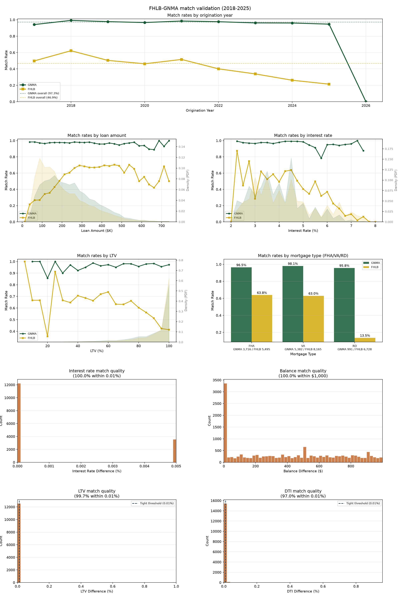
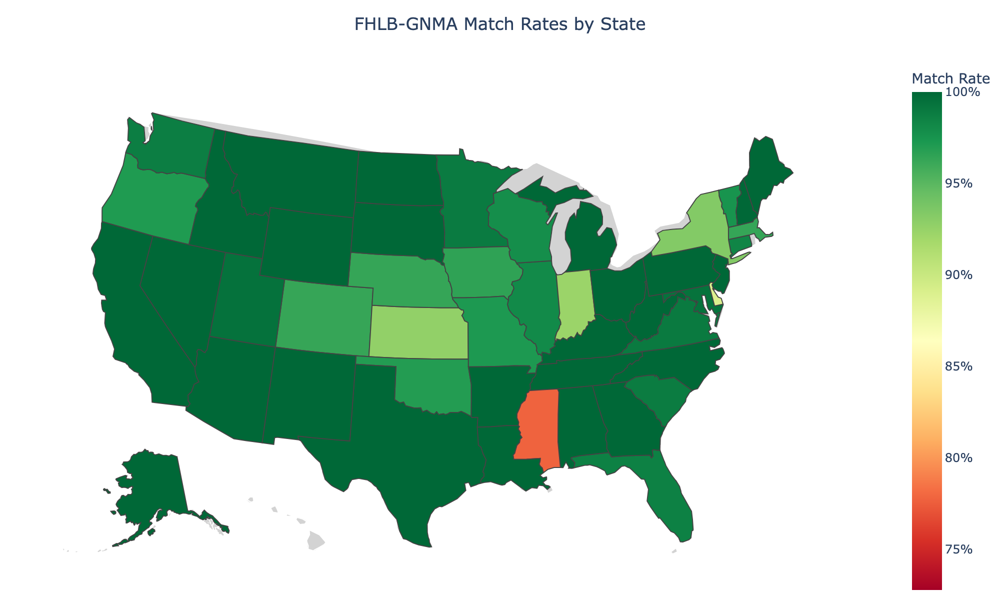

# FHLB-MBS Matching

This workflow links Ginnie Mae (GNMA) loan-level disclosure to the Federal Home Loan Banks'
Acquired Member Assets (AMA) data, identifying government-insured loans (FHA, VA, RD) that
an FHLB acquired and that a GNMA issuer pooled. GNMA is the only MBS side; see
[No Fannie Mae side](#no-fannie-mae-side).

## Data sources

- GNMA `dailyllmni` loan-level disclosure (silver) for government-insured loans, for a
  single GNMA issuer per run. The default, issuer 3937, is the Federal Home Loan Bank of
  Chicago in GNMA's issuer file: it pools government loans that FHLBs acquire through MPF.
- FHLB AMA acquisition data, filtered by `MortgageType` to FHA, VA and RD. Records from the
  Cincinnati and Indianapolis Banks, which acquire through MPP rather than MPF, are
  excluded.

## Method

### Keys and tolerances

The round lives in `match_fhlb_mbs/rounds.py` (`ROUNDS`). Today there is one; a copied
entry with changed fields runs as round 2 on the loans round 1 left unmatched, and
`match fhlb-mbs info` prints them.

Candidates are joined exactly on state FIPS code, mortgage type (FHA = 1, VA = 2, RD = 3),
property units, number of borrowers and origination year, and must have a compatible loan
purpose (a GNMA purchase never pairs with an FHLB refinance, nor the reverse). Only GNMA Loan
Purpose 1 and 2 are used; 3 and 4 (modifications) and 5 (re-performing loans) are dropped.

Tolerances apply in two stages: looser ones find candidates, stricter ones filter the
matches.

| Field | Candidate stage | Post-match filter |
|-------|-----------------|-------------------|
| Interest rate | ±0.25% | < 0.125% |
| Principal balance | ±$2,500 | ≤ $1,000 |
| LTV | ±1.1% | ≤ 1.0% |
| DTI | ±1.1% | ≤ 1.0% |
| Loan term | ±12 months | — |

LTV and DTI pass when either side is missing. Between the two stages each candidate is
scored on its rate, balance, LTV and DTI gaps, each scaled by its candidate tolerance; a pair
is kept when it is the best for both loans, and a loan whose best score is tied stays
unmatched. Both sources carry these fields in the same units (rate and LTV/DTI in percent,
balance in dollars), so no conversion is applied.

### Origination year

The GNMA origination year comes from Loan Origination Date where the file carries it
(GNMA files from April 2015 on), and from First Payment Date otherwise. First payment
usually falls a month after origination, so it alone would put some loans originated in
December into the next year. The AMA side uses the note year.

### No Fannie Mae side

FHLBanks reach the conventional market two ways: selling to Fannie Mae through UMBS, and
acquiring member loans onto their own balance sheets through AMA. These populations do not
overlap. A test under deliberately loose tolerances (measured 2026-10-22) found 5 candidate
pairs among 133,144 FHLB-seller UMBS loans originated 2019–2025, each a coincidence inside
the tolerance window (the note amounts differ by $1,200-$4,500), so there is no FNMA leg.
UMBS-sold and AMA-held FHLB loans are disjoint, and combining the two datasets does not
double-count.

## Output

`crosswalk/fhlb_mbs/fhlb_mbs_crosswalk_gnma.parquet`, one row per pair:

| Column | Type | Description |
|--------|------|-------------|
| gnma_loan_id | String | GNMA loan identifier |
| fhlb_loan_id | Int64 | FHLB AMA loan identifier (`LoanCharacteristicsID`) |
| match_round | UInt8 | Position of the round in `ROUNDS` (1 today) |

```bash
mortgage-data match fhlb-mbs run         # --min-year / --max-year / --issuer-id (0 = all)
mortgage-data match fhlb-mbs validate    # validation figure and state map
mortgage-data match fhlb-mbs info        # the round, input and output status
```

`run` defaults to 2009–2025 and issuer 3937; the crosswalk on disk holds 15,777 pairs from
that default run.

## Results

Both rates are computed on `validate`'s scope: issuer 3937's GNMA loans with a first
payment in 2018–2026 (10,089 loans), and FHLB AMA government records acquired in 2018–2025
outside Cincinnati and Indianapolis (20,388 records). The crosswalk covers the wider
2009–2025 run; the 5,965 matched GNMA loans and 6,221 matched FHLB records outside the
scope are excluded from numerator and denominator.

- GNMA-side: 97.3% of in-scope GNMA loans (9,812) reach an FHLB AMA record.
- FHLB-side: 46.9% of in-scope FHLB AMA records (9,556) reach a GNMA loan.

The two should not be quoted interchangeably. FHLB AMA holds government-insured loans that
this issuer never pooled into a Ginnie security, so only about half of AMA records have a
counterpart.

| Year | GNMA-side | FHLB-side |
|---|---:|---:|
| 2017 | 94.1% | 49.7% |
| 2018 | 99.2% | 62.2% |
| 2019 | 97.7% | 50.4% |
| 2020 | 96.6% | 46.2% |
| 2021 | 98.5% | 51.6% |
| 2022 | 97.6% | 40.1% |
| 2023 | 96.2% | 34.1% |
| 2024 | 96.0% | 26.2% |
| 2025 | 94.7% | 21.4% |

Years are GNMA origination year and AMA note year, so 2017 originations with a first
payment in 2018 appear. The 38 in-scope loans originated in 2026 have no AMA year to reach
yet and are left out of the table. The GNMA side holds in the mid-to-high nineties every
year; loans originated late in a year are often acquired the next, so the newest year runs
low until the next AMA release. The FHLB side falls from 62.2% (2018) to 21.4% (2025).
That is a coverage trend, not a matcher regression: this issuer's GNMA volume falls much
faster than FHLB AMA volume over the window, so a growing share of AMA records has nothing
to reach.

By mortgage type:

| Type | GNMA-side | FHLB-side | GNMA loans | FHLB records |
|---|---:|---:|---:|---:|
| FHA | 96.5% | 63.8% | 3,716 | 5,495 |
| VA | 98.1% | 63.0% | 5,382 | 8,165 |
| RD (USDA) | 95.8% | 13.5% | 991 | 6,728 |

RD matches at 13.5% on the FHLB side, against 63–64% for FHA and VA. FHLB AMA holds 6,728
RD records against only 991 RD loans from this issuer, which pools little USDA product, so
most AMA RD records have nothing to match.

By FHLB Bank (FHLB side, measured 2026-10-21):

| Bank | FHLB records | Matched | FHLB-side | FHA+VA only |
|---|---:|---:|---:|---:|
| Chicago | 9,533 | 3,251 | 34.1% | 46.4% |
| Topeka | 5,876 | 4,036 | 68.7% | 78.8% |
| Des Moines | 2,990 | 895 | 29.9% | 59.9% |
| Atlanta | 1,001 | 994 | 99.3% | 99.4% |
| Boston | 528 | 380 | 72.0% | 78.5% |
| Pittsburgh | 264 | 0 | 0.0% | 0.0% |
| New York | 196 | 0 | 0.0% | 0.0% |

The issuer pools almost all of Atlanta's government acquisitions, most of Topeka's and
Boston's, and none of Pittsburgh's or New York's. Chicago and Des Moines hold many RD
loans (42% and 50% of their records), which pulls their FHLB side down.

## Validation

`mortgage-data match fhlb-mbs validate` renders one figure: match rates by origination
year; loan amount and interest rate; LTV and mortgage type; then the four match-quality
difference distributions. The state map is a separate file.



**Match quality.** On fields the matcher tolerates rather than keys exactly, matched pairs
are very close:

| Field | P50 | P95 | P99 | Within tight threshold |
|-------|-----|-----|-----|---:|
| Interest rate | 0.000% | 0.005% | 0.005% | 100.0% within 0.01% |
| Balance | $393 | $925 | $986 | 100.0% within $1,000 |
| LTV | 0.00% | 0.00% | 0.00% | 99.7% within 0.01% |
| DTI | 0.00% | 0.01% | 0.02% | 97.0% within 0.01% |

LTV and DTI differences pile up at zero. Rate differences are either zero or 0.005 points,
a rounding step. Balance differences have a spike at zero and otherwise spread roughly
evenly across the $0–$1,000 tolerance, as expected if the two sources report balance as of
different dates in the same month.

**Geography.** GNMA-side rates are above 92% in every state with at least 50 loans (lowest
Kansas, 92.7%). The one state that stands out on the map, Mississippi, has fewer than 50
loans. The color scale spans the observed range, clamped below at 0.50.



**Loan characteristics.** Rates are not flat:

- By loan amount, the GNMA side stays between about 93% and 98% up to $600K and dips to
  about 89% just above it, where loans are few. The FHLB side climbs from about 21% in the
  smallest bin to a plateau near 67–70% between $280K and $530K, then falls to 42–68% in
  the thin upper bins.
- By interest rate, the GNMA side is above 95% at most rates, with one dip to about 78% at
  5.75%. The FHLB side is noisy below 3% and falls above 4.5%, to near zero at 7.5% and
  above. The high-rate end is the 2023–2025 cohort, where the temporal decline is
  concentrated.
- By LTV, the GNMA side stays above 95% in most bins. The FHLB side is 60–74% through the
  middle of the distribution and falls to about 42% at LTV 95 and above, where the density
  is heaviest.

## Limitations

1. **The FHLB side is about half the GNMA side** and falls over the window, because AMA
   holds government-insured loans this issuer never pooled (none from Pittsburgh or New
   York).
2. **RD is a thin slice.** RD-stratified work on this crosswalk rests on 991 GNMA loans.
3. **One issuer per run.** Rates describe the chosen GNMA issuer, not all Ginnie
   securities.
4. **FHLB RD LTV placeholder.** 3.6% of in-scope FHLB RD records (239 of 6,728) report an
   LTV of 2.0%, apparently a placeholder for missing data. They fail the LTV tolerance and
   do not match.
