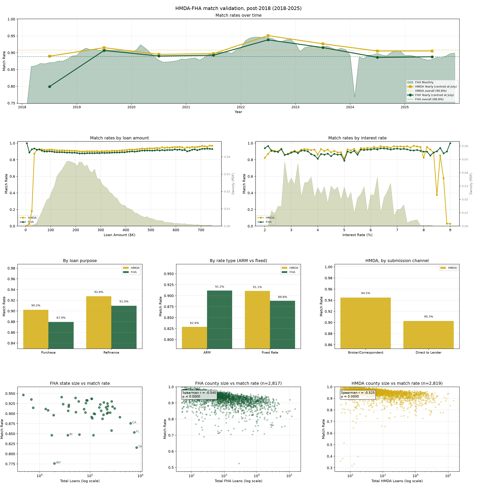
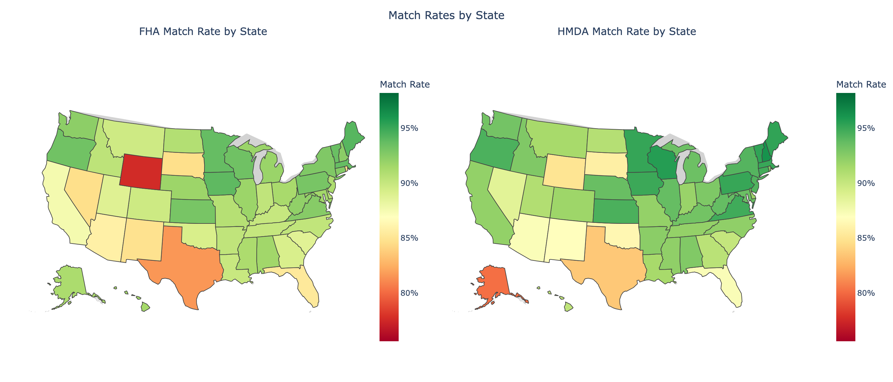
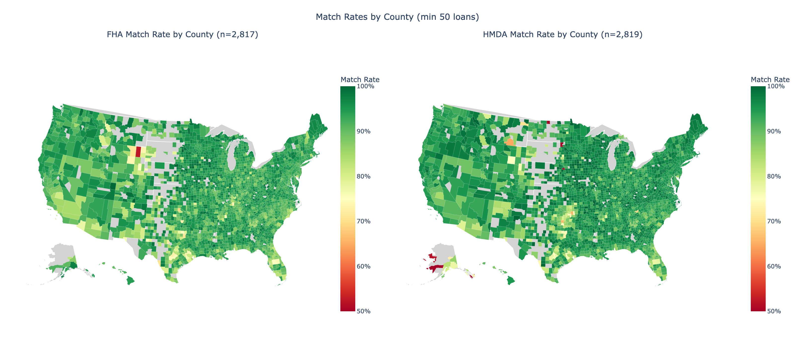
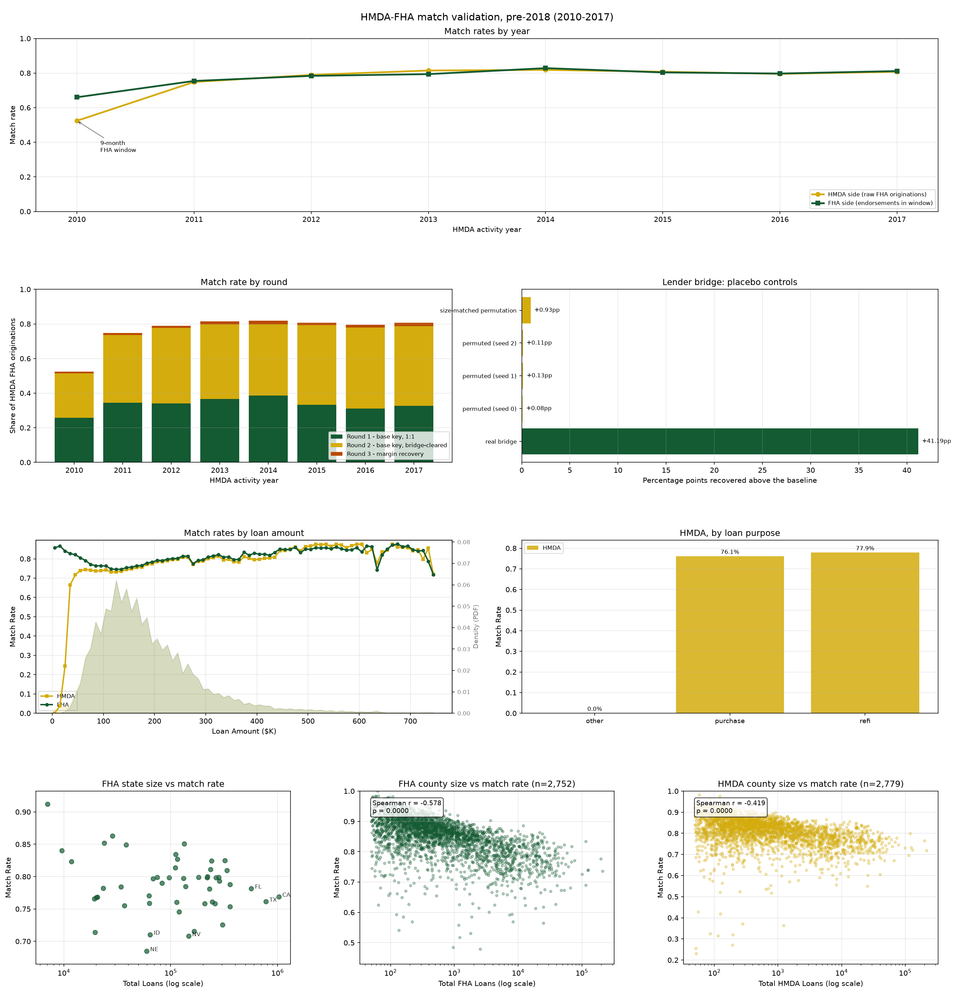
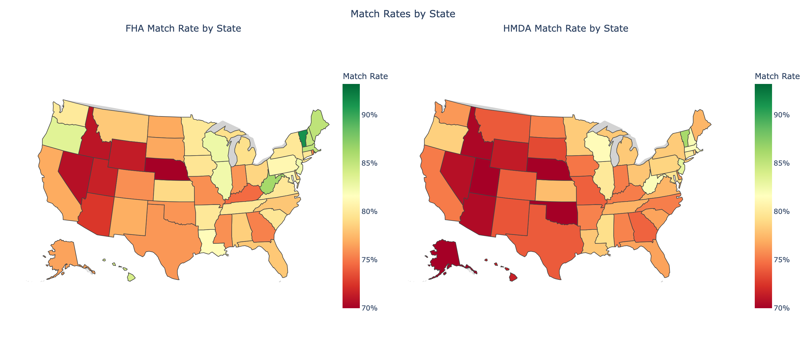
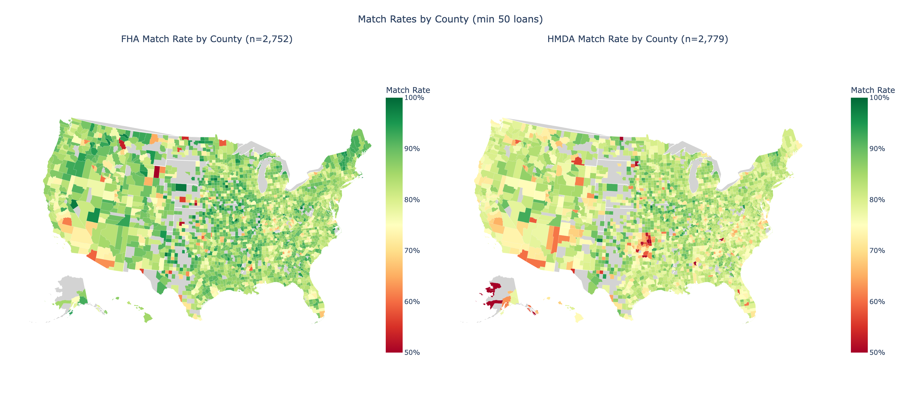

# HMDA-FHA Matching

This workflow links FHA single-family endorsements to HMDA originations. A matched pair
joins FHA's administrative record (endorsement detail, mortgagee identifiers) to HMDA's
borrower demographics, lender identity and geography.

## Two eras, two crosswalks

HMDA's 2018 schema change is too deep for one recipe. Most decisively, pre-2018 HMDA has no
interest rate, which is the post-2018 matcher's most discriminating key. The workflow ships
two matchers and two files:

| Era | Years | File | Pairs | HMDA-side rate¹ | Key discriminator |
|---|---|---|---:|---:|---|
| Post-2018 (default) | 2018–2025 | `hmda_fha_crosswalk_post2018.parquet` | 7,261,866 | 87.7% | 12.5bp interest rate |
| Pre-2018 | 2010–2017 | `hmda_fha_crosswalk_pre2018.parquet` | 7,118,737 | 75.5% | lender-identity bridge |

¹ Of raw HMDA FHA originations (`loan_type = 2`, `action_taken = 1`).

Both files have the same schema (`FHA_Index`, `HMDAIndex`, `match_round`), so
`pl.scan_parquet("crosswalk/hmda_fha/hmda_fha_crosswalk_*.parquet")` reads both eras with no
fills (14,380,603 pairs); see *Unioning the two eras* for the one caveat. They stay separate
files because `matching/master` uses the post-2018 file as its FHA edge and starts at 2018,
and the two rebuild on different cadences: the pre-2018 sources are closed, while post-2018
rebuilds with every HMDA cycle.

## Data sources

**Post-2018**

- FHA endorsements (`fha/silver/single_family`): loan characteristics, Mortgagee and
  Sponsor numbers, geography.
- HMDA post-2018 loans: loan characteristics, demographics, LEI, census tract.
- HUD ZIP-tract crosswalk from the [`usps_crosswalk` subpackage](../api/usps_crosswalk.md),
  2010 census vintage for 2018–2019 and 2020 for 2020 on, consolidated by
  `load_crosswalk_by_vintage()` to unique ZIP-tract pairs.

**Pre-2018**

- HMDA loans, `hmda/silver/loans/period_2007_2017`, activity years 2010–2017. The release
  preference is `a` > `b` > `c` > `d` > `e`. It must include `d`, because 2017 is the only
  year with `a` and every other year has only `d`; the shared post-2018 preference omits `d`.
- HMDA panel, `hmda/silver/panel/period_2007_2017`, read only by the lender bridge: there is
  no `lei` in this era, so respondent identity comes from the panel.
- FHA endorsements, `fha/silver/single_family`. The source starts in 2010-05, so activity
  year 2010 has a nine-month window. Its lower yield is a source floor and must not be
  "fixed" by widening the window.
- The 2010-vintage ZIP-tract crosswalk for every year (`get_zip_tract_for_year`, built on
  demand): 215,514 ZIP-tract pairs, a 2.30× fan-out. Loans lost to a null or absent tract
  fall from 10,797 in 2010 to 1,720 in 2017, so the 2000–2010 tract boundary is not
  binding here, unlike the pre-2018 HMDA-FHFA matcher.

## Post-2018 method

### Preparation

- FHA: restrict to November of `min_year − 1` through `max_year + 1` for cross-year
  matching; round the rate to 12.5bp and the amount to $10,000.
- HMDA: FHA originations only (`loan_type = 2`, `action_taken = 1`), excluding reverse
  mortgages and properties over 4 units; round the rate to 12.5bp; attach ZIP through the
  tract crosswalk at the loan's census vintage.
- Both sides carry an ARM flag (FHA `Product Type`; HMDA `intro_rate_period` against
  `loan_term`) for validation only.

### Rounds

The rounds live in `rounds.py` (`ROUNDS_POST2018`) and run in order. Each sees only the HMDA
loans and FHA records earlier rounds left, and `match_round` is the round's position. Every
candidate joins on state, amount ($10k) and rate (12.5bp) plus a geography key, and passes
a purpose gate: an HMDA purchase never pairs with an FHA refinance, nor a refinance with a
purchase.

| Round | Geography | Endorsement window | Rate | Other gates | Resolution |
|---|---|---|---|---|---|
| 1 | ZIP, county checked; county for loans with no ZIP | Dec Y−1 – Feb Y+1 | 0.5bp | sponsor/submission, lender pairs | unique on both sides |
| 2 | ZIP; county for loans with no ZIP candidate | Jan Y−1 – Dec Y+1 | 2.5bp | none | scored unique best |

Y is the HMDA activity year. The prepared FHA pool starts in November of the first year
before the range, so round 2's window for 2018 opens in November 2017. A loan with an
exempt rate cannot match, since every round gates on the rate.

Round 1 identifies lender pairs (FHA Mortgagee Number ↔ HMDA LEI) in two steps: keep pairs
holding at least 1% of each lender's matches, then rank them and keep the top pairs and
those that do not conflict with them. Its candidates resolve only when unique on both
sides. It has no minimum lender size.

Fixed-versus-adjustable agreement is not a filter. HMDA `intro_rate_period` carries
temporary buydown periods for some filers and FHA `Product Type` miscodes some genuine
ARMs, so the flags disagree on about 0.15% of otherwise validated pairs. Of those that
reach a GNMA loan, 99.5% agree with it on held-out term, units and rate type, so enforcing
agreement would remove correct matches and catch almost no wrong ones.

**Round 2** resolves contested candidates on evidence instead of dropping them:

- Score: lender identity +2 when aligned (HMDA panel name against FHA Originating
  Mortgagee or Sponsor name at token Jaccard ≥ 0.5, or the pair is on the roster of
  round-1 lender pairs), −2 when unaligned and HMDA's purchaser is Ginnie Mae or none
  (`purchaser_type` 2 or 0); sponsor/submission consistency +1; rate within 0.5bp +1; ZIP
  tier +1.
- Resolution: candidates scoring at least 2, strictly unique best on both sides by score,
  then by endorsement distance from mid activity year; ties are dropped.

Round 2's pairs are 96.4% identity-aligned, 99.5% rate-exact at 0.5bp and 95.8% in the ZIP
tier.

## Pre-2018 method

Every choice below was established on the full 2010–2017 data, not carried over from the
post-2018 configuration. A direct port of the post-2018 recipe matches 0.8%.

### Rounds

The rounds live in `rounds.py` (`ROUNDS_PRE2018`) and run in order through one engine,
as post-2018. Each sees only the HMDA loans and FHA records earlier rounds left, and
`match_round` is the round's position. Every candidate joins on the base key below inside
the round's endorsement window.

| Round | Endorsement window | Lender bridge | Resolution |
|---|---|---|---|
| 1 | Feb Y – Jan Y+1 | no | unique on both sides; learns the rate offset |
| 2 | Feb Y – Jan Y+1 | filter | unique on both sides |
| 3 | Jan Y – Jan Y+1 | no | margin tiers: county, geography + rate, rate |

Rounds 1 and 2 stay separate although one bridged round gives the same pairs (a round-1
pair is the only candidate of both its sides, so claiming it touches no other candidate):
the split keeps round 1 as a precision dial, and round 3 learns its rate offset from
unbridged pairs, which a merged round would change for about 0.5% of round 3's pairs.
Round 3's tiers stay inside one round. Run as rounds of their own, county first loses 109
of its pairs and adds 527 whose geography-and-rate winners agree on county 26% of the
time; rate first adds 1,404, but its geography-and-rate additions cross a county line four
times in ten, against 0.1% for round 3.

### Base key and window

The key is ZIP + loan amount at $1,000 + loan purpose. HMDA `census_tract` is fanned to ZIP
through the 2010 crosswalk and matched against FHA `Property Zip`, which cuts candidates
from 220.69 per HMDA loan (county + $10k bins) to 2.66. Candidate pairs are deduplicated on
`(HMDAIndex, FHA_Index)` after the ZIP fan, because one loan appears in several ZIP cells;
counting per cell overstates cleanliness by about 6pp.

Endorsement lags origination by about a month, so HMDA year Y is matched against the same
12-month window slid forward: February Y through January Y+1. Sweeping the months trimmed
from Y (head) against the months admitted from Y+1 (tail), share of HMDA loans matched:

| Head / tail | Window | 2012 | 2015 | 2016 |
|---|---|---:|---:|---:|
| 0 / 2 | Jan Y – Feb Y+1 | 33.2% | 32.7% | 30.4% |
| 0 / 1 | Jan Y – Jan Y+1 | 33.6% | 32.9% | 30.7% |
| **1 / 1** | Feb Y – Jan Y+1 | **34.2%** | **33.3%** | **31.2%** |
| 1 / 2 | Feb Y – Feb Y+1 | 33.8% | 33.0% | 30.9% |
| 2 / 1 | Mar Y – Jan Y+1 | 32.8% | 32.5% | 30.0% |
| 3 / 1 | Apr Y – Jan Y+1 | 30.6% | 30.5% | 28.0% |

`head = tail = 1` wins in every year. Each extra tail month costs about a point, because it
adds key-sharing endorsements over which the drop-all-ambiguous rule then destroys pairs.
The eight windows are disjoint and together cover February 2010 – January 2018.

The window must restrict the FHA pool before the 1:1 rule, not filter its output.
Deduplicating first costs about 75% of the matches: an out-of-window endorsement sharing
the key destroys a pair a year-blocked pass would never have seen.

### The lender bridge in the matcher

92.4% of ZIP-joinable loans (8,672,397 of 9,382,001) have a base-key candidate in the base
window, so the binding constraint is disambiguation. The bridge (see *Lender bridge*
below) maps FHA mortgagee numbers to HMDA respondent keys, and the matcher uses it as a
filter:

- On both sides, before the 1:1 rule.
- Remove-only: a loan with no bridge-consistent candidate keeps its full candidate set.
- An entry filed under either role counts for either FHA id: the mortgagee number is one
  registry, and the originating/sponsor split belongs to the loan, not the institution.
- Year-blind. The bridge records `first_year`/`last_year` spans, but the filter does not
  enforce them, and the evidence under *Validation* is measured without them.

The 1:1 gate is the post-2018 rule and code: drop every ambiguous candidate on both sides.
The crosswalk is checked 1:1 on both indices before it is written.

### Round 3

Rounds 1–2 leave 2,450,830 HMDA FHA originations unmatched (26.0%). Inside the base
window, 1,491,152 still hold an unclaimed base-key candidate, 205,031 lost every candidate
to a round 1–2 pair, and 754,647 never had one (45,043 of them because their tract joins
no ZIP). Round 3 runs on that remainder only, so rounds 1–2 are unchanged, and it uses no
lender identity.

Its window reopens January: January Y – January Y+1. The base window drops January because
loans endorsed then were mostly originated the year before, but for a loan rounds 1–2 could
not place, January is often where its partner is. A January record sits in two years'
windows, so pools are built for every year first and a record is contested by the loans of
both years. The tail is not lengthened: the pairs a June Y+1 tail adds agree with HMDA on
borrower count 88.2% of the time, against 97.76% for round 3 (see *Validation*).

The contested cells are the ones the bridge could not split; in half of them two or more
candidates belong to the same lender. Three pieces of evidence the earlier rounds do not
use can still separate some:

- County agreement: the ZIP fan can cross a county line, while HMDA's county is the
  tract's own.
- ZIP share: HUD's USPS TRACT_ZIP residential ratio (2010-vintage quarters through 2018,
  averaged), how much of the tract lies in each ZIP it fans to.
- Rate: HMDA `rate_spread` (APR − APOR, reported when ≥ 1.5pp) against the FHA note rate,
  net of the month's median offset on round-1 pairs, since neither source carries APOR or
  the lock date.

A candidate is accepted only if it leads every rival by a clear margin on both sides
(`resolve.margin_best`) under one of three tiers, each resolved on its own: it is the only
county-consistent candidate (`county`); its combined geography-and-rate score leads by two
points (`geo_rate`); or its rate fits within 0.125pp while every rival's is at least 0.375pp
further off (`rate`). A loan or record two tiers assign to different partners is
dropped. Best-score-wins on the same evidence is not used: it accepts candidates the margin
rule leaves too close to call, and the pairs it adds agree on held-out fields below round
3's level (see *Validation*).

### Encodings that differ from post-2018

Each of these fails silently, returning zero rows or plausible garbage:

1. `state_code` is a 2-digit FIPS (`'02'`), not FHA's postal `Property State`. FHA silver's
   `state_fips` is the counterpart; both are carried so geography joins FIPS to FIPS.
2. `county_code` is already the 5-digit FIPS and joins FHA `FIPS` directly. County is not a
   key; it is the held-out precision check.
3. `loan_amount` is in dollars and 100% exact thousands (only 9.13% divisible by $10,000).
   The post-2018 `Loan Amount Round` snaps to $10k and leaves 0.8% of loans in a clean 1:1
   cell instead of 26.7%. Never reuse it here.
4. `loan_purpose` is 1 = purchase, 2 = home improvement, 3 = refinance, not 1 / 31 / 32.
   The post-2018 mapping sends every loan to `other`.
5. `respondent_id` is encoded differently by release: `file_type=d` zero-pads numerics and
   hyphenates tax IDs (`0000013303`, `63-1005978`); `file_type=a` does neither (`13303`,
   `631005978`). Without canonicalization a pooled lender analysis silently loses 2017:
   113 of 1,658 respondent keys carried over from 2016, against 1,412 after normalizing.
   Canonicalize both loans and panel; the panel is not `file_type`-partitioned and uses
   the `d` encoding.

## Lender bridge (pre-2018)

`match_hmda_fha/lender_bridge.py` writes `hmda_fha_lender_bridge_pre2018.parquet` and
`hmda_fha_lender_bridge_names_pre2018.parquet` under `data/matching/hmda_fha/bridge/`.
It is built as its own step (`run --era pre2018 --step bridge`) rather than inside the
match because it reads a source the matcher never opens (the HMDA panel) and answers a
question independent of matching: which HMDA respondent is FHA mortgagee 64119, in which
years?

**A deterministic ID embedding.** For agency-code 7 (HUD) filers, the 10-digit HMDA
`respondent_id` contains the 5-digit FHA mortgagee number as its prefix. All 365 tier-0
entries satisfy `respondent_id.zfill(10)[:5] == fha_id`. Respondent `6411900018` →
mortgagee `64119`, both named `MERIT MORTGAGE SERVICES INC.`; respondent `1100900005` →
mortgagee `11009`, `SFMC LP` against `SERVICE FIRST MORTGAGE COMPANY`, with no shared
token. 20 of the 365 have name-Jaccard exactly 0.0, pairs no name rule could reach. Against
a shuffled placebo the embedding scores mean name-Jaccard 0.840 against 0.126.

**Composition.** 4,513 entries, name route only (see *Circularity*):

| Tier | Rule | Entries |
|---:|---|---:|
| 0 | `hud_id_prefix`, the ID embedding | 365 |
| 1 | `exact` / `exact+era` / `exact+state` name match | 2,881 |
| 2 | `jaccard` ≥ 0.70 (`jaccard` / `jaccard+era` / `jaccard+state`) | 1,267 |

3,589 entries are `originating` and 924 `sponsor`, the only two `fha_id_type` values (a
`master` value would be a bug: it is the matcher's `coalesce(originating, sponsor)`
fallback). Agency code 7 accounts for 2,077. A `+state` rule needs the FHA lender's modal
state to be unique; a tied plurality admits no entry.

710 entries are `era_tagged`. Pre-2018 respondent identity is unstable (HUD-form ID to EIN
around 2011, agency reassignments, the CFPB handover), so one firm legitimately holds
several respondent keys. 93.4% of the exact-name-ambiguous volume resolves to entity sets
with pairwise disjoint panel-year spans. Emitting them as era-tagged entries rather than
dropping them raised name-route coverage from 73.3% to 87.6% of pre-2018 FHA endorsements.

The bridge is one row per `(fha_id_type, fha_id, resp_key, agency_code)`, verified unique
on all 4,513 rows; one-to-many is the correct shape.

| Column | Meaning |
|---|---|
| `fha_id_type`, `fha_id` | `originating` or `sponsor`; the zero-padded 5-character mortgagee number |
| `resp_key`, `agency_code` | canonicalized HMDA respondent id and its agency |
| `fha_name`, `respondent_name` | each side's name as filed |
| `first_year`, `last_year` | observed panel-year span (Int16) |
| `era_tagged` | the FHA lender holds several respondent keys with disjoint spans |
| `name_tier`, `name_rule`, `name_score` | 0/1/2 and the rule that fired |
| `fha_loans`, `hmda_fha_loans` | volume on each side, used by the size-matched placebo |
| `in_name_route`, `in_learned_route` | where the evidence came from |
| `provenance` | `agree` iff both booleans; never null |
| `merge_rule` | how the merge resolved |

`provenance` and `merge_rule` are separate because they are different facts: where the
evidence came from, and how the merge resolved. Only the name route ships, so every row
reads `provenance = 'name_only'`.

**Circularity.** A second route can be learned from matched pairs by co-occurrence.
Learned out of sample (each year's entries from other years' round-1 pairs only) and run as
an additive pass over the leftovers, it adds 1.67pp (157,143 pairs). It does not ship: a route
fitted on the crosswalk's own pairs makes the bridge depend on the crosswalk it feeds. Only
the name route ships, and its 74.0% (rounds 1–2) is free of that circularity by
construction: `build_name_route` takes `(fha_silver_dir, hmda_panel_dir, hmda_loans_dir)`
and has no parameter through which a crosswalk could arrive. A learned route, if added,
must take the pairs as a required argument.

The pre-2018 sources are closed, so the bridge rebuilds only on a method change or an
upstream silver rebuild.

## Output

`crosswalk/hmda_fha/hmda_fha_crosswalk_{post2018,pre2018}.parquet`, one row per pair,
no nulls, 1:1 on both indices within each file:

| Column | Type |
|---|---|
| `FHA_Index` | String |
| `HMDAIndex` | String |
| `match_round` | UInt8 (1–2 post-2018, 1–3 pre-2018; see the method sections) |

In the pre-2018 file `match_round` is a real precision dial (see *Validation*): round 1 is
clean 1:1 on the base key alone, which the bridge cannot reach; round 2 is where the bridge
removed inconsistent candidates and a 1:1 cell emerged; round 3 is the margin recovery.

### Unioning the two eras

Each file is 1:1, but 3,104 `FHA_Index` values appear in both (0.044% of the pre-2018
file). All sit at the boundary: HMDA activity year 2017 on the pre-2018 side, against FHA
endorsements in November 2017 (521), December 2017 (596) and January 2018 (1,987), months
both eras' windows admit; 110 come from pre-2018 round 3. Both pairs cannot be right, so the
[master crosswalk](master_crosswalk.md) withholds its FHA link on every one
(`conflict_flags` reason `fha_cross_era`). `HMDAIndex` overlap is zero. A consumer who
globs both files and assumes global 1:1 on `FHA_Index` must deduplicate; joining per era or
on `HMDAIndex` is unaffected.

```bash
mortgage-data match hmda-fha run                          # post-2018 (default era)
mortgage-data match hmda-fha run --era pre2018 --step bridge [--overwrite]   # bridge first
mortgage-data match hmda-fha run --era pre2018 [--overwrite]
mortgage-data match hmda-fha run --era pre2018 -m 2015 -M 2016
mortgage-data match hmda-fha validate [--era pre2018] [--skip-placebo]
mortgage-data match hmda-fha info
```

Both eras run every round in `rounds.py`, which `info` prints; to try a round, copy an entry
there and change its fields. `--overwrite` rebuilds the prepared intermediates; without it
they are reused. Pre-2018 intermediates prepared before round 3 existed lack the columns it
reads (HMDA `census_tract` and `rate_spread`, FHA `Interest Rate`), and the run stops with
an error naming `--overwrite`. `build-zip-tract` takes a census vintage, not a year, so
`build-zip-tract 2010` serves the whole pre-2018 era. Era settings live on
`HMDAFHAMatchingConfig`; the pre-2018 ones carry a `PRE2018_` prefix.

## Results

### Post-2018 (2018–2025)

| | Count |
|---|---:|
| FHA endorsements, 2018–2025 | 8,098,782 |
| HMDA FHA originations, all | 8,277,066 |
| HMDA FHA originations, eligible (non-reverse, ≤4 units) | 7,994,791 |
| Pairs | 7,261,866 |
| Round 1 | 6,824,090 |
| Round 2 | 437,776 |
| FHA-side rate (7,195,638 pairs on 2018–2025 endorsements) | 88.8% |
| HMDA-side rate, all FHA originations | 87.7% |
| HMDA-side rate, eligible | 90.8% |

The FHA-side numerator excludes the 66,228 pairs whose endorsement falls outside
2018–2025 (the HMDA side's cross-year matches), so it is not 7,261,866 / 8,098,782.

Round 1 produces 94.0% of pairs. Counts are from the 2026-10-21 build.

### Pre-2018 (2010–2017)

The HMDA denominator is raw originations (`action_taken = 1`, `loan_type = 2`), not the
ZIP-joinable subset, which is about 0.4pp smaller and would inflate every rate. The FHA
denominator is that year's February Y – January Y+1 window.

| Year | HMDA FHA orig. | FHA in window | Months | Pool ratio | Round 1 | Round 2 | Round 3 | Pairs | HMDA-side | FHA-side |
|---:|---:|---:|---:|---:|---:|---:|---:|---:|---:|---:|
| 2010 | 1,437,916 | 1,141,416 | **9** | 0.794 | 370,466 | 369,704 | 13,374 | 753,544 | 52.4% | 66.0% |
| 2011 | 1,074,237 | 1,065,919 | 12 | 0.992 | 369,627 | 420,316 | 14,129 | 804,072 | 74.9% | 75.4% |
| 2012 | 1,305,118 | 1,314,381 | 12 | 1.007 | 443,781 | 571,502 | 14,996 | 1,030,279 | 78.9% | 78.4% |
| 2013 | 1,107,275 | 1,136,365 | 12 | 1.026 | 405,011 | 476,985 | 20,198 | 902,194 | 81.5% | 79.4% |
| 2014 | 789,989 | 780,351 | 12 | 0.988 | 304,494 | 325,494 | 16,496 | 646,484 | 81.8% | 82.8% |
| 2015 | 1,232,830 | 1,238,943 | 12 | 1.005 | 409,488 | 567,721 | 18,472 | 995,681 | 80.8% | 80.4% |
| 2016 | 1,322,426 | 1,319,321 | 12 | 0.998 | 411,833 | 618,754 | 21,294 | 1,051,881 | 79.5% | 79.7% |
| 2017 | 1,157,253 | 1,151,586 | 12 | 0.995 | 378,687 | 532,351 | 23,564 | 934,602 | 80.8% | 81.2% |
| **Total** | 9,427,044 | 9,148,282 | — | 0.970 | 3,093,387 | 3,882,827 | 142,523 | **7,118,737** | **75.5%** | **77.8%** |

Round 1 alone is 32.8% of HMDA FHA originations; the bridge (round 2) adds 41.2 points and
round 3 1.5, so rounds 1–2 total 6,976,214 (74.0%). 48,543 round-3 pairs were endorsed in
January Y; they are counted in their HMDA activity year although the record belongs to the
previous year's window, which leaves the all-years FHA-side rate unchanged.

2010 is bounded by the source: its window holds nine months, and January 2010, the month
round 3 reopens, has no records. The seven full years average 79.7% on the HMDA side.
Every FHA-side denominator is restricted to the union of the eight windows; the prepared
FHA intermediate spans 2010–2018 in full, and using it unrestricted would add 886,299
endorsements no year could match and understate the FHA-side rate by about 6.7pp.

## Validation

### Post-2018

`mortgage-data match hmda-fha validate` renders one figure (rates over time; loan amount |
interest rate; purpose | rate type | submission channel; state size | FHA county size | HMDA
county size) plus two choropleths.



Overall rates are 88.8% on the FHA side and 90.8% on the HMDA side (eligible loans).
HMDA-side figures count each loan once: the prepared HMDA pool carries one row per ZIP
the loan's tract fans to, and validation collapses it to one row per loan. Monthly FHA rates
track the yearly figures, with one visible dip in early 2024. The panel is framed on the
yearly series because the first months of 2018 match far lower while FHA endorsement
coverage ramps up.



Most states fall in the high eighties to low nineties, with CA, FL and TX at the low end
and WY lowest. State volume against match rate: Spearman −0.226 (p = 0.11) FHA-side and
−0.111 (p = 0.44) HMDA-side, weak and not significant; the volume axis is log-scaled
because volume spans two orders of magnitude.



Counties (≥ 50 loans, territories excluded) vary more, consistently across the two sides.
County volume against match rate is moderately negative: −0.540 (p < 0.0001, n = 2,817)
FHA-side and −0.525 (p < 0.0001, n = 2,819) HMDA-side, so larger counties match somewhat
worse.

- **Loan amount:** both sides sit around 88–95% above about $50K; the thin tail of very
  small loans matches far worse. Most FHA loans are $100K–$400K.
- **Interest rate:** flat; the HMDA side falls above about 8.5%, where there are few loans.
- **Purpose:** purchase 87.9% FHA-side / 90.2% HMDA-side; refinance 91.0% / 92.8%.
- **Rate type:** fixed 88.8% / 91.1%; ARM 91.2% / 82.9%. Rate type is neither a key nor a
  filter. The 8-point opposite-direction gap for ARMs, a small share of FHA volume, is
  most likely a coding disagreement between the sources (the HMDA denominator counts
  records flagged adjustable), not a matching failure. It has not been chased down.
- **Submission channel** (HMDA only): direct 90.3%, broker/correspondent 94.5%.

**Held-out fields through GNMA.** Each FHA record is linked to its GNMA loan on state,
$1k-floored amount, exact rate and endorsement from 1 month before to 3 after GNMA
origination, kept only when 1:1 (1,816,234 records, 12–33% by year). No HMDA field enters
that link, so comparing the HMDA loan with the GNMA loan on term, units, borrower count and
MIP-aware CLTV within 1 point, none of which a round reads, tests the HMDA-FHA pair:

| Pairs | All four agree |
|---|---:|
| Round 1 | 97.2% |
| Round 2 | 93.0% |
| Placebo: the same HMDA loans against the other FHA records in their key cell, ±3 months | 21.9% |

### Pre-2018

`mortgage-data match hmda-fha validate --era pre2018` renders one figure (rates by year;
round contribution | placebo controls; loan amount | purpose; state size | FHA county size |
HMDA county size) plus two choropleths. There is no interest-rate panel because the era
has no interest rate.



**Placebo.** The bridge relaxes the 1:1 rule, and a relaxation can count cell density
rather than real matches. Each control reruns the whole matcher with a bridge that keeps
both marginals (the same FHA lenders, respondent keys and 4,513 entries) and destroys only
the pairing:

| Bridge | Pairs | Recovered above baseline |
|---|---:|---:|
| None (baseline) | 3,093,387 | — |
| Real | 6,976,214 | **+41.19pp** |
| Permuted, seed 0 | 3,101,148 | +0.08pp |
| Permuted, seed 1 | 3,105,953 | +0.13pp |
| Permuted, seed 2 | 3,103,680 | +0.11pp |
| Size-matched permutation (within FHA-volume deciles) | 3,180,984 | +0.93pp |

Permuted bridges recover 0.08–0.13pp against 41.2pp, a factor of 300 or more. The
size-matched control, which pairs large lenders with other large lenders' respondents,
reaches 0.93pp, so the gain is not a large-lender artifact. The mechanism is identity.

**Frozen reference.** `fha_hmda_matches_pre2018_202506.parquet` (7,120,621 rows, 2010–2017)
is a frozen crosswalk with no generating code, the only independent reference available:

| Year | Frozen rows | Comparable pairs | Agreement | Round-2 pairs | Round-2 agreement |
|---:|---:|---:|---:|---:|---:|
| 2010 | 865,002 | 706,788 | 99.94% | 342,628 | 99.95% |
| 2011 | 750,070 | 703,309 | 99.91% | 365,081 | 99.90% |
| 2012 | 981,221 | 925,754 | 99.88% | 513,831 | 99.86% |
| 2013 | 896,965 | 859,539 | 99.88% | 452,597 | 99.86% |
| 2014 | 645,145 | 615,933 | 99.85% | 309,146 | 99.82% |
| 2015 | 1,004,173 | 950,903 | 99.85% | 540,976 | 99.83% |
| 2016 | 1,051,254 | 1,001,329 | 99.86% | 587,781 | 99.84% |
| 2017 | 926,791 | 892,479 | 99.93% | 509,686 | 99.92% |
| **Total** | 7,120,621 | 6,656,034 | **99.89%** | 3,621,726 | **99.87%** |

Measured 2026-10-22: on round-2 pairs, where the bridge decided, a uniform draw among the
round's base-key candidates for the loan (before the bridge filter, 3.19 per loan) would
agree 45.94% of the time. When the frozen record is among the candidates at all, rounds
1–2 select it in 6,548,810 of 6,548,845 cases (99.9995%). Round 1 agrees 99.92% on the
2,934,059 pairs it shares with the reference, and round 3 99.51% on 100,249. The reference
presumably used a similar method, so this measures reproducibility, not correctness. The
comparison needs a split key (2010–2016 rows key on `(respondent_id, agency_code,
sequence_number)`, 2017 on `HMDAIndex`) and a one-position endorsement-index offset between
the builds, both handled in `pre2018_frozen_agreement`; without them it reads 0.0%.

**Lender agreement.** Share of pairs whose HMDA respondent is the FHA lender's modal
respondent, against a control that permutes the FHA side within the year:

| Year | Round | Pairs | Modal share | Shuffled | Held out |
|---:|---:|---:|---:|---:|---|
| 2012 | 1 | 443,781 | 98.28% | 12.61% | yes |
| 2012 | 2 | 571,502 | 98.28% | 10.09% | no |
| 2012 | 3 | 14,996 | 95.75% | 16.39% | yes |
| 2015 | 1 | 409,488 | 98.94% | 11.01% | yes |
| 2015 | 2 | 567,721 | 98.92% | 5.62% | no |
| 2015 | 3 | 18,472 | 97.38% | 13.72% | yes |

Rounds 1 and 3 never read lender identity, so their 95.7–98.9% against 11–16% shuffled is
genuine confirmation; an FHA lender maps to a median of 1 HMDA respondent in the matched
set against 32–34 under shuffling. For round 2 the statistic is true by construction once
the bridge is a key and carries no information; its precision evidence is the placebo and
the frozen reference.

**County.** County is not a key, and 99.66% of round 1–2 pairs agree on 5-digit county
FIPS. Round 3 uses county as evidence, so it is not held out there; with it, the whole
crosswalk agrees 99.67%.

**Round 3.** The placebo and lender test speak for the bridge, so round 3 was checked on a
field none of its rules reads: HMDA's co-applicant flag against the borrower count on the
GNMA loan the FHA record reaches. The FHA-GNMA link is the one used post-2018 (state,
$1k-floored amount, exact rate, endorsement from 1 month before to 3 after GNMA
origination, kept only when 1:1); GNMA disclosures carry the origination date from April
2015, so it reaches 8–11% of 2015–2017 endorsements. Measured 2026-10-22:

| Population | Pairs | Borrowers agree (n) | Frozen reference agrees (n) |
|---|---:|---:|---:|
| Round 1 | 3,093,387 | 98.38% (171,684) | 99.92% (2,934,059) |
| Round 2 | 3,882,827 | 98.14% (119,183) | 99.87% (3,621,726) |
| Round 3 | 142,523 | 97.76% (6,688) | 99.51% (100,249) |
| … endorsed in January Y | 48,543 | 97.37% (2,278) | 99.56% (40,159) |
| … inside the base window | 93,980 | 97.96% (4,410) | 99.48% (60,090) |
| Random pairs, same year and state | 3,093,387 | 52.24% (171,684) | 0.02% |

Round 3 and both its parts sit within a point of rounds 1 and 2, against 52% for random
pairs. The frozen reference also pairs endorsements from February–June of the following
year; the 2,713 of them the link reaches agree on borrowers 97.2%. Extending round 3's
window to June Y+1 adds 86,108 pairs and destroys 17,717; the added pairs agree on
borrowers 88.2% (4,296 reached), 97.2% where the frozen reference holds the same pair but
79.9% where it does not, so the window stops at January Y+1. Extending every round's tail
to June Y+1 loses 225,335 pairs net. Best-score-wins on the same evidence (any strict best
under each tier, no margin) adds 294,509 pairs that agree on borrowers 95.4% and with the
frozen reference 91.8%. Measured 2026-10-22.

**Selection bias.** The matched subset is not representative: it skews non-Hispanic and
higher-income. Round 1 alone against everything else:

| | 2012 round 1 / rest | 2015 round 1 / rest |
|---|---|---|
| Race = 5 (White) | 79.4% / 78.6% (+0.8pp) | 76.7% / 76.2% (+0.4pp) |
| Ethnicity = 2 (not Hispanic) | 81.5% / 78.1% (+3.4pp) | 78.1% / 73.5% (+4.6pp) |
| Sex = 1 (Male) | 64.4% / 61.5% (+2.9pp) | 61.2% / 60.9% (+0.3pp) |
| Median income | $67k / $56k (+$11k) | $64k / $59k (+$5k) |

The published crosswalk (rounds 1–3) against unmatched loans:

| | 2012 matched / unmatched | 2015 matched / unmatched |
|---|---|---|
| Race = 5 (White) | 79.0% / 78.4% (+0.6pp) | 76.4% / 76.4% (−0.1pp) |
| Ethnicity = 2 (not Hispanic) | 79.5% / 78.3% (+1.2pp) | 75.4% / 73.3% (+2.1pp) |
| Sex = 1 (Male) | 63.2% / 60.0% (+3.1pp) | 61.0% / 60.7% (+0.4pp) |
| Median income | $61k / $53k (+$8k) | $61k / $57k (+$4k) |
| Loans | 1,030,279 / 274,839 | 995,681 / 237,149 |

The likely mechanism is mechanical: drop-all-ambiguous keeps loans in sparse cells
(unusual amounts, less dense ZIPs), and denser urban ZIPs have both more competing loans
and a higher Hispanic share. Rounds 2–3 roughly halve the ethnicity and income skew but do
not remove it, and the 2012 sex gap widens slightly; round 3 leaves it about where round 2
did (2012 ethnicity gap +1.0pp to +1.2pp). Distributional work (pricing, denial or
steering by race, ethnicity or income) must weight or condition on this.

**Time and geography.** From 2011 both sides sit in a 74.9–82.8% band and track each other,
as the pool ratios predict (within 2.6% outside 2010).



State volume against match rate is negligible: Spearman −0.116 (FHA) and +0.124 (HMDA).



County volume against match rate (≥ 50 loans, territories excluded) is moderately to
strongly negative: −0.578 (FHA, n = 2,752, p < 1e-200) and −0.419 (HMDA, n = 2,779,
p < 1e-100). That is slightly stronger than post-2018 and than rounds 1–2 alone (−0.545 /
−0.396), so round 3's gains are not concentrated in dense counties. It is the geographic
face of the same mechanism as the selection bias.

**Purpose.** Share of HMDA loans matched, over the 9,382,001 HMDA FHA originations whose
tract joins a ZIP (the raw total is 9,427,044; the purpose split needs the prepared pool):

| Purpose | HMDA loans | Matched | Rate |
|---|---:|---:|---:|
| Purchase | 6,096,261 | 4,640,661 | 76.1% |
| Refinance | 3,181,739 | 2,478,076 | 77.9% |
| Other (home improvement) | 104,001 | 0 | 0.0% |

FHA silver's `Loan Purpose` takes only `Purchase`, `Refi_FHA` and `Refi_Conv_Curr`, so
home-improvement loans (1.10% of the denominator) have no counterpart; matching them to
refinances would manufacture false pairs. With no rate key, this era reaches 75.5% against
90.8% of eligible loans post-2018.

**Negative results.** Property type has no lift: 97.5% concordant matched against 97.5%
shuffled in 2015 (97.8 / 97.8 in 2012), because FHA's structure types nearly all map to
HMDA code 1. Occupancy is unusable: FHA silver has none, and HMDA's `occupancy_type` is
99.2% owner-occupied. FHA silver also has no borrower demographics or income, so no
agreement test on them is possible.

## Limitations

1. **Larger counties match worse in both eras** (Spearman −0.54 / −0.53 post-2018,
   −0.58 / −0.42 pre-2018): take care with sub-state geography.
2. **Post-2018 exclusions:** reverse mortgages and properties over 4 units are excluded,
   and a loan with an exempt rate (−99999) cannot match.
3. **Pre-2018 2010 is a nine-month year** (FHA silver starts 2010-05). Its 52.4% is a source
   floor; widening the window only costs yield.
4. **Pre-2018 has no interest rate**, which is why disambiguation comes from lender
   identity and why the era's ceiling is lower: 24.5% of HMDA FHA originations (2,308,307)
   are unmatched, most in cells whose candidates share a ZIP and a lender, which nothing in
   pre-2018 HMDA separates, or with no candidate even in the reopened window.
5. **Pre-2018 selection bias**, quantified above; required reading for distributional work.
6. **Pre-2018 home-improvement loans (1.10%) cannot match.**
7. **3,104 `FHA_Index` collisions across the two era files** at the November 2017 –
   January 2018 boundary; see *Unioning the two eras*.
8. **No FHA-side borrower demographics**, so no demographic agreement test is possible.
9. **The pre-2018 crosswalk is content-deterministic, not byte-deterministic**: two runs
   give the same pairs in a different row order, so compare contents, not files.
10. **The frozen pre-2018 reference is archived**, with a provenance README, at
    `data/matching/hmda_fha/legacy/`. It cannot be rebuilt, and every future method change
    will want it.
