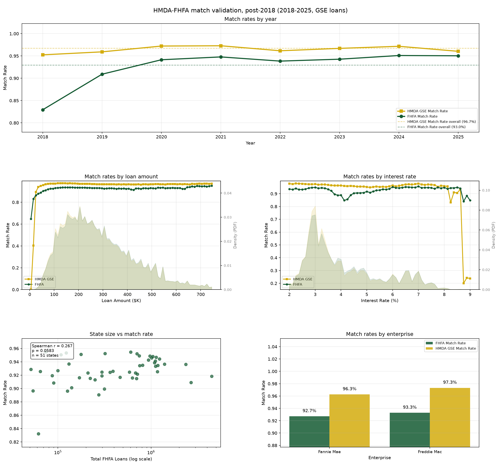
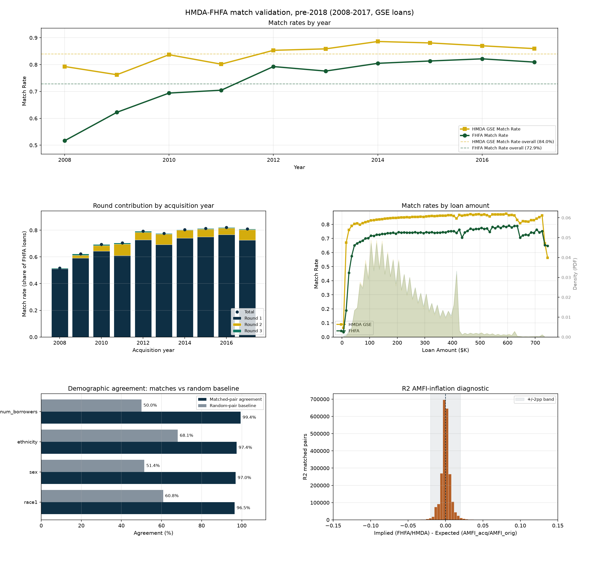
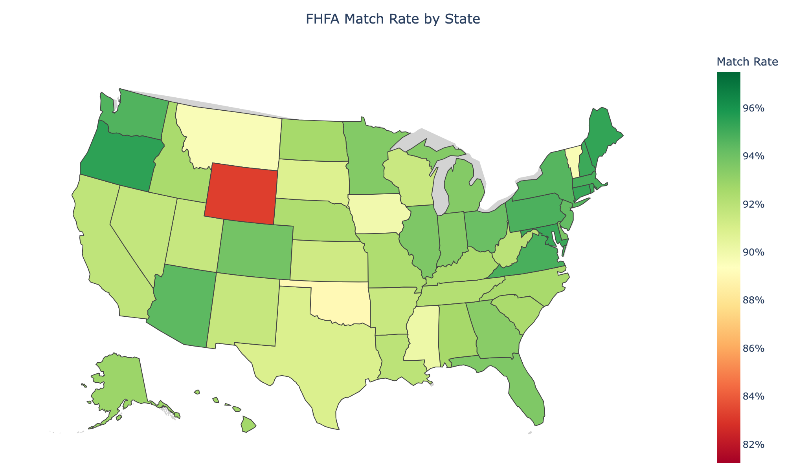
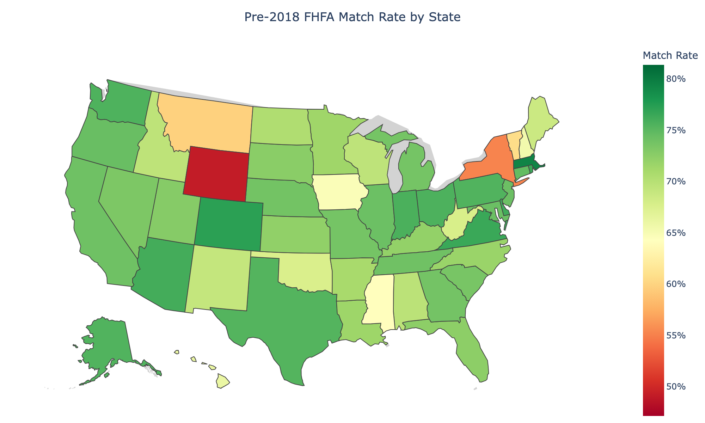

# HMDA-FHFA Matching

This workflow links HMDA loan records to FHFA's single-family census-tract file (`sf_c`) of
Fannie Mae and Freddie Mac acquisitions, joining HMDA's borrower, lender and tract data to
the GSE acquisition record. It runs as two matchers because FHFA's file changed in 2018:

| Era | FHFA acquisition years | What `sf_c` carries | Rounds | FHFA-side rate |
|---|---|---|---:|---:|
| Post-2018 | 2018–2025 | rate, LTV, DTI, term, channel | 5 | 93.0% |
| Pre-2018 | 2008–2017 | none of those | 3 | 72.9% (75.3% on 2009–2017) |

Together they cover 2008–2025 with 66.0M matched FHFA loans.

## Data sources

- HMDA silver: post-2018 `hmda/silver/loans/post2018/activity_year={year}/file_type={a|b|c}/`
  (best release per year, `a` > `b` > `c`); pre-2018
  `hmda/silver/loans/period_2007_2017/activity_year={year}/file_type=d/` (the FFIEC
  nationwide non-confidential format).
- FHFA silver: `fhfa/silver/sf_c/sf_c_{year}.parquet`, about 66 columns post-2018 and about
  41 pre-2018, which lack rate, LTV, DTI, term and channel.

## Method

### Post-2018: five rounds

Every round joins on census tract (11-digit FIPS), rounded loan amount, loan type
(conventional, FHA, VA, RD) and occupancy, screens the candidates on the fields the join
does not key on, and keeps only pairs that are 1:1 on both sides. Before the 1:1 step, a
loan with a candidate within 0.01 points of its rate drops its looser candidates. Rounds run
in order, each on the loans earlier rounds left unclaimed. Same-year rounds break
same-fingerprint ties by closest income, only when the closest is within $1,000 (other ties
fall to the 1:1 rule), and resolve per year; cross-year rounds pool every year pair (FHFA
year ≥ HMDA year) and resolve once.

| Round | HMDA `purchaser_type` | Years | Join adds | Rate / term | Checks | After 1:1 | Catches |
|---|---|---|---|---|---|---|---|
| 1 | 1, 3 | same | purchaser, rate | ±0.05 / ±30 | same-year origination, strict purpose, demographics, DTI | — | direct GSE sales |
| 2 | 0, 1, 3, 5+ | same | rate | ±0.05 / ±30 | same-year origination, strict purpose, DTI | — | uninformative purchaser types (e.g. 9) |
| 3 | 0, 1, 3, 5+ | FHFA ≥ HMDA | rate | ±0.05 / ±30 | coarse purpose, prior-year origination for GSE sales and type 0, demographics, DTI | ±0.01 / ±6 | acquisition in a later year |
| 4 | 0, 1, 3, 5+ | same | — | ±0.20 / ±12 | same-year origination, coarse purpose, demographics, DTI (never relaxed) | — | rates in a different 12.5 bp bucket |
| 5 | 0, 1, 3, 5+ | FHFA ≥ HMDA, across 2021/2022 | rate, 2010↔2020 tract bridge | ±0.05 / ±30 | as round 3 | ±0.125 / ±12 | the 2021/2022 tract redraw |

- **Rate / term:** the largest gap after the join, in percentage points and months. The term
  check applies FHFA's Freddie term conventions (ceiling plus product-envelope binning,
  `matching/terms.py`). **After 1:1** tightens it once the pair is unique.
- **Same-year origination:** FHFA `date_of_mortgage_note == 1`, the loan was originated in
  its acquisition year.
- **Purpose:** strict means purchase, refinance and cash-out must agree; coarse only stops a
  purchase pairing with a refinance.
- **Demographics:** applicant age band, age 62+ and sex must not contradict.
- **Type 0** ("not sold" in the HMDA year): rounds 3–5 admit it only as a prior-year
  origination acquired in a later year, so round 4 never admits it. Round 2 has no such
  check and admits it same-year (934,694 pairs).

`mortgage-data match hmda-fhfa info` prints this table from the round definitions
(`ROUNDS_POST2018` in `rounds.py`), which are the source of truth. A round's
`match_round` is its position there, so a copied and edited entry runs as a new round.

**Round 5.** The 2020 Census redrew tracts, and 16–27% of HMDA-2021 ↔ FHFA-2022 tract
GEOIDs do not line up. Round 5 translates FHFA's 2020-vintage tract to its 2010-vintage candidates
(Census `tab20_tract20_tract10_natl` relationship file). It runs only for HMDA year ≤ 2021
against FHFA year ≥ 2022, the one direction the matcher crosses the boundary, and uses looser
post-1:1 tolerances than round 3 because redrawn tracts hold larger candidate sets and wider
rate disagreement. It recovers about 146K matches (about 3.8% of FHFA 2022).

**DTI.** Both sources bin DTI as 10 (<20%), 20 (20–30%), 30 (30–36%), 50 (50–60%) and 60
(>60%), report 36–49 as integers, and code missing as 99 (FHFA) or NA/Exempt (HMDA). Two
binned values must be equal, two integers within 2 points; a binned value against an integer
is not checked. HMDA's applicant-stage DTI and FHFA's delivery DTI disagree on a real share
of true pairs, so a DTI-failing candidate is kept when it is unique on both sides before the
DTI filter (where DTI cannot disambiguate anything) and held-out discount points do not
contradict it (a usable Closing-Disclosure amount that clearly disagrees rejects it). Round
4 does not relax DTI. Relaxed pairs carry `dti_relaxed` and the signed HMDA − FHFA bracket
gap `dti_gap`.

### Pre-2018: three rounds

With no rate, LTV, DTI, term or channel, the pre-2018 matcher keys on tract, loan type and
income. Demographics never join: Rounds 1 and 2 use co-borrower presence only to exclude
pairs, and Round 3 scores race, ethnicity, sex and borrower count to resolve contested cells.

**Round 1: same year, exact income.** HMDA[Y] originations (`action_taken = 1`,
`purchaser_type` not in {0, 2, 4}) against FHFA[Y] acquisitions (`enterprise_flag` 1, 2);
removing 0 from the round's `barred_purchasers` (`ROUNDS_PRE2018` in `rounds.py`) keeps
`pt = 0`, and Ginnie Mae and Farmer Mac loans never reach
the Enterprise files. The join is tract, `loan_type` ↔ `Federal Guarantee`, and exact
`income` ↔ `Borrower(s) Annual Income`, with
`0 ≤ HMDA − FHFA ≤ max($2,000, 1% × HMDA)` on amount because `Acquisition UPB` is after
paydown. Impossible pairs are dropped: FNMA × HMDA
purchaser 3 and FHLMC × purchaser 1; FHFA purchase × HMDA refinance or home improvement, and
the reverse; mismatched `co_applicant_sex` and `Co-Borrower Gender`; owner-occupied ×
non-owner-occupied; 1–4 family × manufactured housing.

**Round 2: one-year lag, AMFI-deflated income.** For loans originated the year before
acquisition, FHFA publishes `round_to_$1k(orig × AMFI_acq / AMFI_orig)` as the income (2016
SF File C dictionary, field 11), with AMFI HUD's area median family income. Round 1 misses
this cohort, about 8% of acquisitions each year. Round 2 takes HMDA[Y−1] originations with
`purchaser_type` not in {1, 2, 3, 4} (direct GSE sales belong to FHFA[Y−1]) against FHFA[Y]
records left by Round 1, on tract and loan type with Round 1's filters, and requires

```
|round_to_$1k(FHFA × AMFI_orig_msa / AMFI_acq_msa) − HMDA_income| ≤ $1,000
```

AMFI is the modal `area_median_family_income` in FHFA silver by MSA × year, with a state ×
year panel for non-metro records (`msa_code` 99999, about 10% of volume). It is not
`local_area_median_income`, which is frozen for 2009–2011 and rebased in 2012. On unique
candidate pairs agreeing on every held-out demographic, the AMFI ratio lands inside the $1k
band 65–87% of the time in every year 2010–2017, against 1–49% for the local ratio and
18–52% with no deflation, and it is monotonic across 2012. Round 2 runs for every year whose prior
year is in the panel, which starts the year before `min_year`: 2009 is covered from 2008,
and 2008 (no `sf_c_2007`) is skipped.

**The 2011/2012 tract bridge.** HMDA 2011 uses 2000-vintage tracts and FHFA 2012 uses 2010
tracts, so the direct join keeps only about 71% of tract codes for that pair (99.5%+
elsewhere). An additive pass maps each unclaimed FHFA record to its related 2000-vintage
tracts (Census 2010 Tract Relationship File, intersections holding ≥ 5% of the 2010 tract's
population) and matches it against the unclaimed prior-year pool under the same rules. It
adds 65,369 pairs and disturbs none. Held-out race and ethnicity agree 98.6% and 99.5%,
against 99.2% and 99.9% for same-year Round 1 and 86.6% and 94.4% for a displaced-amount
placebo.

**Round 3: demographic tie-break.** Round 1 drops every candidate in a cell with two or more
candidates on either side, 1.5–2.4% of its volume, 99% of which matches nowhere else. Round
3 scores those cells on fields Round 1 never keys on (race, ethnicity, sex, borrower count,
exact purpose, occupancy, property type) as agreeing minus disagreeing fields;
not-provided codes are no evidence. A pair is admitted only if it is the unique best for
both its FHFA record and its HMDA loan, agrees on at least 3 fields and disagrees on none. A
smaller amount gap breaks exact score ties; remaining ties are not admitted. It recovers
about 55% of the ambiguous records (1.0% of the crosswalk). Scoring on {race,
ethnicity, borrower count} and checking {sex, exact purpose, occupancy}, and the reverse,
gives 97.4–99.5% agreement, against a 96.7–99.6% same-year Round 1 ceiling and a 67–74%
displaced-cell placebo; 82–88% of admissions agree on every scored field.

**Loan key.** HMDA 2017 silver has `sequence_number` entirely null, so 2017 uses its
persisted `HMDAIndex` and 2007–2016 get a stable synthetic one from `(activity_year,
respondent_id, agency_code, sequence_number)`. `HMDAIndex` is the dedup key in every round.
Rounds 1 and 3 share one candidate frame and all rounds share one set of exclusion filters.

## Output

Post-2018: `crosswalk/hmda_fhfa/hmda_fhfa_crosswalk_post2018.parquet`

| Column | Type | Description |
|---|---|---|
| `HMDAIndex` | String | HMDA loan identifier |
| `activity_year` | Int32 | HMDA activity year |
| `fhfa_year` | Int32 | FHFA acquisition year |
| `enterprise_flag` | Int8 | 1 = Fannie Mae, 2 = Freddie Mac |
| `record_number` | Int32 | FHFA record number within (year, enterprise) |
| `purchaser_type` | Int8 | HMDA purchaser type |
| `dti_relaxed` | Boolean | kept despite a DTI disagreement (unique on both sides; see DTI above) |
| `dti_gap` | Int32 | signed HMDA − FHFA DTI bracket gap |
| `match_round` | UInt8 | 1–5 |

Pre-2018: `crosswalk/hmda_fhfa/hmda_fhfa_crosswalk_pre2018.parquet`

| Column | Type | Description |
|---|---|---|
| `year` | Int32 | FHFA acquisition year |
| `Enterprise Flag` | Int8 | 1 = Fannie Mae, 2 = Freddie Mac |
| `Record Number` | Int32 | FHFA record number within (year, enterprise) |
| `activity_year` | Int16 | HMDA activity year |
| `respondent_id` | String | HMDA respondent ID |
| `agency_code` | Int8 | HMDA agency code |
| `sequence_number` | Int32 | HMDA sequence number (null for 2017) |
| `HMDAIndex` | String | HMDA loan key (persisted for 2017, synthesized for 2007–2016) |
| `match_round` | UInt8 | 1 same year, 2 one-year lag (incl. the 2012 bridge), 3 tie-break |

```bash
mortgage-data match hmda-fhfa run --era post2018        # --min-year / --max-year
mortgage-data match hmda-fhfa run --era pre2018
mortgage-data match hmda-fhfa validate --era {post2018,pre2018}
```

## Results

The FHFA-side rate divides by FHFA acquisitions in the year; the HMDA GSE-side rate divides
by HMDA loans sold to a GSE (`purchaser_type` 1 or 3) in that activity year.

### Post-2018

32,390,404 of 34,836,782 FHFA loans match (93.0%); 96.7% on the HMDA GSE side. 428,868
pairs (1.3%) carry `dti_relaxed`.

| Round | Pairs | Cumulative FHFA-side |
|---|---:|---:|
| 1 | 21,757,815 | 62.5% |
| 2 | 7,527,160 | 84.1% |
| 3 | 2,588,639 | 91.5% |
| 4 | 369,506 | 92.6% |
| 5 | 147,284 | 93.0% |

| Year | FHFA loans | Matched | FHFA-side | HMDA GSE-side |
|---|---:|---:|---:|---:|
| 2018 | 3,239,368 | 2,686,601 | 82.9% | 95.3% |
| 2019 | 4,050,117 | 3,682,088 | 90.9% | 95.9% |
| 2020 | 8,637,597 | 8,132,391 | 94.2% | 97.2% |
| 2021 | 9,029,722 | 8,558,769 | 94.8% | 97.3% |
| 2022 | 3,837,778 | 3,601,690 | 93.8% | 96.2% |
| 2023 | 1,938,185 | 1,827,246 | 94.3% | 96.7% |
| 2024 | 2,010,248 | 1,911,745 | 95.1% | 97.2% |
| 2025 | 2,093,767 | 1,989,874 | 95.0% | 96.0% |

The FHFA-side lows in 2018 and 2019 are the years with the least to match against. The
newest HMDA year is right-censored: its loans acquired the following year match only once
that year's FHFA file is out (HMDA 2024 rose from 96.1% to 97.2% when FHFA 2025 arrived).

### Pre-2018

33,588,090 of 46,099,443 FHFA loans match (72.9%; 31,168,368 of 41,416,321, or 75.3%, on
2009–2017); 84.0% on the HMDA GSE side (activity years 2008–2017).

| Round | Pairs | Share |
|---|---:|---:|
| 1 | 30,896,587 | 92.0% |
| 2 (incl. the 2012 bridge) | 2,342,495 | 7.0% |
| 3 | 349,008 | 1.0% |

R1–R3 are each round's matches as a share of that year's FHFA loans.

| Year | FHFA loans | Matched | FHFA-side | HMDA GSE-side | R1 | R2 | R3 |
|---|---:|---:|---:|---:|---:|---:|---:|
| 2008 | 4,683,122 | 2,419,722 | 51.7% | 79.3% | 51.1% | — | 0.6% |
| 2009 | 5,931,117 | 3,691,666 | 62.2% | 76.2% | 59.1% | 2.1% | 1.0% |
| 2010 | 4,803,680 | 3,333,946 | 69.4% | 83.7% | 64.4% | 4.1% | 0.9% |
| 2011 | 4,336,597 | 3,056,070 | 70.5% | 80.2% | 61.0% | 8.5% | 0.9% |
| 2012 | 5,989,320 | 4,747,734 | 79.3% | 85.3% | 72.8% | 5.5% | 1.0% |
| 2013 | 5,619,812 | 4,360,796 | 77.6% | 85.9% | 69.3% | 7.7% | 0.6% |
| 2014 | 3,111,994 | 2,504,485 | 80.5% | 88.6% | 74.1% | 5.9% | 0.5% |
| 2015 | 3,720,282 | 3,026,266 | 81.3% | 88.1% | 74.9% | 5.9% | 0.5% |
| 2016 | 4,198,472 | 3,448,858 | 82.1% | 87.0% | 76.7% | 4.8% | 0.6% |
| 2017 | 3,705,047 | 2,998,547 | 80.9% | 85.9% | 72.6% | 7.8% | 0.6% |

2008 has no Round 2 (no FHFA 2007 file for the AMFI panel); 2012's Round 2 includes the
bridge. The 2008–2009 lows reflect crisis-era GSE acquisitions outrunning HMDA GSE-sold
volume, plus 2008's missing Round 2. From 2012 on both sides sit at 78–89%. From 2009 on,
Round 1 contributes at least 59 points of FHFA each year and Round 2 2.1–8.5 points (5.5 in
2012, where it runs through the tract bridge).

### By enterprise

HMDA GSE-side rates divide by HMDA loans sold to that enterprise (`purchaser_type` 1 for
Fannie Mae, 3 for Freddie Mac) in the era's matchable activity years.

| | Fannie Mae | Freddie Mac | Gap |
|---|---:|---:|---:|
| Post-2018 FHFA-side | 92.7% | 93.3% | +0.6 pp |
| Post-2018 HMDA GSE-side | 96.3% | 97.3% | +1.0 pp |
| Pre-2018 FHFA-side | 72.9% | 72.7% | −0.2 pp |
| Pre-2018 HMDA GSE-side | 83.8% | 84.4% | +0.6 pp |

## Validation

`mortgage-data match hmda-fhfa validate` renders one figure per era plus a state map.
Post-2018: rates by year; loan amount and interest rate; state size against rate, and rates
by enterprise.



Pre-2018: rates by year; round contribution and loan amount; demographic agreement and the
Round 2 AMFI diagnostic.



**Geography.** Post-2018, most states match at 90–95%. State FHFA volume and FHFA-side rate
have a Spearman r of 0.267 (p = 0.058, n = 51 states with at least 100 loans; territories
and the unknown-state code excluded): a weak tendency for larger states to match better,
not enough to under-represent any state. The volume axis is log-scaled; the largest state has two orders
of magnitude more loans than the smallest.



Pre-2018, the large states match at 69–76%. New York is the exception at 55.2%, possibly
from NYC tract reporting, condo and co-op reporting, or state-specific HMDA respondents; the
post-2018 map shows no such gap (New York 94.6%).



**Loan amount and rate.** Post-2018 rates are flat across the GSE-eligible range, low to mid
nineties on both sides above about $50K, with only very small loans matching far worse, and
stable across interest rates apart from an FHFA-side dip at 4–4.5%. Pre-2018 rates are
stable where loans are dense ($100K–$400K), around 74% FHFA-side and 83–86% HMDA-side.

**Demographic agreement (pre-2018).** Matched pairs against a random baseline (the sum of
squared marginal probabilities), on fields the match does not key on:

| Field | Matched pairs | Random baseline | Lift | Ratio |
|---|---:|---:|---:|---:|
| num_borrowers | 99.4% | 50.0% | +49.4 pp | 1.99x |
| sex | 97.0% | 51.4% | +45.6 pp | 1.89x |
| ethnicity | 97.4% | 68.1% | +29.4 pp | 1.43x |
| race1 | 96.5% | 60.8% | +35.7 pp | 1.59x |

Round 2 is within a fraction of a point of Round 1 (race1 96.4% vs 96.5%, num_borrowers
98.8% vs 99.5%). Round 3 reads lower (race1 93.0%, ethnicity 93.6%) because this table
counts a not-provided code as disagreement and Round 3 can admit a pair without race;
restricted to substantive codes its pairs agree by construction, so its precision rests on
the split-field test. The post-2018 matcher does not compute this diagnostic.

**AMFI inflation (pre-2018 Round 2).** Each pair's implied ratio (`FHFA_inc / HMDA_inc`)
against the expected MSA ratio (`AMFI_acq / AMFI_orig`). The diagnostic uses the MSA panel
for every loan, not the matcher's non-metro state fallback, which holds most of the tail.

| Pairs | Median implied | Median expected | Median residual | Mean abs residual | ±1 pp | ±2 pp | ±5 pp |
|---:|---:|---:|---:|---:|---:|---:|---:|
| 2,342,495 | 1.012 | 1.013 | 0.000 | 0.008 | 86.5% | 96.0% | 98.1% |

Implied and expected agree at the median (about one year of AMFI growth), so Round 2's
incomes follow FHFA's published procedure. The check alone cannot separate the two income
bases in 2009–2011: there `local_area_median_income` is frozen, so its expected ratio is
exactly 1.0. The figure's histogram spans ±15 points.

## Limitations

1. **Multifamily is not matched.** FHFA `mf_c` tracts overlap HMDA's at 99.4%, but `mf_c`
   loans are commercial (median about $11.9M in 2023, against about $1.0M for 5+ unit HMDA
   loans) and do not correspond 1:1. The best achievable rate is about 47%, so `mf_c` is
   better used on its own.
2. **Pre-2018 reaches one year of lag.** Loans originated two or more years before
   acquisition are not matched; a 2–7 year round is plausible but not built.
3. **Pre-2018 HMDA 2017 `sequence_number` is null** in every file type, so the matcher keys
   on `HMDAIndex`. Backfilling it in the HMDA silver import is open.
4. **Pre-2018 New York** (state code 36) matches at 55.2%, against 69–76% for the other
   large states, likely from NY-specific tract coding or condo and co-op reporting.
5. **Pre-2018 has no rate, LTV, DTI, term or channel**, which caps its rates well below
   post-2018.
6. **Same-year `pt = 0` is barred** (`barred_purchasers=(0,)` in rounds 1 and 3), about 46k
   matches a year, for about 1 point of average precision. Remove the 0 to favor recall.
7. **Acquisition year 2008 has no Round 2.** It is matched (Round 1 at 51% FHFA-side, 99.4%
   held-out race agreement), but the AMFI panel needs FHFA 2007. An undeflated prior-year
   round admits pairs at about 96% race agreement, below the other rounds, so it is skipped.

## Related workflows

- [FHFA-MBS Matching](fhfa_mbs_matching.md): FNMA and FHLMC loan-level disclosure to FHFA,
  the post-2018 production fingerprint.
