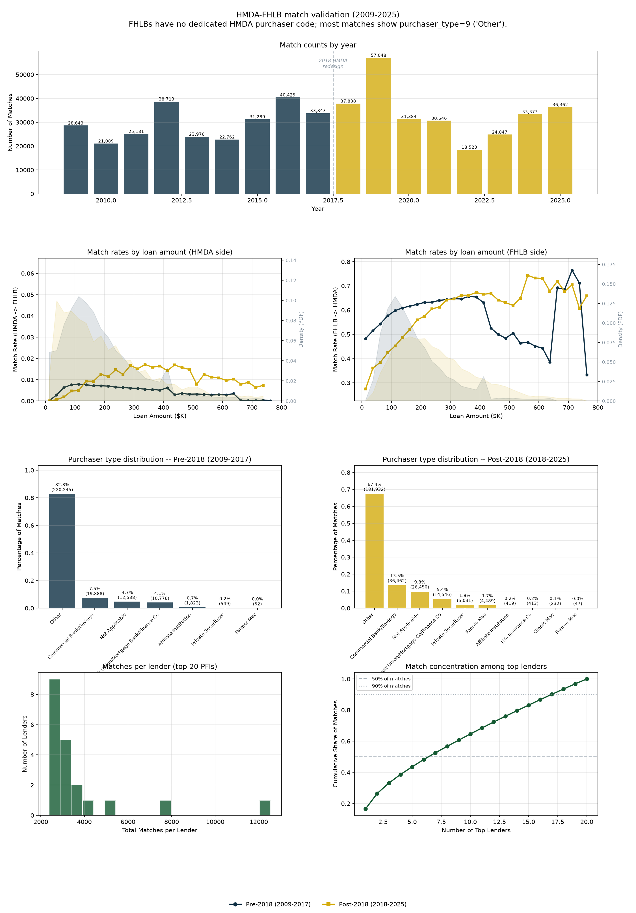

# HMDA-FHLB Matching

This workflow links HMDA loan records to the Federal Home Loan Banks' Acquired Member
Assets (AMA) data: loans FHLB members sold or pledged to their Bank through the MPF, MAP
or MPP programs. Post-2018 rounds 1 and 2 search the originations of identified FHLB
members. Post-2018 round 3 extends the search to non-member correspondents, whose loans
reach a Bank through a member intermediary.

Post-2018 HMDA identifies lenders by LEI; pre-2018 HMDA by `respondent_id` +
`agency_code`. The two eras share one round engine; each has its own rounds and its own
screen, because the pre-2018 AMA file has its own schema.

## Data sources

- HMDA loan application register, post-2018 and pre-2018.
- FHLB AMA acquisition data.
- The Philadelphia Fed's HMDA Lender File (the "Avery file"), whose FHLB flag identifies
  member institutions: the 2018–present file (2018–2025 in the release used) for the
  post-2018 era, the 1990–2017 file for the pre-2018 era.
- FHFA's quarterly FHLBank membership listings (2009 onward), to fill gaps in the Avery flag
  (see *Membership*).

## Method

### Membership

Post-2018 rounds 1 and 2 and the pre-2018 round restrict HMDA candidates to lenders
flagged as FHLB members in a given year. The pre-2018 era uses the Avery flag as it
stands; the post-2018 era supplements it.

The Avery flag is FHFA's membership listing joined on the identifier printed in it (NCUA
charter, FDIC certificate or RSSD). When a credit union converts between a federal and a
state charter, NCUA assigns a new charter number, and FHFA's listings kept printing the
retired number, in some cases for years. FHFA corrected 40 printed charters in its 2026Q1
listing alone. The Avery file misses those members in every year the listing lagged.

A supplement fills the post-2018 Avery gaps from FHFA's listings alone:

1. **Identifier history.** Each identifier reaches every FHFA member id it was ever printed
   with, across all listings from 2009. A number FHFA printed only after correcting its
   listing still identifies the member in earlier years: Blue Federal Credit Union
   (charter 7361) was printed as the transposition 7631 from 2016 through 2026Q1.
2. **Charter aliases.** `schemas/fhlb/member_charter_aliases.csv` lists the NCUA charters
   FHFA never printed for a member: five credit unions whose intermediate charter FHFA
   skipped entirely. Each entry records the evidence: the same RSSD, name and city under
   both charters in NCUA's data, never active at the same time.
3. **Year-end membership.** Of the members an identifier reaches, only those on the
   latest listing of that year count. An LEI-year is linked only when exactly one member
   remains across all its identifiers; the district comes from that listing.

Membership always comes from FHFA's listing for the year; identifiers only establish
which member the lender is. The supplement adds 372 LEI-years (75 LEIs, 43–48 a year) to
the Avery file's 28,610, all of them credit unions; banks' FDIC certificates are stable,
and the supplement finds no bank the Avery flag misses. NCUA's own membership answer
(Call Report `ACCT_896`, not an input) is "member" for 366 of the 367 added LEI-years with
a year-end Call Report (measured 2026-10-21).

### Post-2018 rounds

The rounds are defined in `match_hmda_fhlb/rounds.py` (`ROUNDS_POST2018`, `ROUNDS_PRE2018`),
which is the source of truth; `match hmda-fhlb info` prints them. Each round runs on the loans
earlier rounds left unclaimed, and its `match_round` is its position in the list, so a copied
and edited entry runs as a new last round. Every post-2018 round joins exactly on year
(HMDA activity year, AMA note year), census tract, loan type, units and occupancy, compares
the fields below within its tolerances, and keeps only 1:1 pairs. The HMDA pool is
originations (`action_taken` 1); loans sold to Freddie Mac (`purchaser_type` 3) are
excluded from every round.

| | Round 1 | Round 2 | Round 3 |
|---|---|---|---|
| HMDA pool | FHLB members | FHLB members | all originations |
| Loan amount | same $10,000 bin | ±$15,000 | same $10,000 bin |
| Income | ±$2,500 | ±$5,000 | ±$2,500 |
| LTV | ±1.05 points | ±2.05 points | ±1.05 points |
| DTI | ±1 point | ±2 points | ±1 point |
| Interest rate | ±0.0625 points | ±0.0625 points | ±0.0625 points |
| Term | ±12 months | ±12 months | ±12 months |

Public HMDA reports loan amount as the midpoint of a $10,000 bin. The AMA note amount is
binned the same way, and a note amount on a bin edge is tried in both adjacent bins. A
missing income, rate, term or LTV on either side fails the comparison. DTI is compared
only where HMDA reports it as an exact value (36–49); outside that range HMDA reports a
bracket and DTI does not restrict the pair. Every round also requires a compatible
purpose (an HMDA purchase never pairs with an AMA refinance, nor the reverse) and borrower
sexes that do not contradict (a male HMDA applicant never pairs with a female AMA
borrower 1, and likewise for the co-applicant).

For government loans AMA discloses the LTV of the note with financed fees included, while
HMDA reports the base CLTV. In every round a candidate outside the LTV tolerance still passes
when AMA LTV is within 1.05 points of HMDA CLTV times the program's financed-fee factor: FHA
1.0175 (upfront MIP); VA 1.0215, 1.023, 1.033 or 1.036 (funding fee); USDA 1.01 (guarantee
fee), taking the closest factor for VA.

Round 3 runs round 1's criteria on the leftovers against every HMDA origination. It
reaches correspondent chains (a non-member originates, sells to a member, and the member
delivers to its Bank) and any member the supplement still misses.

FHLB silver `TotalAnnualIncomeAmount` is annual income in every year (FHFA publishes it
monthly from 2019 and silver annualizes it), and the matcher compares it directly with
HMDA's annual income.

### Pre-2018

One round (`ROUNDS_PRE2018`) searches the originations of FHLB members, identified by
`respondent_id` + `agency_code`. Pairs share year, census tract and loan amount (pre-2018
HMDA reports thousands of dollars; the AMA note amount is rounded to match), must agree
on loan type, and must agree on income within ±$1,000. The FHLB district must agree where
AMA reports one, and borrower sexes must not contradict. Loans sold to Fannie Mae, Ginnie Mae or Freddie
Mac (`purchaser_type` 1–3) are excluded before the 1:1 step, so they never count as
rivals. Occupancy is not compared: FHLB and pre-2018 HMDA code it differently. FHLB loan
ids are unique only within a year before 2018, so the acquisition key is (year,
`LoanCharacteristicsID`).

Purpose uses two code spaces. FHLB codes 1 = purchase and 2 = refinance; pre-2018 HMDA
codes 1 = purchase, 2 = home improvement and 3 = refinance. FHLB has no home-improvement
code, so a home-improvement loan a Bank acquired is reported as a refinance: FHLB 1
matches HMDA 1, and FHLB 2 matches HMDA 3 or 2. Of 265,871 pairs, 106,572 are purchases,
150,380 refinance-refinance and 8,919 refinance-home improvement (3.4%).

## Output

`crosswalk/hmda_fhlb/hmda_fhlb_crosswalk_post2018.parquet` and
`hmda_fhlb_crosswalk_pre2018.parquet`:

| Column | Type | Description |
|---|---|---|
| HMDAIndex | String | HMDA loan identifier |
| LoanCharacteristicsID | Int64 | FHLB AMA loan identifier |
| activity_year | Int16 | Pre-2018 only: the year, part of the FHLB key before 2018 |
| match_round | UInt8 | Position of the round in its era's tuple in `rounds.py` (post-2018: 1 members, amount keyed; 2 members, amount under tolerance; 3 open pool; pre-2018: always 1) |

The member lists are written beside them: `hmda_fhlb_lender_crosswalk_post2018.parquet`
(`LEI`, `FHFBID` district code, `Year`; the Avery flag plus the supplement) and
`hmda_fhlb_lender_crosswalk_pre2018.parquet` (`hmprid` respondent id, `code` agency code,
`Year`, `FHLB`, `FHFBID`).

```bash
mortgage-data match hmda-fhlb run                 # both eras
mortgage-data match hmda-fhlb run --no-pre2018 --overwrite
mortgage-data match hmda-fhlb run --step prepare  # prepare the inputs only
mortgage-data match hmda-fhlb run --step match    # match the prepared inputs
mortgage-data match hmda-fhlb validate            # validation figure
mortgage-data match hmda-fhlb info                # rounds and input status
```

`--max-year` (default 2025) is shared by both eras; the pre-2018 matcher also reads FHLB
acquisitions up to it. Re-run with `--overwrite` after every HMDA release so the cleaned
HMDA caches key on the current release.

A lender (LEI) with at least one match in a year is a likely Participating Financial
Institution (PFI) for that year; a threshold on match count or share classifies PFIs.

## Results

### Post-2018 (2018–2025)

FHLB-side rate = matched AMA loans / AMA loans in the acquisition year.

| AMA year | AMA loans | Matched | Rate | Round 1 | Round 2 | Round 3 |
|---|---:|---:|---:|---:|---:|---:|
| 2018 | 65,703 | 35,496 | 54.0% | 32,211 | 436 | 2,849 |
| 2019 | 89,767 | 54,338 | 60.5% | 48,987 | 575 | 4,776 |
| 2020 | 83,106 | 35,185 | 42.3% | 34,013 | 458 | 714 |
| 2021 | 63,890 | 29,564 | 46.3% | 28,421 | 314 | 829 |
| 2022 | 33,018 | 20,144 | 61.0% | 18,578 | 148 | 1,418 |
| 2023 | 34,273 | 24,424 | 71.3% | 23,139 | 186 | 1,099 |
| 2024 | 46,981 | 32,573 | 69.3% | 31,457 | 253 | 863 |
| 2025 | 55,706 | 38,297 | 68.8% | 36,883 | 229 | 1,185 |
| **All** | **472,444** | **270,021** | **57.2%** | 253,689 | 2,599 | 13,733 |

Rounds 1–2 cover 54.2% of AMA loans and round 3 adds 2.9 points. By HMDA activity year
the matched loans are 37,838 (2018), 57,048, 31,384, 30,646, 18,523, 24,847, 33,373 and
36,362 (2025); an FHLB acquisition year can include loans originated the year before.

FHLB members' originations, excluding loans sold to Freddie Mac, are 34–51% of all HMDA
originations (`action_taken` 1) by year, from 33.8% in 2021 to 50.6% in 2018. The rounds
1–2 matches are 0.8% of that member pool (256,288 of 30,408,696): Banks acquire a small
slice of their members' lending.

### Pre-2018 (2009–2017)

265,871 of 441,367 FHLB acquisitions match (60.2%), between 21,089 (2010) and 40,425
(2016) a year.

### Purchaser type

FHLBs have no HMDA purchaser code, so matched originations mostly report
`purchaser_type` 9 (Other):

| `purchaser_type` | Post-2018 | Pre-2018 |
|---|---:|---:|
| 9 Other | 67.4% | 82.8% |
| 6 Commercial bank / savings | 13.5% | 7.5% |
| 0 Not applicable | 9.8% | 4.7% |
| 71 (7 pre-2018) Credit union, mortgage or finance company | 5.4% | 4.1% |

Round 3 pairs differ: 70% report a sale to a bank (`purchaser_type` 6) and 13% to a credit
union or mortgage company (71), against 5% "Other". Correspondents code the sale to the
member intermediary, not to the Bank.

## Validation

`mortgage-data match hmda-fhlb validate` draws match counts by HMDA activity year, match
rates by loan amount (HMDA side and FHLB side) and the purchaser-type distribution of each
era. The dashed line marks the 2018 HMDA redesign; the eras are matched separately and are
not comparable in level. The last row covers post-2018 member lenders (rounds 1–2): matches
per lender and the cumulative share of the top 20 of the 853 lenders with a match.



The two loan-amount panels measure opposite directions. The FHLB side (the share of FHLB
acquisitions that reach a HMDA record) is the coverage measure: post-2018 it rises from
about 27% for the smallest loans to 60–74% above $500K; pre-2018 it peaks near 65% around
$400K and falls above it. The HMDA side (the share of member originations a Bank acquired)
stays under 2%, which reflects FHLB acquisition volume, not match quality. Shading shows
each era's loan density, so the noisy tails can be read against their sample size.

**Borrower age.** Age is not a match key. HMDA reports `applicant_age` in bands (<25,
25–34, …, 75+) and FHLB reports `Borrower1AgeAtApplicationYears` as an integer. Mapping
FHLB ages into HMDA bands over the 266,182 post-2018 pairs with a valid age on both
sides, 99.0% agree exactly and 99.9% within one band:

| HMDA band | Pairs | Exact | Within one band |
|---|---:|---:|---:|
| <25 | 9,455 | 96.4% | 99.8% |
| 25–34 | 70,032 | 98.8% | 99.9% |
| 35–44 | 72,264 | 99.1% | 100.0% |
| 45–54 | 52,186 | 99.1% | 99.9% |
| 55–64 | 37,845 | 99.1% | 99.9% |
| 65–74 | 19,082 | 99.4% | 99.9% |
| 75+ | 5,318 | 99.8% | 99.9% |

The <25 band is lowest because it is open-ended. By round: round 1 99.0% exact (250,576
pairs), round 2 95.1% (2,573), round 3 99.0% (13,033). Round 3 matches round 1 quality;
round 2's looser tolerances cost a few points. For 2025 acquisitions the exact rate is
99.4%.

**Correspondent chains.** 8,919 of round 3's 13,733 originations appear in the HMDA
seller-purchaser crosswalk. Of their 8,933 purchase records, 99.9% were filed by a lender
that was an FHLB member that year, and 88.5% report `purchaser_type` 9, the
member-to-Bank sale.

## Limitations

1. **No FHLB purchaser code.** HMDA has no code for a sale to an FHLB, so match quality
   can be validated only indirectly.
2. **Income field.** `TotalAnnualIncomeAmount` is annual income in every year; FHFA
   publishes it monthly from 2019, and silver annualizes it.
3. **Unmatched ceiling.** 202,423 AMA loans (42.8%) stay unmatched. Measured 2026-10-21,
   84.1% of them share round 1's exact keys (year, tract, amount bin, loan type, units,
   occupancy) with at least one HMDA origination, but no candidate survived the
   tolerances and the 1:1 rule; 2.5% have no HMDA origination even on round 2's keys,
   which drop the amount.
4. **Freddie Mac exclusion.** Originations sold to Freddie Mac are excluded in every round:
   FHLBs have no Freddie pass-through analogous to MPF Xtra, and Freddie-sold originations
   reach the member pool only at the noise rate.
5. **Membership gaps.** A member is missed when FHFA's listing never prints any of its
   identifiers and no alias entry covers it; round 3 catches its loans instead. Credit
   unions whose Call Report claims membership while FHFA's listing does not (a handful a
   year, mostly with only an FHLB line of credit) are treated as non-members.
