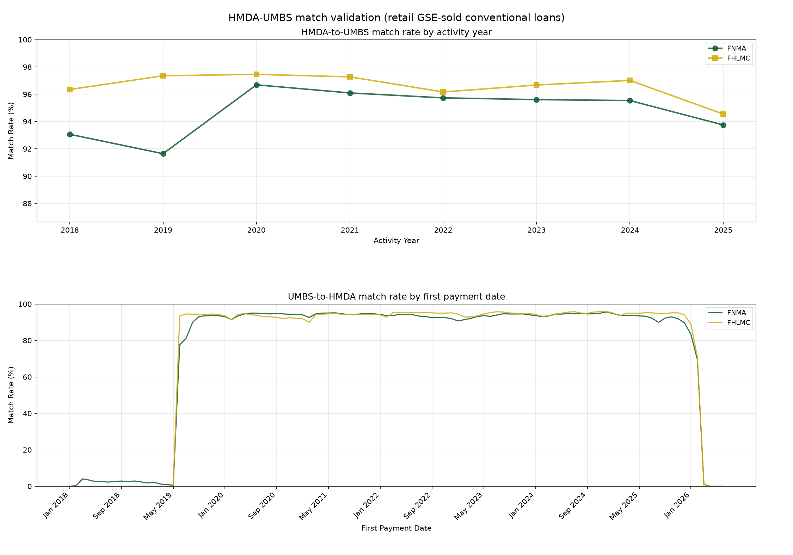

# HMDA-GSE Matching

This workflow links HMDA conventional originations to the Fannie Mae (FNMA) and Freddie Mac
(FHLMC) single-family loan-level records. It reaches the same targets by two routes, and
both are live:

- **The chain** composes three edge crosswalks: HMDA → FHFA PUDB
  ([`hmda_fhfa`](hmda_fhfa_matching.md)), FHFA PUDB → GSE loan-level
  ([`fhfa_mbs`](fhfa_mbs_matching.md)), and GSE loan-level → UMBS
  ([`mbs_umbs`](mbs_umbs_matching.md)). It does no matching of its own.
- **The direct route** matches HMDA straight to the tri-agency `combined/loan_issuance`
  spine, with no FHFA leg. It is a matcher in its own right, with its rounds in `rounds.py`.

Neither route's matching reads the other's output. The direct route reads the chain only
after matching, to label each of its pairs against it. The
[master crosswalk](master_crosswalk.md) takes every chain link and adds the direct links
for loans the chain leaves unlinked. Government loans go through the GNMA edge
([`hmda_gnma`](hmda_gnma_matching.md)).

## How the master uses the two routes

The master's conventional edge (`mbs_loan_id`, `umbs_loan_id`, `agency`) is the chain plus
the direct route's admitted increment. `mbs_source` records which route supplied a link.
In the current master (2018–2025):

| Case | In the master | `mbs_source` | Loans |
|---|---|---|---:|
| The chain links the loan | the chain's link | `chain` | 30,954,522 |
| Only the direct route links the loan, admitted, FHFA corroborates | the direct link | `direct_corroborated` | 556,354 |
| Only the direct route links the loan, admitted, no FHFA link | the direct link | `direct_no_link` | 607,962 |
| The two routes name different targets | withheld, flagged `mbs_contested` | — | 148,046 |

The chain wins every loan it links. A direct pair that names a different target from the
chain's is not adjudicated: the master withholds the conventional link for that loan and
records `mbs_contested` in `conflict_flags` (its default `strict` conflict policy). Direct
increments enter only under the admission rule
([Admission against the chain](#admission-against-the-chain)).

The direct crosswalk's labels describe the chain as it was when the direct route ran, so
the master re-checks every admitted increment against the chain it is building from, and
drops any target that two increments from different activity years claim. In the current
build no increment changed status: all 1,164,316 admitted increments entered.

## Data sources

- HMDA silver, post-2018, activity years 2018–2025.
- **Chain**: the `hmda_fhfa` post-2018 crosswalk, the per-year `fhfa_mbs` crosswalks and
  the `mbs_umbs` crosswalks, one set per enterprise.
- **Direct**: conventional (`loan_type` 1), first-lien HMDA originations, and the GSE rows
  (`agency` FNMA or FHLMC) of `combined/loan_issuance`. That spine coalesces the GSE
  single-family (SF) disclosure with the UMBS issuance file (ILLD), so one target row
  carries ZIP3 and MSA (SF only), an unmasked seller name (ILLD; the SF file reports small
  sellers as "Other", 45.8% of Fannie and 34.9% of Freddie loans originated 2018–2025) and
  an origination quarter.
- **Direct, lender names**: the HMDA transmittal series, the HMDA panel and the Avery
  lender file (`lender_names.build_name_universe`).
- **Direct, geography**: the tract→ZIP3 reference (`core.reference.load_tract_zip3`),
  2019 vintage for activity years through 2021 and 2023 from 2022.
- **Direct, labels only**: the chain crosswalks (for `disposition`) and the `hmda_fhfa`
  crosswalk (for `fhfa_verdict`). Neither enters a key or a score.

Every crosswalk reads one HMDA release per year, which its `HMDAIndex` prefix names: `a`
for 2018–2022, `b` for 2023–2024 and `c` for 2025 in the current crosswalks. Consumers read
the release a crosswalk's own prefixes name (`hmda.load.scan_hmda_for_index`), so a
new HMDA release never mixes vintages between a crosswalk and its denominators.

## Method

### The chain

```
HMDA (origination)
    ↓ HMDAIndex
HMDA-FHFA crosswalk (enterprise_flag: 1 = FNMA, 2 = FHLMC)
    ↓ (record_number, fhfa_year) = (fhfa_record_id, crosswalk year)
FHFA-MBS crosswalks, this activity year through the last built year
    ↓ loan_id = Loan Sequence Number (MBS)
MBS-UMBS crosswalk (left join)
    ↓ Loan Sequence Number (UMBS)
```

For each HMDA activity year the chain reads the FHFA-MBS crosswalks from that year through
the last built year, not the same year only. Loans originated late in a year often reach
an MBS pool the following year, so same-year MBS data alone understates coverage. The
join keys on the FHFA year as well as the record id, because the same FHFA record id
refers to different loans in different years.

The UMBS hop is a left join, so a loan-level link survives where the UMBS hop is missing:
`umbs_loan_id` is null on 132,620 FNMA and 151,631 FHLMC links, 175,000 of them 2018
originations, most of which terminated before UMBS disclosure began in June 2019.

The chain is then made strictly one-to-one: every row whose `HMDAIndex`, `mbs_loan_id` or
(non-null) `umbs_loan_id` appears more than once is dropped, never resolved by a pick.
`match_round` is the `hmda_fhfa` round of the first leg.

### The direct route

The direct route builds a lender bridge, then runs the rounds in `rounds.py` in order over
every activity year, then labels each pair against the chain.

#### Lender bridge

The name-pinned round blocks on the GSE seller name a lender delivers under, reached from
the HMDA loan's LEI through a bridge built before any round runs:

1. **Name entries.** A GSE seller name joins an LEI when it equals a name the transmittal
   series, panel or Avery file gives that LEI, exactly or after a leading `THE` and
   trailing legal-form tokens are stripped from both (stripped names under three
   characters never join). No chain output enters.
2. **Learned entries.** The bridge pass (`BRIDGE_PASS`) matches on characteristics alone
   over the full pool, with the nameless round's settings below. On loans HMDA reports as
   sold to Fannie Mae or Freddie Mac (`purchaser_type` 1 or 3), the originator is the
   delivering seller, so a pass pair shows the name that lender delivers under. For each
   lender-year, a seller name becomes an entry when the lender has at least 25 such pairs,
   the name carries at least 15% of them, and it aligns (exact, stripped, containment or
   first word) with a name the LEI is known by. Every qualifying name is kept, so a
   mid-year rebrand keeps both. Learned entries bind to their year; name entries bind to
   every year. The pass's pairs teach the bridge and are otherwise discarded.

The bridge holds 11,263 entries: 4,240 name entries and 7,023 learned entries over 6,645
lender-years. Most learned entries repeat a name entry for one year; 300 are names the
name entries lack (129 lender–name pairs, 120 LEIs), and those reach rebrands and DBAs
such as New American Funding, PrimeLending and DHI Mortgage. `purchaser_type` selects
which pass pairs teach the bridge. It never enters a key or the score and never decides
whether a pair is accepted.

The bridge is saved beside the crosswalks. `run --saved-bridge` blocks on the saved bridge
instead of building one, which skips the bridge pass.

#### Rounds

The rounds run in order. Each sees only the HMDA loans and targets that earlier rounds
claimed in no activity year, so the name-pinned round wins every loan or target the two
rounds would contest. `match_round` is a round's position in the tuple.

| Round | Lender identity | Characteristic keys | Score floor (of 7) | Cells |
|---|---|---|---:|---|
| bridge pass (not a match) | none | ZIP3, $10k bin, rate, term, purpose, occupancy | 6 | at most 25 candidate pairs |
| 1, name-pinned | seller name via the bridge | the same | 3 | all |
| 2, nameless | none | the same | 6 | at most 25 candidate pairs |

A cell's size is (HMDA loans) × (target loans) sharing every key. The nameless round's cap
and floor keep it to cells small enough to decide: at a floor of 5, its pairs on loans HMDA
reports as sold to a GSE agreed with the chain only 66% of the time (2022, 782 pairs).
Denser cells are skipped, not sampled. Cell size is counted on the full pool, before
earlier claims are removed. Counted on the leftovers, every claim would shrink cells under
the cap, so a copy of the nameless round would add 131,629 pairs; counted on the full
pool, a copy adds 3,315.

**Precedence.** Running the rounds in order, rather than both on the full pool with every
loan they disagree on withheld, lets round 1 keep 23,656 such loans, at 0.960 held-out
borrowers and 0.963 chain concordance (round 1 overall: 0.998 and 0.994), and frees 49,612
nameless pairs a round-1 claim would tie, at 0.991 and 0.994; 149 pairs are lost.

**Pooled exclusivity.** A target claimed in two activity years goes to no one. A later
round never sees a target an earlier round claimed, so the competing claims are always one
round's.

**No state-keyed round.** A round blocking on state instead of ZIP3 over the leftovers adds
130,752 pairs on 2021 at 0.5589 chain concordance and 0.7496 held-out borrower agreement,
against 0.9864 and 0.9948 for the ZIP3 round. On the leftovers the true partner has usually
been claimed already, so it no longer makes a wrong candidate tie, and state-sized cells
give that room to bite.

#### Keys and score

Every key is calibrated on 7.93M chain-verified true pairs (activity year 2021). Agreement
on those pairs:

| Key | Agreement on true pairs | Role |
|---|---:|---|
| Term | 100.00% | hard key |
| ZIP3-derived geography | 99.16% | hard key (every tract→ZIP3 candidate with share ≥ 0.15) |
| Occupancy | 100.00% | hard key (HMDA 1/2/3 → P/S/I, no off-diagonal) |
| $10k amount bin | 97.08% → 100.00% | hard key, with the edge rule below |
| Interest rate at 3 decimals | 99.30% | hard key |
| Origination window | 99.9993% | hard filter (below) |
| Loan purpose, purchase vs not | below | hard key |
| Units | 99.96% | score +1 |
| CLTV within 0.25 / 1 / 5 points | 98.56% within 1 | score 4 / 3 / 1 |
| DTI, rounding-aware window | 97.68% | score +2 (below) |
| Borrowers | 99.66% | held out, never a key |

**Amount-bin edge.** HMDA reports `loan_amount` as the midpoint of a `(low, high]` $10k
interval, while `floor(upb/10000)*10000+5000` bins `[low, high)`. They disagree exactly on
UPBs that fall on a $10k multiple: 231,530 of the 7.93M true pairs, always one bin low,
never high. Emitting the extra low-side candidate for those loans is therefore complete,
not a heuristic, at 2.9% more candidates.

**Origination window.** Origination year equals activity year for 99.33% of true pairs. Of
the 0.67% a year earlier, 99.67% are Q4 originations straddling HMDA's action date and the
GSE's origination date. Admitting the whole prior year lets in 34,581 matches in quarters
with almost no genuine pairs (2020 Q1/Q2/Q3: 6, 38 and 129 true pairs), so the filter
admits only the prior Q4. That needs the fused target's `orig_quarter`; a
first-payment-date proxy smears across the year boundary.

**DTI.** HMDA reports an exact integer in the 36–49 band, and that integer is a floor.
`combined/loan_issuance.dti` is the GSE-published DTI, an integer the GSEs round, so a true
44.6 is HMDA 44 and target 45. The window is `t ∈ {h, h+1}`, with the same +1 slack at
each bucket's upper edge. On true pairs the hit rate rises from 0.68–0.74 under a
half-open `[h, h+1)` window to 0.976, while the +$50k amount-shift placebo barely moves
(0.130 → 0.162). The slack is for a rounded integer target only: the GNMA edge's DTI is
continuous, so that matcher keeps the half-open window, and the two must stay different.

**Purpose stays coarse.** A three-way purchase/refinance/cash-out map leaks: HMDA 31
(refinance) lands on the target's cash-out code for 71,506 true pairs and HMDA 2 (home
improvement) for another 39,587. The purchase split is clean: 377 non-purchase HMDA codes
on a target purchase out of 2.49M.

**Acceptance.** A pair must be the strictly unique maximum score on both sides, at or
above the round's floor. Ties are dropped, not broken.

**Unreachable targets.** A target row needs an origination quarter, a ZIP3 and a real
seller name to enter the join, in every round. Rows with no SF twin (`loan_key_kind`
`umbs_seq`: 1,712,448 FNMA and 245,339 FHLMC, all vintages) carry neither ZIP3 nor
origination quarter. Rows whose seller name is null or still masked have no ILLD record to
supply one.

#### Admission against the chain

Each pair is labelled against the chain:

| `disposition` | Meaning | Pairs, 2018–2025 |
|---|---|---:|
| `agrees` | the chain links the loan to the same target | 25,389,503 |
| `contested_target` | the chain links the loan to a different target | 148,046 |
| `dropped_double_claim` | the chain gave the target to a different HMDA loan, in any year | 135,189 |
| `increment` | the chain left the loan unlinked | 1,283,157 |

**Contested targets** are not reliably adjudicable: most contested pairs are twins on every
held-out field, having matched on the same rate, term, amount bin and geography, so the
separating evidence is spent as keys.
**Double claims** are dropped: one of the two assignments is certainly wrong and nothing
separates them (`run --keep-double-claims` labels them `increment_double_claim` instead).

**Triangulation.** The FHFA pin (the chain's first leg, present even where later legs
failed) corroborates or contradicts each increment (`fhfa_verdict`). The admission rule
(`matching_direct.admitted_row`) takes:

- every `agrees` row;
- a name-pinned increment unless the pin contradicts it;
- a nameless increment only when the pin corroborates it and the target carries a UMBS
  identity. Without a seller name in the key the pin is its only lender-side evidence, and
  corroborated nameless increments on targets with no UMBS identity agree with HMDA's
  borrower count only 25.0% of the time (800 rows), against 99.1% on targets with one.

Of the 1,283,157 increments, 1,164,316 are admitted.

## Output

| File (under `crosswalk/hmda_gse/`) | Grain |
|---|---|
| `hmda_gse_crosswalk_chain_fnma.parquet`, `hmda_gse_crosswalk_chain_fhlmc.parquet` | one row per linked HMDA loan, 1:1 on every id |
| `hmda_gse_crosswalk_direct_{year}.parquet` | one row per direct pair, every disposition kept |
| `hmda_gse_lender_bridge.parquet` | one row per bridge entry: `lei`, `seller_norm`, `year` (null for name entries) |

Chain columns:

| Column | Description |
|---|---|
| `HMDAIndex` | HMDA loan identifier |
| `activity_year` | HMDA activity year |
| `record_number` | FHFA record id |
| `mbs_loan_id` | GSE loan-level id (Fannie loan identifier, Freddie loan sequence number) |
| `umbs_loan_id` | UMBS loan id; null where the UMBS hop missed |
| `match_round` | `hmda_fhfa` match round |

Direct columns:

| Column | Description |
|---|---|
| `HMDAIndex` / `loan_key` | the linked ids (`loan_key` is the combined spine's SF-keyed key) |
| `agency` | FNMA or FHLMC |
| `score` | characteristic agreement, max 7 (borrowers excluded by design) |
| `lei` / `seller_norm` | the HMDA lender, and the bridge name that pinned the match (null for the nameless round) |
| `match_round` / `geo` | 1 name-pinned, 2 nameless; blocking geography (`zip3`) |
| `activity_year` | HMDA activity year |
| `target_umbs` | whether the target carries a UMBS identity |
| `chain_key` | the chain's target for this loan, where it has one |
| `disposition` | `agrees`, `contested_target`, `increment` or `dropped_double_claim` |
| `fhfa_agency` / `fhfa_verdict` | the FHFA pin, and `corroborated`, `contradicted` or `no_link` |

Rejected direct rows are labelled, not deleted, so a consumer can choose its own admission
rule. The bridge pass and the rounds always span every year, whatever years a run writes:
the bridge learns from every year, a target claimed in any year is gone for later rounds,
and pooled exclusivity must see every year that could claim a target. The bridge pass's
pairs are cached under the workflow's data directory.

`run --enrich` also writes, to the workflow's data directory, a chain crosswalk with the
HMDA `lei` and `purchaser_type`, the HMDA panel's `respondent_name`, and the UMBS
`Seller Name` and `Channel`. `run --step lender-crosswalk` reads it to list lender/seller
name pairs that disagree.

```bash
mortgage-data match hmda-gse info                       # inputs, outputs, the rounds tuple
mortgage-data match hmda-gse run                        # both routes, chain first
mortgage-data match hmda-gse run --route chain [--agency fnma|fhlmc] [--enrich]
mortgage-data match hmda-gse run --route direct [--min-year] [--max-year] [--overwrite] [--saved-bridge]
mortgage-data match hmda-gse validate                   # the master's conventional edge, figure
mortgage-data match hmda-gse validate --direct          # direct pairs on held-out fields
mortgage-data match hmda-gse run --step lender-crosswalk [--channel R]
```

## Results

### The chain

| Activity year | FNMA | FHLMC |
|---|---:|---:|
| 2018 | 1,611,357 | 1,166,610 |
| 2019 | 2,042,676 | 1,639,174 |
| 2020 | 4,568,254 | 3,439,435 |
| 2021 | 4,309,223 | 3,704,258 |
| 2022 | 1,681,343 | 1,490,096 |
| 2023 | 897,877 | 870,979 |
| 2024 | 921,181 | 985,890 |
| 2025 | 837,764 | 936,925 |
| Total | 16,869,675 | 14,233,367 |

Against conventional first-lien originations HMDA reports as sold to that enterprise, the
chain links 92.0% of Fannie sales (`purchaser_type` 1) and 92.7% of Freddie sales
(`purchaser_type` 3) to that enterprise. The crosswalks are larger than that denominator
because the chain also reaches GSE acquisitions `purchaser_type` never identifies
(correspondent deliveries, post-year sales).

### The direct route

26,955,895 pairs over 2018–2025: 24,248,595 from the name-pinned round and 2,707,300 from
the nameless round.

| Year | Pairs | Held-out borrowers | Destination | Chain concordance |
|---|---:|---:|---:|---:|
| 2018 | 2,178,639 | 0.9948 | 0.9976 | 0.9943 |
| 2019 | 2,935,059 | 0.9969 | 0.9972 | 0.9959 |
| 2020 | 6,951,219 | 0.9975 | 0.9965 | 0.9911 |
| 2021 | 6,989,736 | 0.9973 | 0.9970 | 0.9917 |
| 2022 | 2,931,014 | 0.9982 | 0.9967 | 0.9986 |
| 2023 | 1,581,499 | 0.9975 | 0.9979 | 0.9986 |
| 2024 | 1,678,219 | 0.9988 | 0.9970 | 0.9983 |
| 2025 | 1,710,510 | 0.9986 | 0.9964 | 0.9984 |

The measures are defined under [Validation](#direct-pairs-on-held-out-fields). The shuffled
borrower floor is 0.504. Of the 26,955,895 pairs, 26,553,819 are admitted rows: every
`agrees` row and 1,164,316 increments.

### Coverage from each side

**HMDA side.** The denominator is the 23,774,398 conventional first-lien originations
2018–2025 that HMDA reports as sold to Fannie Mae or Freddie Mac (`purchaser_type` 1 or 3).
A loan counts as linked if a route links it to either enterprise.

| Year | Known-sold loans | Chain crosswalk | Direct route alone (admitted rows) | Master conventional edge |
|---|---:|---:|---:|---:|
| 2018 | 1,957,058 | 89.91% | 86.77% | 94.51% |
| 2019 | 2,511,051 | 91.32% | 89.88% | 94.44% |
| 2020 | 6,391,879 | 92.79% | 91.75% | 96.63% |
| 2021 | 6,471,279 | 92.61% | 92.45% | 96.40% |
| 2022 | 2,486,921 | 94.26% | 93.74% | 96.42% |
| 2023 | 1,272,637 | 94.47% | 93.90% | 96.66% |
| 2024 | 1,318,111 | 95.05% | 94.39% | 96.91% |
| 2025 | 1,365,462 | 92.34% | 92.61% | 95.19% |
| All | 23,774,398 | 92.69% | 91.85% | 96.07% |

The master links 96.07%: 92.18% through chain links and 3.90% through direct increments.
Its total is below the plain union of the two routes (96.59%) because it withholds the
0.52% of loans whose two routes name different targets. The newest year reads low on both
routes because loans originated late in a year are acquired, and published, the next. On
loans HMDA reports as sold to a GSE the two routes reach nearly the same share; the
difference lies in correspondent loans the originator sold to an aggregator, which the
direct route can reach only through the nameless round
([Limitations](#limitations)).

**Agency side.** The denominator is the 34,213,422 Fannie Mae and Freddie Mac loans
originated 2018–2025 in `combined/loan_issuance`.

| | FNMA | FHLMC | Both |
|---|---:|---:|---:|
| Loans | 18,469,814 | 15,743,608 | 34,213,422 |
| With a direct pair | 80.34% | 76.87% | 78.74% |
| With an admitted direct pair | 79.06% | 75.84% | 77.58% |
| Linked in the master conventional edge | 93.91% | 93.51% | 93.73% |

Part of the gap to the HMDA side is loans whose originator does not report to HMDA, so no
HMDA record exists to match.

## Validation

### The conventional edge

`validate` scores the master's conventional edge: the chain plus the admitted direct
increment, read through the same loader `match master build` uses. The HMDA side is retail
(`submission_of_application` 1) conventional originations HMDA reports as sold to that
enterprise; the UMBS side is each enterprise's ILLD loans by first payment date. A direct
link whose UMBS hop missed counts on the HMDA side only.

HMDA side, from `validate` (run 2026-10-21):

| Year | FNMA | FHLMC |
|---|---:|---:|
| 2018 | 93.07% | 96.35% |
| 2019 | 91.65% | 97.36% |
| 2020 | 96.69% | 97.46% |
| 2021 | 96.10% | 97.28% |
| 2022 | 95.73% | 96.17% |
| 2023 | 95.61% | 96.68% |
| 2024 | 95.54% | 97.01% |
| 2025 | 93.75% | 94.55% |

On the UMBS side the rate holds between about 90% and 96% for both enterprises from June
2019, when ILLD begins, through late 2025. Before June 2019 ILLD holds only loans pooled
late, a few thousand a month, and under 5% of them match; the right edge falls away after
the last first-payment months that 2025 originations reach. Neither end is a matching
failure.



### Direct pairs on held-out fields

Three measures, none a matcher input: held-out borrower count, destination
(`purchaser_type` against the matched agency) and chain concordance. Destination is the
only one that works on increment rows, which have no chain pair, so `purchaser_type` must
never be a key.

Increment cells, pooled 2018–2025 (benchmark: chain-confirmed `agrees` rows at 0.9983
borrowers and 0.9973 destination):

| Round | FHFA verdict | Rows | Admitted | Held-out borrowers | Destination |
|---|---|---:|---:|---:|---:|
| 1 | corroborated | 544,418 | 544,418 | 0.9943 | 0.9973 |
| 1 | no link | 607,962 | 607,962 | 0.9946 | 0.9966 |
| 1 | contradicted | 1,182 | 0 | 0.8384 | 0.5900 |
| 2 | corroborated | 12,736 | 11,936 | 0.9440 | 0.8815 |
| 2 | no link | 116,729 | 0 | 0.9836 | 0.7814 |
| 2 | contradicted | 130 | 0 | 0.6846 | 0.0290 |

The admitted nameless rows (round 2, corroborated, with a UMBS identity) agree on
borrowers at 0.991. The excluded nameless no-link cell agrees on borrowers at 0.984 but on
destination only 0.781: without a name pin or an FHFA pin, nothing confirms the agency.
The `agrees` cell is 100% corroborated by construction (a chain link implies an FHFA leg
naming the enterprise whose crosswalk supplied the target), so it carries no evidence;
only the increment cells do.

### Seller names on the chain

The enriched chain crosswalks (`run --enrich`) put the HMDA panel name of the originating
LEI beside the UMBS seller name. They join the panel of the activity year (2023 for later
years), because a single recent panel turns every rename into a mismatch. Seller-name
agreement is a check on the chain, never a match key. Agreement after normalization
(`lender_seller_crosswalk.normalize_name`: lowercase, leading "the" and punctuation
removed, abbreviations expanded, suffixes such as llc, bank and mortgage stripped), and
with a shared first word also counted, measured 2026-10-21:

| UMBS channel | FNMA links | Normalized | + first word | FHLMC links | Normalized | + first word |
|---|---:|---:|---:|---:|---:|---:|
| Retail (R) | 10,624,058 | 89.0% | 95.1% | 7,857,470 | 90.5% | 95.4% |
| Broker (B) | 2,174,257 | 71.0% | 92.7% | 2,016,090 | 69.7% | 94.6% |
| Correspondent (C) | 3,928,935 | 15.3% | 18.5% | 4,208,176 | 12.8% | 16.0% |

Rates are over links with both names present. In the correspondent channel the HMDA
originator and the UMBS seller are different institutions by construction, so disagreement
is expected. Retail mismatches are mostly benign: DBA names ("Broker Solutions" against
"Broker Solutions Inc. DBA New American Funding"), dropped suffixes ("Idaho Central"
against "Idaho Central Credit Union"), mergers, affiliates and rebrands ("Quicken Loans"
against "Rocket Mortgage"). `run --step lender-crosswalk` lists the frequent retail pairs
that disagree, classified by connection type.

The Federal Home Loan Bank of Chicago is the Fannie seller on 107,479 chain links (0.64%),
through its MPF program; no FHLB seller appears on the Freddie side. See
[`hmda_fhlb_matching.md`](hmda_fhlb_matching.md) for the FHLB-side view.

## Limitations

1. **Conventional GSE loans only.** Government loans go through the GNMA edge.
2. **The newest activity year is understated** on both routes until the next year's
   agency files publish, because loans originated late in a year are acquired, and
   published, the next.
3. **`purchaser_type` denominators count directly reported sales only.** Correspondent
   deliveries are reported by the aggregator and post-year sales are not reported, so a
   coverage rate against them is not a rate against all GSE acquisitions.
4. **The chain inherits its first leg's ceiling.** A loan the annual, lagged FHFA PUDB
   never reaches is lost to the chain however good the later legs are; the direct route
   exists to reach those loans.
5. **The fused target inherits `mbs_umbs` error.** `combined/loan_issuance` joins the SF
   and ILLD records with a matched crosswalk, not a deterministic key, so a wrong join puts
   the wrong ZIP3 and origination quarter on a target row.
6. **Contested targets are withheld, not solved.** An adjudicator would need a field held
   out from both routes; ZIP3 would serve but is a key here.
7. **Aggregator deliveries reach the direct route only through the nameless round.** The
   agency record names the aggregator, while the HMDA origination sits under the
   correspondent's LEI, so no bridge entry can pin them. The nameless round reaches them
   only in sparse cells, and its increments enter the master only when FHFA corroborates
   them. The chain reaches this population without seller names, which is most of why the
   union beats the direct route alone.
8. **FHFA-corroborated increments without a UMBS identity are weak.** Name-pinned ones
   (5,022 admitted) agree on borrowers 62.5% of the time, against 96.0% for no-link
   increments without one (2,914 rows, both rounds). The cause is not yet diagnosed; the rows stay
   admitted and are visible through `target_umbs`.
9. **A crosswalk can be stale against its own inputs.** The chain is composed from three
   crosswalks and is not rebuilt when they are, and nothing warns when they have been.
   Compare mtimes before trusting a count.
