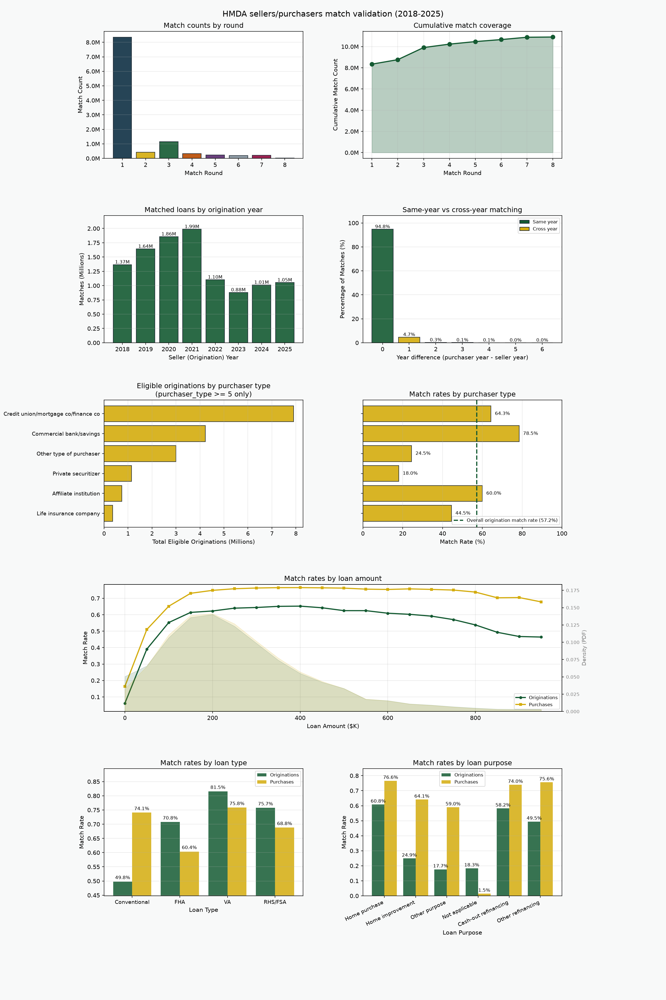

# HMDA Sellers-Purchasers Matching

When a lender originates a loan and sells it to another HMDA filer, the loan appears twice
in HMDA: once as an origination (`action_taken = 1`) and once as a purchase
(`action_taken = 6`). This workflow links the two records, which traces loan sales,
disposition timing and originator–purchaser relationships.

The legacy (2007–2017) and expanded (2018 on) HMDA releases carry different columns and
code spaces, so each era has its own matcher and its own crosswalk. Everything up to
*The 2007–2017 era* describes the post-2018 matcher, which runs eight rounds over
2018–2025.

## Data sources

Post-2018 HMDA LAR silver, one release per activity year: the most mature on disk (`a`
three-year, then `b` one-year, then `c` snapshot, then `e` modified LAR). The current
crosswalk reads `a` for 2018–2022, `b` for 2023–2024 and `c` for 2025.

The seller side is originations (`action_taken = 1`) not reported as sold to Fannie Mae,
Ginnie Mae, Freddie Mac or Farmer Mac (`purchaser_type` 1–4), since those buyers file no
HMDA purchase record. Originations reported as not sold in the year (`purchaser_type = 0`)
stay in, because a loan sold the following year still has a purchase record to find. The
purchaser side is every purchase record (`action_taken = 6`).

Purchase records carry far fewer usable attributes than originations. The underwriting and
risk fields are empty or sentinel-filled on the purchaser side, so they cannot
discriminate and are not used as keys:

| Field group | On purchaser records |
|---|---|
| `combined_loan_to_value_ratio`, `debt_to_income_ratio`, `rate_spread`, `prepayment_penalty_term` | ~99.5% null (Not Applicable), the rest `-99999` (Exempt) |
| `applicant_credit_score_type`, `co_applicant_credit_score_type`, `aus_1`, `denial_reason_1`, `submission_of_application`, `initially_payable_to_institution` | one real code plus `1111` (Exempt) |
| `aus_2`–`aus_5`, `denial_reason_2`–`denial_reason_4` | 100% null |
| `preapproval` | single value (`2`, not requested) |

The rounds therefore key on structural fields populated on both sides (`loan_type`,
`loan_amount`, `census_tract`, `occupancy_type`, `loan_purpose`), plus fees and
demographics.

## Method

### Preparation

The `9999`, `8888`, `1111` and `-99999` sentinels are replaced with null in the numeric
fields (income, property value, rate, term, fees and the product flags; not
`loan_amount`). Records with a null key or a blank tract are dropped. Connecticut tracts
are mapped to the planning-region convention HMDA adopted in 2024, so a cross-year pair
that straddles the change can still join. Amounts, income and fees are in dollars, as
HMDA silver reports them; `interest_rate` is in percentage points.

### Match criteria

Each round is an entry in `ROUNDS_POST2018` in `rounds.py`. A round loads only the records
no earlier round matched, joins sellers to purchasers on its match columns, and then
screens the candidate pairs:

- **First-pass tolerances**: the largest seller–purchaser gap allowed per column, applied
  right after the join. A tolerance of 0 means the column must agree. A null on either
  side passes.
- **Demographics**: applicant and co-applicant age, sex, race and ethnicity must be
  compatible.
- **Fees** compare `discount_points`, `lender_credits`, `origination_charges`,
  `total_loan_costs` and `total_points_and_fees`. *Strict* requires the same column to
  match exactly in at least one case; *generous* lets any fee column match any other.
  Either way, a pair passes when one side reports no fees at all.
- **Weak rate tolerance** (rounds 1–5): a candidate whose rate gap exceeds 0.01 is dropped
  when both its seller and its purchaser have an exact-rate candidate elsewhere.
- **Uniqueness** is either one-to-one (every seller and every purchase record has exactly
  one surviving candidate; ambiguous ones are all dropped) or one-to-many. One-to-many
  still requires each purchase record to have exactly one candidate, but lets an
  origination keep two when at least one of the purchasers reports selling the loan on
  (`purchaser_type_p` ≥ 5). That is what records a loan resold down a chain of buyers:
  each owner files its own purchase record, and both are kept.
- **Post-resolution tolerances**: a second, usually wider set of checks after uniqueness.
  In rounds 1, 2 and 5 they drop the failing pair; in the others they drop every pair of
  an origination if any of its pairs fails.

Rounds 1, 2 and 5 check demographics after uniqueness and apply the weak rate tolerance
before the fee step. The other rounds check demographics before the fee step, to shrink the
candidate set before the expensive steps, and (rounds 3 and 4) apply the weak rate
tolerance after it.

### Rounds

All rounds join on `loan_type`, `census_tract` and `occupancy_type`, and all but round 5
on the exact `loan_amount`. *Cross* rounds pool 2018–2025 and keep pairs with seller year
≤ purchaser year; *same* rounds run one activity year at a time.

| Round | Further keys | Years | First-pass tolerances | Fees | Uniqueness | Post-resolution and other filters |
|---|---|---|---|---|---|---|
| 1 Same-year exact | `loan_purpose`, `activity_year` | same | income $1,000, rate 0.0625 | strict | 1:1 | strict set¹; cleanup² |
| 2 Cross-year strict | `loan_purpose` | cross | as round 1 | strict | 1:1 | strict set¹ with rate 0.01; cleanup² |
| 3 Secondary sales | `loan_purpose` | cross | as round 1 plus product fields³ | generous | 1:many | loose set⁴ |
| 4 Without loan purpose | `i_Purchase` | cross | as round 3 | generous | 1:many | loose set⁴; refinance rule⁵ |
| 5 Loan-amount tolerance | `i_Purchase`, `activity_year` (no `loan_amount`) | same | as round 1 plus `loan_amount` $10,000 | strict | 1:1 | strict set¹ without income and rate; cleanup²; seller amount ≥ purchaser amount; `purchaser_type_p` 0–4 |
| 6 Exclude portfolio/NA | `i_Purchase` | cross | as round 3 without income | generous | 1:many | income $2,000, rate 0.01, property value $30,000, term 12 months; refinance rule⁵; drops originations with `purchaser_type` 0 or 9; zero fees and income read as missing |
| 7 Minimal + fee requirement | `i_Purchase` | cross | rate 0.0625, `total_units` equal | counted only | 1:1 | ≥ 1 exact fee match; rate 0.01, term 12 months; no demographics; refinance rule⁵; drops `purchaser_type` 0 and 9; zeros read as missing |
| 8 Purchaser-type constrained | `i_Purchase` | cross | as round 6 | generous | 1:many | income $1,000, rate 0.01, property value $10,000, term equal; refinance rule⁵; quality filters⁶; lender-pair constraint⁷ |

¹ Strict set: income $1,000, rate 0.0625, property value $20,000, loan term 12 months,
`discount_points`, `lender_credits` and `origination_charges` within $5,
`intro_rate_period` within 6 months, and equal `conforming_loan_limit`,
`construction_method`, `lien_status`, `open_end_line_of_credit`, `total_units` and
applicant and co-applicant age-above-62 flags.

² Cleanup: drops every pair of an origination if any of them has a rate gap of 0.005 or
more, or the origination lacks income, rate or property value.

³ Product fields: equal `conforming_loan_limit`, `construction_method`, `lien_status`,
`open_end_line_of_credit` and `total_units`; `intro_rate_period` within 6 months.

⁴ Loose set: income $1,000, rate 0.0625, property value $20,000, loan term 12 months.

⁵ Refinance rule: the two `loan_purpose` codes must agree unless either is a refinance
(31 or 32). `i_Purchase` (home purchase or not) replaces `loan_purpose` as the key from
round 4 on, so a loan whose purpose code differs between the two filings can still match.

⁶ Quality filters: where a seller or purchase record has a candidate with two or more
exact fee matches, its candidates without a generous fee match are dropped; likewise for a
rate within 0.001 and an exact income.

⁷ Lender-pair constraint: from rounds 1–7, the cells of (seller LEI, purchaser LEI, year,
seller `purchaser_type`) holding at least 50 matched loans and at least 99% of that lender
pair-year's matches. A candidate passes if it falls in one of those cells or the seller
reported the loan as not sold.

Rounds must run in order: each excludes earlier matches, and round 8 reads the lender-pair
relationships rounds 1–7 found. `mortgage-data match hmda-sellers-purchasers info` prints
both eras' round tuples.

## Output

Both eras write the same schema:

| Column | Type | Description |
|---|---|---|
| HMDAIndex_s | String | Seller (origination) loan identifier |
| HMDAIndex_p | String | Purchaser loan identifier |
| activity_year_s | Int16 | Origination year |
| match_round | UInt8 | Round that produced the pair |

Each era is a dataset hive-partitioned by `match_round` then `activity_year_s`, under
`crosswalk/hmda_sellers_purchasers/hmda_sellers_purchasers_crosswalk_post2018/` and
`…_crosswalk_pre2018/`. Every `HMDAIndex` embeds the release it was numbered under
(`2023b_…`), so join the crosswalk back to HMDA through `hmda.load.scan_hmda_for_index`,
which reads exactly those releases. The purchase year is the first four characters of
`HMDAIndex_p`; lender identifiers come from that join.

```bash
mortgage-data match hmda-sellers-purchasers info               # rounds, inputs, outputs present
mortgage-data match hmda-sellers-purchasers run --overwrite    # all eight rounds, post-2018
mortgage-data match hmda-sellers-purchasers run --round 3 --overwrite   # one round
mortgage-data match hmda-sellers-purchasers validate           # report and validation figure
```

Both eras skip a round already built; `--overwrite` rebuilds it, deleting only that
round's partitions for the years being run. Rerunning one post-2018 round leaves later
rounds' partitions as they were, so rerun every round after it too.

## Results

| Round | Pairs | Share | Cumulative |
|---|---:|---:|---:|
| 1 Same-year exact | 8,344,008 | 76.5% | 76.5% |
| 2 Cross-year strict | 423,828 | 3.9% | 80.4% |
| 3 Secondary sales | 1,143,680 | 10.5% | 90.9% |
| 4 Without loan purpose | 321,849 | 3.0% | 93.9% |
| 5 Loan-amount tolerance | 239,772 | 2.2% | 96.1% |
| 6 Exclude portfolio/NA | 189,708 | 1.7% | 97.8% |
| 7 Minimal + fee requirement | 220,321 | 2.0% | 99.8% |
| 8 Purchaser-type constrained | 20,165 | 0.2% | 100.0% |
| Total | 10,903,331 | | |

Round 1 carries most of the crosswalk and round 3 is second; the five relaxed rounds
together add under 10 points.

The crosswalk is not 1:1. Rounds 3, 4, 6 and 8 are one-to-many, so a loan resold more than
once carries one row per hop: 10,724,256 originations appear across the 10,903,331 rows,
and 179,075 of them carry two purchase records. Each purchase record maps to exactly one
origination, and no record appears in more than one round.

Two rates are reported, and they are not interchangeable:

- **Purchase match rate, 70.6%:** the share of the 15,454,290 purchase records that find a
  matching origination.
- **Origination match rate, 57.2%:** the share of the 17,381,590 originations reported as
  sold to a non-agency purchaser (`purchaser_type` ≥ 5) that find a matching purchase.
  Agency sales (`purchaser_type` 1–4) are matched by the dedicated GSE and Ginnie Mae
  workflows, not here.

The 783,333 pairs (7.2%) whose origination was reported as not sold
(`purchaser_type = 0`) count toward the purchase rate but sit outside the origination
rate's denominator.

## Validation



The figure, from `mortgage-data match hmda-sellers-purchasers validate`, shows match counts by
round and cumulative coverage; matches by origination year and same-year versus
cross-year; eligible originations and match rates by purchaser type; match rates by loan
amount; and match rates by loan type and loan purpose. Figures measured 2026-10-21.

**Timing.** Matched volume follows the market rather than holding flat: 1.37M in 2018,
1.99M in 2021 at the refinancing peak, 0.88M in 2023, and about 1.05M in 2024–2025. Read
per-year rates against that; a pooled figure mixes a refi boom with a purchase market.
94.8% of matches are same-year, 4.7% land one year later and 0.5% later still. A sale late
in the year lands in the next year's purchase file, so the spread reflects HMDA reporting.
Negative year differences are impossible by construction, and none appear.

**Purchaser type** (origination match rate):

| Purchaser type | Eligible originations | Rate |
|---|---:|---:|
| Commercial bank/savings | 4,225,877 | 78.5% |
| Credit union/mortgage co/finance co | 7,907,179 | 64.3% |
| Affiliate institution | 739,621 | 60.0% |
| Life insurance company | 359,735 | 44.5% |
| Other type of purchaser | 3,001,787 | 24.5% |
| Private securitizer | 1,147,391 | 18.0% |

The two lowest categories are the ones whose buyer is least likely to file its own HMDA
purchase record, so their rates reflect reporting coverage rather than match quality.
Purchaser-stratified work needs weighting.

**Loan amount.** Both sides climb steeply below $150K and plateau through the bulk of the
distribution. Above that the purchase side holds near 75% out to $800K, while the
origination side peaks around 65% near $350K–$400K and falls to about 46% by $950K: larger
loans are more often held or sold outside HMDA's reporting scope, which only the
origination side sees.

**Loan type and purpose:**

| | Origination side | Purchase side |
|---|---:|---:|
| Conventional | 49.8% | 74.1% |
| FHA | 70.8% | 60.4% |
| VA | 81.5% | 75.8% |
| RHS/FSA | 75.7% | 68.8% |
| Home purchase | 60.8% | 76.6% |
| Cash-out refinancing | 58.2% | 74.0% |
| Other refinancing | 49.5% | 75.6% |
| Home improvement | 24.9% | 64.1% |
| Other purpose | 17.7% | 59.0% |
| Not applicable | 18.3% | 1.5% |

The origination side measures whether a reported sale reaches a buyer that files a
matching purchase record, and that varies by disposition. Conventional loans sold to
`purchaser_type` ≥ 5 are the most likely to reach a non-filer, hence 49.8% against 74.1%;
VA matches best on both sides. Refinances trail home purchases by 3–11 points on the
origination side, and home-improvement and other-purpose loans, more often held in
portfolio, match far worse. The purchase side is flat across purposes except `Not
applicable` at 1.5%: those records carry no usable purpose.

## Limitations

1. **Filer-level data defects.** A filer whose records are degenerate in the preferred
   release goes unmatched for the whole year, even when another release of that year is
   clean. These filer-years are not repaired in production; the lost pairs are accepted.
   Signatures measured on the post-2018 silver 2026-10-21:

   | Filer (LEI) | Year | Defective release | Signature | Clean release |
   |---|---|---|---|---|
   | Lakeview Loan Servicing (`549300NOCASXPA34X033`) | 2018 | `a` | 99.8% of 91,229 records carry `loan_amount = 5000`, the midpoint of the lowest published bucket — amounts filed in thousands | `c` |
   | Lakeview Loan Servicing (`549300NOCASXPA34X033`) | 2022 | `a`, `b` | `census_tract` and `county_code` null on all but one of 137,094 records | `c` |
   | Network Funding (`254900QRD0ZXHH08TX87`) | 2021 | `a` | `census_tract` and `county_code` 100% null, `interest_rate` and `property_value` Exempt (−99999) on every record (13,009 records) | `b`, `c` |

   Neither signature can form the match key, so these filer-years match at ~0%. A scan of
   2018–2025 found no other filer-year whose preferred release has an unusable key while
   another release has a usable one: 3 filer-years, 171,726 records, 95% of them Lakeview.
   Reading the clean release would recover roughly 100,000 purchase-side pairs (123,809
   usable purchase records, 100,325 with an unconsumed counterpart that passes the round
   gates). Lakeview's other years are unaffected; its 2019 records are identical across all
   three releases.

   To repair these for an analysis, drop the filer's rows from the preferred release for
   each `(lei, activity_year)` above, read them from the clean release, and rerun the
   matcher. The recovered pairs carry the clean release's `HMDAIndex` values (`2018c_…`),
   so they resolve through `hmda.load.scan_hmda_for_index` but do not join to crosswalks
   built on the preferred release.

2. **GSE cash-window sales coded as non-agency sales.** Some filers code loans sold for cash
   directly to Fannie Mae or Freddie Mac as sales to a credit union or mortgage company
   (`purchaser_type=71`), a life insurer (`72`), a bank (`6`) or "other" (`9`) instead of
   `1`/`3`, consistently across years. The GSE files no HMDA purchase record, so these loans
   cannot match and sit in the origination-side denominator. At least 277,391 unmatched
   affirmative-sale originations reach a multi-lender GSE pool (through the `hmda_gse`
   chain) delivered by the originator itself: the loan's UMBS seller name is one of the
   originator's names, matched through the HMDA-GSE lender bridge. Counting deliveries under
   a sibling entity's name (a seller name sharing the originator's distinctive first word)
   gives 302,090. The convention is concentrated in 843 LEIs, the top 10 holding 50.7%.
   Excluding the class lifts the origination-side rate from 57.24% to 58.17%, or 58.25% with
   sibling-entity deliveries (measured 2026-10-22).

3. **Buyers that do not report HMDA.** A purchaser that does not originate files no HMDA,
   so its purchases are invisible. The largest case is PennyMac Corp, seller of record on
   ~975,538 GSE-delivered loans: its HMDA-reporting affiliate files for a different, mostly
   government-insured book, and 1.7% of those loans find a counterpart. No matcher change
   reaches these.

## The 2007–2017 era

The legacy release has no interest rate, loan term or fee columns, so the post-2018 rounds
have nothing to work with. This era has its own two-round matcher (`ROUNDS_PRE2018` in
`rounds.py`, run by `matching_pre2018.py`) and its own crosswalk.

### Data sources

The legacy silver era (`silver/loans/period_2007_2017`, 47 columns), most mature release per
year: `file_type=d` for 2007–2016 and `file_type=a` for 2017. The universe is purchases
(`action_taken = 6`) plus originations (`action_taken = 1`) not reported as sold to Fannie
Mae, Freddie Mac, Ginnie Mae or Farmer Mac (`purchaser_type` outside 1–4), since a loan
sold to an agency has no HMDA-filing purchaser to match.

| Year | Originations | In matching universe | Purchases |
|---|---:|---:|---:|
| 2007 | 10,441,545 | 7,925,262 | 4,781,414 |
| 2008 | 7,177,262 | 4,633,484 | 2,921,821 |
| 2009 | 8,950,936 | 5,081,496 | 4,294,528 |
| 2010 | 7,863,337 | 4,743,541 | 3,229,010 |
| 2011 | 7,095,262 | 4,226,216 | 2,944,662 |
| 2012 | 9,783,966 | 5,002,713 | 3,167,577 |
| 2013 | 8,706,657 | 4,406,208 | 2,794,414 |
| 2014 | 6,039,826 | 3,365,210 | 1,796,613 |
| 2015 | 7,404,258 | 3,956,567 | 2,102,036 |
| 2016 | 8,377,907 | 4,313,378 | 2,231,990 |
| 2017 | 7,372,565 | 4,114,216 | 2,089,157 |
| 2007–2017 | 89,213,521 | 51,768,291 | 32,353,222 |

### Match keys

Amounts and income are in dollars, as HMDA silver reports them. The tolerances are written
in thousands, the raw files' unit, and scaled by `DOLLARS_PER_THOUSAND` in `rounds.py`;
the missing-income code is 9,999 thousand and passes every income check.

Both rounds share one sequence: join, income within $5,000, a different lender
(`respondent_id` or `agency_code`), one-to-one uniqueness, agreement on applicant and
co-applicant sex, race and ethnicity (each allowing the "not available" codes), a tight
income check, purchaser `purchaser_type` at most 4 (the purchaser kept the loan or sold it
to an agency, not on to another filer), and the round's own filters.

**Round 1, same-year with a binned amount.** Joins within one activity year on
`loan_type`, `census_tract`, `occupancy_type`, `loan_purpose` and a $10,000 loan-amount
bin; a seller in a bin's lower half is also offered to the bin below, so a pair straddling
a bin edge can still meet. The tight income check is exact equality. Its own filters: the
seller's amount equals the purchaser's or exceeds it by exactly $1,000, the seller reported
a sale (`purchaser_type` above 0), and `property_type` agrees.

**Round 2, exact amount across the year boundary.** Drops every record round 1 paired and
joins on exact `loan_amount` with `loan_type`, `census_tract`, `occupancy_type`,
`property_type` and `loan_purpose`, pooled across the era. The purchase may fall in the
origination year or the next. The tight income check is $1,000. Its own filter is a year
rule: a same-year pair needs a seller that reported a sale (`purchaser_type` above 0), a
next-year pair one that did not. The exact amount key is what lets this round resolve
pairs round 1 dropped as ambiguous.

### Running it

```bash
mortgage-data match hmda-sellers-purchasers run --era pre2018                    # both rounds
mortgage-data match hmda-sellers-purchasers run --era pre2018 --round 1 --overwrite
mortgage-data match hmda-sellers-purchasers run --era pre2018 --min-year 2010 --max-year 2012
```

```python
from mortgage_data_manager.matching.match_hmda_sellers_purchasers import (
    run_matching_pre2018,
    run_round_pre2018,
)

counts = run_matching_pre2018()                  # pairs written per round
pairs = run_round_pre2018(1, min_year=2010, max_year=2012, overwrite=True)
```

Both return pair counts, skip a round whose partition exists unless `overwrite=True` (which
deletes only that round's partition), and take their default paths from
`HMDASellersPurchasersMatchingConfig` (`HMDA_SILVER_DIR_PRE2018`, `MIN_YEAR_PRE2018`,
`MAX_YEAR_PRE2018`, `get_crosswalk_dir("pre2018")`). Round 2 reads round 1's partition and
refuses to run without it.

### Results

| Round | Pairs |
|---|---:|
| 1 Same-year, binned amount | 6,375,603 |
| 2 Exact amount, across the year boundary | 5,325,611 |
| Total | 11,701,214 |

Unlike the post-2018 crosswalk, this one is 1:1: zero duplicate sellers, zero duplicate
purchasers and zero cross-round overlap.

It matches 22.6% of the 51.77M originations in the matching universe (13.1% of all 89.21M
originations) and 36.2% of the 32.35M purchase records. Round 2 is 94.3% same-year; only
305,603 of its pairs cross the year boundary, so its yield comes from the exact amount key
rather than the wider year window.

### Validation

Every pair has a seller `lien_status` of 1, 2 or 3 (a real lien) and a purchaser
`lien_status` of 4 ("not applicable, purchased loan"), the direction the crosswalk claims,
on a field the matcher never reads. Demographic agreement on matched pairs is about twice
that of random re-pairings within the same tract and year (`co_applicant_sex`: 63.6%
against 30.8% in round 1, 53.6% against 27.1% in round 2; measured 2026-10-21). It is not
higher because the demographic filters admit the "not available" codes on either side.

This era has almost no other held-out field. Of the 47 columns, those the matcher does not
use are near-degenerate (`hoepa_status` is one value for 99.98% of records, `preapproval`
for 87%), almost entirely null (`rate_spread`, `applicant_race_2`, `edit_status`), or
implied by `census_tract` (`county_code`, `state_code`, `msa_md`, the tract demographic
columns). The post-2018 era can be checked against rate, term and fees; this one cannot, so
its pairs are less strongly evidenced even though they are 1:1. `validate` covers the
post-2018 crosswalk only.
