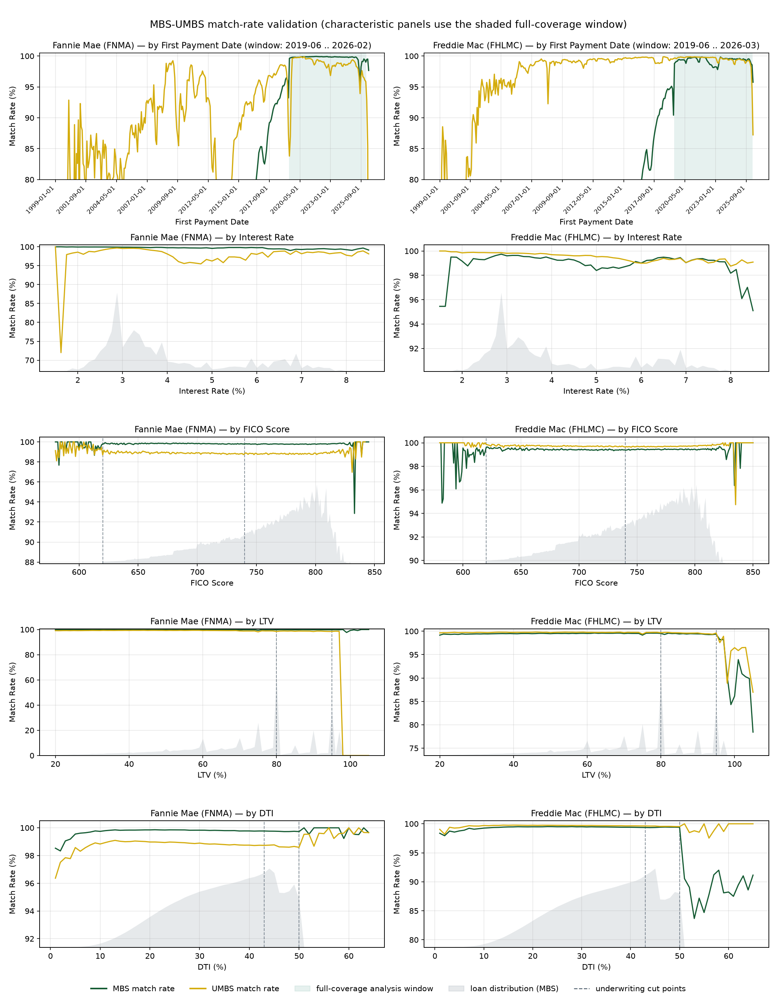

# MBS-UMBS Matching

This workflow links each GSE's single-family loan-level release (the MBS side) to the
loan-level disclosure of the UMBS pools those loans sit in (the UMBS side), for Fannie Mae
(FNMA) and Freddie Mac (FHLMC). A matched pair joins a loan's credit and performance
history to its security.

The UMBS side uses only the public ILLD and monthly disclosure files. Field-level
comparison suggests their loan identifiers are the ones used in commercial eMBS datasets,
but no commercial data is involved.

## Data sources

**MBS side**

- FNMA `silver/issuances`: the quarterly single-family files, including the non-standard
  Exclusion files (`2000Q1EXCL`–`2020Q3EXCL`; 15.7M loans, 448,602 matched). Exclusion
  matches cluster in recent quarters. Seasoned bulk acquisitions mostly never entered a
  UMBS pool, so the 2019Q3 bulk quarter matches only 16.5%.
- FNMA `silver/harp`: the HARP/Refi Plus population, which Fannie publishes separately
  from the quarterly files. 1,035,452 no-cash-out refinances, with no loan ids in common
  with `silver/issuances`. Included by default; `--no-harp` leaves it out.
- FHLMC `silver/origination`, including the non-standard `excl` set.

**UMBS side**

- ILLD (`FNM_ILLD`, `FRE_ILLD`): issuance disclosure, starting June 2019 with UMBS.
- The first monthly snapshot (`MLLD_201906` for FNMA, `FU_201906` for FHLMC): every loan
  outstanding in a UMBS-eligible pool in June 2019. It is the only route to loans pooled
  before ILLD began. `--no-snapshot` leaves it out.

## Method

### Preparation

1. Drop loan modifications (Loan Purpose `M`) from both UMBS sources. This runs before the
   snapshot is combined with ILLD. A modified pre-2019 loan reappears in ILLD as a
   purpose-`M` reissue under the same Loan Identifier. If that row were still present, it
   would remove the loan's original snapshot row, which is the only one that can match.
2. Combine the UMBS sources: all of ILLD, plus every snapshot loan whose Loan Identifier
   is not in ILLD. Identical duplicate disclosures collapse to one row. Duplicates that
   disagree are excluded.
3. Rename columns to a shared vocabulary (`schemas/umbs/{agency}_column_mapping.csv`).
   The snapshot carries the same at-origination fields as ILLD (its amortized balance is
   in separate UPB columns), so it uses the same mapping.
4. Harmonize types where the matcher reads its inputs (`inputs.py`), so that rebuilding
   an upstream layer cannot change what matches. Keys become strings and flags become
   `Y`/`N`. Numeric filters are cast to Float64, and rate and amount are rounded to the
   disclosure grid (3 and 2 decimals). A missing mortgage insurance percentage (MIP) is
   set to 0.0, because FNMA silver leaves uninsured loans null while ILLD reports 0.0.
5. Recode FNMA UMBS refinance purpose `N` to `R`.

### Match criteria

Exact keys: Loan Purpose, Property State, Mortgage Loan Amount, Original Interest Rate,
First Payment Date.

| Filter | Tolerance |
|---|---|
| LTV, CLTV, DTI | ±1 point |
| Loan Term | ±6 months |
| Borrowers, Units, Channel, Occupancy, First-Time Buyer, Property Type | exact |
| Credit Score 1 | ±1 point (FNMA), exact (FHLMC) |

A filter passes if either side's value is missing, so one absent field cannot veto a
candidate that agrees on everything else. For FNMA, the credit-score check also passes
when the MBS co-borrower score equals the UMBS score.

### Rounds

| Round | Criteria |
|---|---|
| 1 | All filters, MIP exact |
| 2 | Drops MIP (MI reported differently, e.g. after cancellation) |
| 3 | Restores MIP, drops credit score (from late 2024 the two sides can report different score types, VantageScore 4.0 or Classic FICO, or none) |
| 4 | Round-1 criteria, resolving contested candidates by exactness (below) |

Each round runs on what the previous rounds left unmatched and keeps only 1:1 pairs.
Rounds 1–3 abandon every loan with more than one passing candidate
(`matching.resolve.drop_ambiguous`). `--no-exact-attribute-round` skips round 4.

**Round 4.** Most loans abandoned for having several candidates do not face a real tie.
True pairs almost never need the tolerance bands: among rounds 1–3 pairs with both values
present, LTV, CLTV, DTI and term all agree exactly in all but 0.041% (FNMA) and 0.009%
(FHLMC) of cases. Round 4 counts mismatches on those four fields (a value missing on one
side is not a mismatch) and keeps a candidate only if it is exact on all four and the
unique best on both sides (`matching.resolve.unique_best`). Two exact candidates are a
tie, and both are dropped. Credit score is left out because FNMA true pairs (rounds 1–3)
agree on it exactly only 78% of the time.

Round 4 was validated on fields the matcher never uses (seller name, servicer name,
maturity date), against rounds 1–3 pairs reweighted to its first-payment-year mix. As a
placebo, the same round was run on the same leftovers with UMBS amounts shifted by
+$50,000, where no match can be real. Names are compared upper-cased and trimmed.
Measured 2026-10-22 on the current build:

| | FNMA | FHLMC |
|---|---:|---:|
| Pairs added | 23,704 | 3,710 |
| Seller name exact: round 4 vs control | 24.4% vs 25.8% | 36.4% vs 36.2% |
| Seller name first word: round 4 vs control | 48.4% vs 49.4% | 58.6% vs 63.0% |
| Servicer name exact: round 4 vs control | 24.1% vs 24.0% | n/a¹ |
| (round 4 − placebo) / (control − placebo) | 92–100% | 93–101% |
| Placebo pairs | 60 | 0 |

¹ Freddie's MBS-side Servicer Name is populated for about 0.6% of loans.

FNMA's 60 placebo pairs are 0.25% of the round's yield; on seller name they agree 9.1% of
the time (5 of 55 with both names), and on servicer name never.

No rule in any round breaks a tie, and the crosswalk is checked 1:1 on both ids before
it is written.

### Pre-2019 loans

ILLD starts in June 2019, so an older loan can match only if it was still outstanding in
the June 2019 snapshot. Pre-2019 match rates are therefore bounded by survivorship and
rise toward 2019. Among unmatched loans with first payment in 2018–2019 before the
snapshot, 76% (FNMA) and 64% (FHLMC) had terminated before June 2019, nearly all by
prepayment; among matched loans the share is at most 0.07%. Loans that did survive to
June 2019 match at 98.4% and 97.3%, within about two points of the post-2019 rate.

Fannie's loan-level security disclosure begins with pools issued in January 2013, so no
older FNMA pool appears in the snapshot and FNMA cohorts before 2013 match below 2%.
Freddie's snapshot holds loans with first payments back to 1999, so its MBS-side rates
climb gradually, from 5.3% for 2008 to 92.7% for 2018.

**The 2019 seam.** First payment comes one to two months after pool issuance, so a loan
with first payment in June–August 2019 can sit in a pool issued before June 2019. It then
appears in the snapshot but never in ILLD. Combining the two sources by Loan Identifier,
rather than splitting them at June 2019, keeps these loans (about 123k FNMA and 78k
FHLMC) in the universe. A split at June 2019 would lower the 2019 match rate from 98.5% to
93.4% for FNMA and from 97.7% to 92.8% for FHLMC.

**HARP.** The UMBS side discloses HARP loans like any others. Without Fannie's HARP
release, pre-2019 FNMA purchases and cash-outs match at 99.7–99.8% of snapshot loans,
but no-cash-out refinances lag well behind. Freddie, which keeps relief refinances in
its standard files, matches 99.0–99.8% of its snapshot loans in every vintage from 2009.

The release contributes 236,365 pairs, all of them HARP loans. Among snapshot loans with
2013 first payments, 76.9% match, against 68.7% without the HARP pairs; 2014 gains 4.1
points, 2015 1.6 and 2016 0.6. (These rates are over loans present in the snapshot; the
table under *Match rates* divides by every MBS loan, so its 2013 figure is lower.) Later
years are unaffected, since HARP first payments end in 2016. HARP loans themselves match
at 57% for 2013, rising to 82% for 2016, and near 0% before 2013 because of the
disclosure start above.

Measured 2026-10-22 against a `--no-harp` run on the same inputs (25,970,744 pairs): on
seller name, which the matcher does not use, the HARP pairs agree 46.1% of the time,
against 39.7% for the run's pairs of the same vintages and 5.9% for random pairs within
first-payment-year × state. Including HARP removes 27 pairs the `--no-harp` run keeps. In
17, a HARP loan is a second candidate and both are dropped as a tie. In the other 10, a
HARP loan takes the UMBS loan: 8 in round 1 from pairs that disagree on MIP and match only
in round 2 without HARP, and 2 in round 4.

## Output

`crosswalk/mbs_umbs/mbs_umbs_crosswalk_{agency}.parquet`, one row per pair:

| Column | Type |
|---|---|
| Loan Sequence Number (MBS) | String |
| Loan Sequence Number (UMBS) | String |
| match_round | UInt8 (1–4, see Rounds) |

Each run also writes `mbs_umbs_crosswalk_{agency}_metrics.json` beside the crosswalk, with
input sizes, pairs by round and MBS-side match rates by first-payment year.

```bash
mortgage-data match mbs-umbs run                   # both GSEs (--agency all)
mortgage-data match mbs-umbs run --agency fnma     # or fhlmc
mortgage-data match mbs-umbs run --no-harp         # also --no-snapshot, --no-null-tolerant,
                                                   #   --no-exact-attribute-round
mortgage-data match mbs-umbs check                 # drift floors + staleness (--agency)
mortgage-data match mbs-umbs validate              # statistics and the validation figure
mortgage-data match mbs-umbs info                  # paths, round table, freshness
```

`--no-snapshot` matches the post-2019 ILLD population only, `--no-null-tolerant` lets a
missing value veto a candidate, and `--no-exact-attribute-round` skips round 4. Each
reproduces a baseline; the defaults build the production crosswalk.

## Results

| | FNMA | FHLMC |
|---|---:|---:|
| Pairs | 26,207,082 | 23,786,127 |
| of which first payment before June 2019 | 9,766,055 | 9,524,625 |
| Round 1 | 25,790,899 | 23,362,963 |
| Round 2 | 322,773 | 392,371 |
| Round 3 | 69,706 | 27,083 |
| Round 4 | 23,704 | 3,710 |
| Build | 2026-10-21 | 2026-10-21 |

Round 1 produces 98.4% (FNMA) and 98.2% (FHLMC) of all pairs.

### Match rates

The raw MBS-side rates, 35.1% for FNMA and 42.8% for FHLMC, mostly reflect loans that
could never match:

- loans that terminated before June 2019 (see *Pre-2019 loans*), and
- FHLMC ARMs. Freddie's UMBS disclosure is effectively fixed-rate: it has 3,206 ARMs in
  ILLD and none in the snapshot. Of 2,530,261 MBS-side ARMs, one matched. Fannie's UMBS
  side does carry ARMs (238,339, of which 150,709 matched), so FNMA ARMs stay in the
  denominator.

| MBS-side denominator | FNMA | FHLMC |
|---|---:|---:|
| All loans | 35.14% of 74,580,239 | 42.77% of 55,618,530 |
| First payment before June 2019 | 16.81% of 58,104,378 | 24.57% of 38,766,955 (FRM) |
| First payment June 2019 on | **99.79%** of 16,475,861 | 99.41% of 14,346,046 |
| First payment June 2019 on, FRM | — | **99.58%** of 14,321,314 |

Every UMBS loan is a GSE single-family loan, so the UMBS side has no product or
survivorship exclusions. For FHLMC, 99.66% of UMBS loans inside the full-coverage window
(below) match, as do 98.43% of those outside it, which are almost all pre-2019 snapshot
loans; 99.16% overall. Snapshot loans match at nearly the post-2019 rate, which is why
the pre-2019 MBS-side shortfall is attributed to survivorship rather than the matcher.

Pre-2019 MBS-side rates by first-payment year:

| | 2013 | 2014 | 2015 | 2016 | 2017 | 2018 |
|---|---:|---:|---:|---:|---:|---:|
| FNMA | 52.5% | 49.1% | 64.8% | 79.3% | 86.6% | 93.1% |
| FHLMC | 58.7% | 50.6% | 65.1% | 78.3% | 85.3% | 92.7% |

**Full-coverage window.** The MBS loan-level files are published with a longer lag than
ILLD, so the latest UMBS months have no MBS counterpart yet and their rates drop sharply.
The window ends at the last month in which the MBS loan count is at least 95% of the UMBS
count. Through that month the ratio stays between 0.96 and 1.02. At the current builds
the window runs from June 2019 to February 2026 (FNMA) and March 2026 (FHLMC). Loans past
the window match once the next loan-level release is in and the matcher is re-run.

## Validation



The figure shows match rates by first-payment month, interest rate, FICO, LTV and DTI,
with FNMA on the left and FHLMC on the right. Grey shading shows the loan distribution,
and dashed lines mark FICO 620/740, LTV 80/95 and DTI 43/50. The first row shades the
full-coverage window, and the other rows use only loans inside it. Without that
restriction, publication lag looks like a characteristic effect. Unrestricted, the UMBS
side matches only 94.5% (FNMA) and 95.4% (FHLMC) of post-June-2019 loans at 5.5–6.5%
coupons, but 68% and 83% of those unmatched loans fall after the window, and inside it
the unmatched rate at those coupons is 1.9% and 0.8%.

- **By month:** pre-2019 rates climb toward mid-2019, then hold at about 99.8% (FNMA) and
  99.4% (FHLMC) on the MBS side. FNMA's UMBS side dips in the seam months (84%, 87% and
  96% for June, July and August 2019): its seam loans from the snapshot match at 83%,
  against 99.7% for FHLMC's. Past the window both lines fall off with the publication lag.
- **By rate:** flat across coupons. FNMA's UMBS side sags to about 95.5% at 4–5.5%. The
  drops at the bottom of the coupon stack (FNMA UMBS 72% near 1.6%) and FHLMC's MBS-side
  slide above 8% are in bins with few loans.
- **By FICO:** flat. The noise below 620 (FHLMC) and above 820 comes from bins with few
  loans.
- **By LTV and DTI:** flat, with no break at the underwriting cutoffs. Rates fall only in
  the sparse tails above LTV 97 (FNMA's UMBS side has a handful of loans there, none
  matched) and DTI 50 (FHLMC MBS side 84–92%).

## Keeping the crosswalk current

The matcher's inputs are rebuilt on their own schedules, and an upstream encoding change (an
Enum join key, a Boolean `Y`/`N` flag, null versus 0 for uninsured MIP) can break matching
without any error. Four safeguards cover this:

1. **Harmonization** (`inputs.py`, above) makes upstream dtype and encoding changes
   harmless.
2. **Regression tests** (`tests/test_matching/test_mbs_umbs_inputs.py`) cover each type of
   drift that has actually happened, and each way the metrics and staleness guards can fail.
3. **Pinned floors.** `mortgage-data match mbs-umbs check` compares the metrics sidecar
   with `schemas/umbs/expected_match_rates.json` and exits non-zero on a breach. The floors
   are loose and meant to catch a collapse, not noise. A round-1-share floor protects the
   MIP encoding, since round 2 would absorb a round-1 loss and the total would look fine.
4. **Staleness.** The sidecar records the raw row count of each input. `check` and `info`
   recount those inputs and warn if any count has changed. Modification times are not
   enough: an input can grow while every file stays older than the crosswalk. A staleness
   warning means the crosswalk is behind, not wrong, so `check` reports it but exits only
   on the floors.

After rebuilding fnma, fhlmc or umbs import layers, re-run the matcher and then `check`.
If a floor fails, diagnose before accepting the crosswalk. If a real improvement moved the
plateau, update the floors in the same change. After any rebuild, rebuild the downstream
consumers too: the `hmda_gse` matcher, the combined `loan_issuance` and `loan_performance`
datasets (and `loan_outcomes`, built from them), and the master crosswalk.

## Limitations

1. **Survivorship before 2019.** Loans that ended before June 2019 cannot be matched, and
   FNMA loans in pools issued before 2013 cannot be matched at all. Neither is recoverable.
2. **Genuine ties.** After all four rounds, 12,115 FNMA and 9,049 FHLMC loans are left
   with two or more candidates that sit in the same pool and agree on every field either
   side carries (measured 2026-10-22). They stay unmatched. Names do not help at this
   margin: true pairs (rounds 1–3) agree on seller name only 27% (FNMA) and 36% (FHLMC)
   of the time. For these loans the pool is known, but the crosswalk links loans, not
   pools, so they are left out.
3. **Credit score types.** From late 2024 the two sides may report different score types
   for the same loan. Round 3 absorbs this at some added false-positive risk. FNMA's 2025 and
   2026 vintages match 98.8% and 99.2%.
4. **Open: FHLMC `Credit Score 1` mapping.** The UMBS mapping
   (`schemas/umbs/fhlmc_column_mapping.csv`) reads `Credit Score 1` from
   `Borrower Credit Score` only. After the score-type split, 490,447 FHLMC ILLD rows
   (3.41%) have no `Borrower Credit Score`, and 483,451 of them carry a score in
   `Classic FICO` instead. Because a missing value does not veto a match, these rows are
   not lost; they match without the credit check, on less evidence. Filling the null from
   `Classic FICO` is deferred: during the transition the score on the other side may be
   VantageScore 4.0, and comparing the two is meaningless. Fixing this needs the GSEs'
   separately released loan-to-VantageScore crosswalks.
